
# md-doc handbook

One guide for people and agents: authoring documents, forms, templates and slide decks,
plus the complete configuration, theme and command references. Paste this **entire file**
into an agent with your draft; no separate authoring prompt is needed. For reading, use
the contents below to jump to the task you are working on.

## Using this handbook with a draft

Tell the agent the output you want, for example: “Convert the draft below into a PDF report
using this handbook.” Optionally provide the project folder, existing `_meta.yml` values,
merge-field schema, template names and asset paths. Without project context, use a standalone
Markdown file with `outputs: [pdf]` and `cover_page: false`; choose other formats when requested.

Use only the section relevant to the requested task. Workspace setup and theme maintenance
are separate tasks; do not run those procedures when the user only asks to author a draft.

When acting as the authoring agent:

- Return one complete `.md` file in a fenced Markdown block (use a longer outer fence when
  the document contains code fences), or save it when the user requests file edits.
- Preserve source facts, names, figures, dates, caveats and obligations. Improve structure
  without inventing content. Keep known values as text unless a reusable template is requested.
- Use only defined Jinja variables and confirmed includes/assets. New standalone variables
  must be defined in the document frontmatter. Ask for essential missing facts; omit unknown
  optional metadata rather than inserting unfinished placeholders.
- Use `[[fields]]` only for requested Word templates, and `?[...]` for requested forms.
  DOTX fields default to fillable Text Form Fields; classic mail merge requires
  `dotx_field_type: merge`. Do not automatically turn a letter into a blank template.
- Preserve supplied project branding and defaults. Ask a concise question only when a
  material ambiguity prevents a usable result; otherwise use the defaults above.
- For decks, condense slide text while retaining source detail and caveats in speaker notes.
  Do not invent metrics or quotes to fill a layout.
- If repository tools are available, inspect project instructions/config, lint and build the
  specific document, and report what was actually checked. Otherwise return the source without
  claiming build validation. Live company documents belong in `workspace/`, not `examples/`.

## Contents

- [Getting started](#getting-started)
- [Authoring documents](#authoring)
- [Markdown syntax](#markdown)
- [Forms](#forms)
- [Slides](#slides)
- [Themes](#themes)
- [Word and PDF](#word-and-pdf)
- [PDF features](#pdf-features)
- [Configuration reference](#configuration)
- [Command reference](#commands)
- [Exporting](#exporting)
- [Extracting](#extracting)
- [Troubleshooting](#troubleshooting)
- [Python API](#python-api)
- [Set up a company workspace](#workspace-setup)
- [Upgrade an existing theme](theme_upgrade.md)


<a id="getting-started"></a>

## Getting started

Get up and running with your first document in 10 minutes.

---

<a id="getting-started-installation"></a>

### Installation

**Prerequisites:**
- Python 3.11+
- [uv](https://docs.astral.sh/uv/getting-started/installation/) package manager
- For PDF output: WeasyPrint system libraries. [Installation guide →](https://doc.courtbouillon.org/weasyprint/stable/first_steps.html#installation)

```bash
git clone https://github.com/gregshallardau/md-doc-pipeline
cd md-doc-pipeline

# Create and activate virtual environment
uv venv
source .venv/bin/activate  # on Windows: .venv\Scripts\activate

# Install dependencies
uv sync --group dev
```

<a id="getting-started-browser-editor"></a>

#### Browser editor

From the repository root, install the editor in the same `.venv`:

```bash
uv venv  # skip if .venv already exists
uv sync --group editor
uv run --offline --no-sync md-doc-edit --no-browser
```

Open http://127.0.0.1:8765/. `--offline --no-sync` launches the installed
environment without dependency downloads or syncing. If you choose to sync
again, include `--group editor` to retain the editor. Activation is optional. For activated commands: `source .venv/bin/activate`
(Linux/macOS), `.\.venv\Scripts\Activate.ps1` (PowerShell), or
`.venv\Scripts\activate.bat` (Command Prompt), then run
`md-doc-edit`. See the [editor guide](../md-doc-web-editor/README.md) for details.


---

<a id="getting-started-your-first-document-5-minutes"></a>

### Your First Document (5 minutes)

<a id="getting-started-1-set-up-a-project"></a>

#### 1. Set up a project

```bash
# Create a company folder and branded theme
md-doc theme init workspace/acme/
```

This creates:
- `workspace/acme/_meta.yml` — company defaults (author, logo, etc.)
- `workspace/acme/_theme.css` — shared brand base (colours, fonts, body styles)

<a id="getting-started-2-create-a-document"></a>

#### 2. Create a document

```bash
md-doc new doc proposal --in workspace/acme/
```

This creates `workspace/acme/proposal.md`:

```markdown
---
title: Q1 Project Proposal
outputs: [pdf]
cover_page: true
---

# Q1 Project Proposal

## Overview

This is the proposal content...

## Timeline

- Week 1: Planning
- Week 2: Execution
```

<a id="getting-started-3-build-it"></a>

#### 3. Build it

```bash
cd workspace/acme/
md-doc build
```

Output: `proposal.pdf` — a branded, professional PDF with:
- Cover page with your company name and theme colours
- Automatic page numbering
- Inherited styling from `_theme.css`

<a id="getting-started-4-customize-the-theme"></a>

#### 4. Customize the theme

Edit `workspace/acme/_theme.css` to change:
- Colours (`#primary`, `#accent`, etc.)
- Fonts
- Spacing and sizing

The theme system has three tiers:
- `_theme.css` — shared brand base (colours, fonts, body text). **Required.**
- `_pdf-theme.css` — PDF-specific overrides (`@page`, cover layout). Optional; imports `_theme.css`.
- `_docx-theme.css` — Word-specific overrides. Optional; imports `_theme.css`.

If only `_theme.css` is present, both PDF and DOCX output use it directly. Add the type-specific files only when you need format-specific rules.

Run `md-doc build` again — changes apply automatically.

---


<a id="authoring"></a>

## Authoring documents

A complete guide to writing documents with md-doc-pipeline — from simple one-pagers to branded multi-section reports with custom cover pages, headers, and interactive forms.

---

<a id="authoring-document-structure"></a>

### Document Structure

Every document is a Markdown file with YAML frontmatter at the top:

```markdown
---
title: My Document Title
author: Jane Smith
date: March 2026
outputs: [pdf]
---

# My Document Title

## First Section

Content goes here...
```

The `# H1` heading becomes the cover page title in PDF output. Use `## H2` for major sections and `### H3` for subsections.

---

<a id="authoring-frontmatter"></a>

### Frontmatter

The YAML block between `---` markers controls how your document is built. Only set keys that are new or different from what's already defined in parent `_meta.yml` files.

<a id="authoring-required-keys"></a>

#### Required keys

None — every key has a sensible default. But most documents should set at least:

```yaml
---
title: The Document Title
---
```

<a id="authoring-common-keys"></a>

#### Common keys

```yaml
---
title: Q1 Project Report
author: Acme Corp
date: April 2026
outputs: [pdf]
cover_page: true
cover_label: Report
---
```

See [configuration reference](#configuration) for the full list of available keys.

---

<a id="authoring-configuration-cascade"></a>

### Configuration Cascade

Settings flow downward through the folder hierarchy:

```
workspace/acme/
  _meta.yml              ← author: "Acme Corp", outputs: [pdf]
  _theme.css         ← shared brand base
  clients/
    stormfront/
      _meta.yml          ← client: "Stormfront Inc"
      proposals/
        q1-proposal.md   ← inherits everything above + its own frontmatter
```

A document at `proposals/q1-proposal.md` automatically inherits `author`, `outputs`, and theme from all parent levels. It only needs to set what's unique to it (like `title`).

<a id="authoring-_metayml"></a>

#### `_meta.yml`

Set defaults that apply to everything at this folder level and below:

```yaml
# workspace/acme/_meta.yml
author: Acme Corp
outputs: [pdf]
cover_page: true
```

<a id="authoring-_themecss"></a>

#### `_theme.css`

Shared brand base — colours, fonts, body text, headings, tables, and code styles that apply to all output formats. A theme can be generated with `md-doc theme init` (which writes `_pdf-theme.css`). The same cascading logic applies — a theme file deeper in the tree overrides the parent.

<a id="authoring-_pdf-themecss-_optional_"></a>

#### `_pdf-theme.css` _(optional)_

PDF-specific overrides. When extending a shared base, start with `@import '_theme.css';` to pull in shared styles, then add rules that only make sense for PDF output (`@page` margins, running headers/footers, cover page layout, `.cover-*` classes). When absent, the builder uses `_theme.css` directly.

<a id="authoring-_docx-themecss-_optional_"></a>

#### `_docx-theme.css` _(optional)_

Word-specific overrides. When extending a shared base, start with `@import '_theme.css';`, then add any Word-specific adjustments. Only properties meaningful to python-docx are applied (body font-family/font-size, h1–h4 colour/font-size, code font-family, table header background/colour). When absent, the builder falls back to `_theme.css`.

<a id="authoring-_merge_fieldsyml"></a>

#### `_merge_fields.yml`

Documents the `[[fields]]` available for mail merge at this level. Cascades additively — deeper levels add to parent fields.

```yaml
contact_name: Full name of the primary contact
company: Client company name
```

---

<a id="authoring-three-variable-types"></a>

### Three Variable Types

These are distinct and must not be mixed:

<a id="authoring--variable---build-time-values"></a>

#### `{{ variable }}` — Build-time values

Resolved from `_meta.yml` at build time. Use for values already known when the document is built.

```markdown
Prepared by {{ author }} on {{ date }}.
Product: {{ product }} v{{ version }}.
```

<a id="authoring-field_name--word-template-fields"></a>

#### `[[field_name]]` — Word template fields

Become Word fields in `.dotx` output. The field type is controlled by `dotx_field_type` in `_meta.yml`:

- **`form`** (default) — Word Text Form Field with Bookmark = field name. Directly fillable in Word — open the template, tab through fields, type values, save. No mail merge needed.
- **`merge`** — Classic Word MERGEFIELD (`«field_name»`). Requires a data source and mail merge run (Word → Mailings → Start Mail Merge).

```markdown
Dear [[contact_name]],

This invoice is for [[company]].
Total: $[[invoice_total]]
```

Only use field names defined in a `_merge_fields.yml` file. Check available fields with:

```bash
md-doc fields workspace/acme/clients/stormfront/
```

<a id="authoring--include----template-fragments"></a>

#### `` — Template fragments

Insert shared content blocks from `templates/` directories:

```markdown

```

Template search order: document directory → `templates/` in ancestor dirs → repo root `templates/`.

---

<a id="authoring-latex-equations"></a>

### LaTeX equations

PDF, DOCX and DOTX builds support inline `$x^2$` (or `\(x^2\)`) and display
math in `$$ ... $$` (or `\[ ... \]`) blocks:

```markdown
The result is $x = \frac{-b \pm \sqrt{b^2 - 4ac}}{2a}$.

$$
\sum_{i=1}^{n} i = \frac{n(n+1)}{2}
$$
```

**Rendered example:**

The result is $x = \frac{-b \pm \sqrt{b^2 - 4ac}}{2a}$.

$$
\sum_{i=1}^{n} i = \frac{n(n+1)}{2}
$$

PDF equations are embedded SVGs; Word equations are native, editable Office
Math objects, including equations in table cells. Code blocks, inline code,
and escaped dollar signs stay literal. No TeX installation or JavaScript is
needed. This supports LaTeX **math expressions**, not full LaTeX documents,
external packages or custom macros. Conversion failures stop the build with
the equation in the error message. PPTX math is not supported.

<a id="authoring-incremental-build-inputs"></a>

#### Incremental build inputs

Builds store a hidden `.NAME.EXT.md-doc-state` file beside each output. Workspace
input additions, edits and deletions invalidate that signature, including local
includes and images; explicit external theme imports are tracked too. This is
conservative: editing an unrelated workspace input can rebuild other documents.
Removing a state file simply causes the next build to regenerate that output.
`output_filename` must contain a filename only; configure `output_dir` separately.
Includes stay inside the project root or explicit renderer search roots.


<a id="markdown"></a>

## Markdown syntax

What you can write in a document body and how it renders in each format. Variables, merge
fields and includes are covered in the [authoring guide](#authoring); forms in the
[PDF forms guide](#forms); slides in the [slides guide](#slides).

<a id="markdown-enabled-markdown-features"></a>

### Enabled Markdown features

PDF, Word and slide output share the same Markdown engine (Python-Markdown) with these
extensions:

| Feature | Syntax | Notes |
|---------|--------|-------|
| Tables | pipe tables, `:---`, `:---:`, `---:` alignment | See [Tables](#markdown-tables). |
| Fenced code | ```` ```lang ```` | Code, inline code and escaped `\$` stay literal; never treated as math. |
| Footnotes | `text[^1]` and `[^1]: note` | Real footnotes in PDF and Word. |
| Definition lists | `Term` then `: definition` | |
| Abbreviations | `*[HTML]: Hypertext Markup Language` | |
| Attribute lists | `{: .class #id }` | Use for CSS hooks in PDF. |
| Markdown inside HTML | `<div markdown="1">…</div>` | Needed inside `<form>` and `<div>` blocks. |
| Table of contents | `[TOC]` | |
| Math | `$x^2$`, `\(x^2\)`, `$$…$$`, `\[…\]` | See the authoring guide, *LaTeX equations*. |

HTML you write is passed through to PDF. Word understands the common inline tags (`strong`,
`em`, `code`, `del`, `sup`, `sub`, `a`, `br`, `img`), lists, tables, `pre`, `blockquote`, `hr`
and `div style="text-align: …"`.

### Headings and inline formatting

```markdown
#### Example heading

Use **bold**, *italic*, and `inline code`. Visit the [authoring guide](#authoring).
```

**Rendered example:**

#### Example heading

Use **bold**, *italic*, and `inline code`. Visit the [authoring guide](#authoring).

### Lists and quotes

```markdown
- First item
- Second item

1. Prepare the document.
2. Build the output.

> A quote or callout keeps supporting information separate from the body.
```

**Rendered example:**

- First item
- Second item

1. Prepare the document.
2. Build the output.

> A quote or callout keeps supporting information separate from the body.

### Callout boxes

Use a blockquote for a callout. Keep a quoted blank line before a list and
prefix every line with `>`:

```markdown
> **Remember**
>
> - First item
> - Second item
```

To change one box's background and left border in PDF, DOCX or DOTX, use
`<blockquote markdown="1">` with inline colours. Word supports three- or
six-digit hex colours for `background` / `background-color` and
`border-left-color`:

```markdown
<blockquote markdown="1" style="background-color: #fff3cd; border-left-color: #d99a00">

**Remember**

- First item
- Second item

</blockquote>
```

Separate adjacent callouts with an ordinary paragraph: the Markdown parser
can merge consecutive blockquotes into one box.

The colours apply only to that box. To change the default for all callouts,
set `blockquote { background: #fff3cd; border-left: 3pt solid #d99a00; }`
in your shared `_theme.css` (or the format-specific theme).

### Bullets

```yaml
bullet_style: leaf        # leaf, dot, square or diamond
bullet_color: "#5ab379"
```

Replaces the default disc in unordered lists with a small SVG shape in PDF and
a picture bullet in Word. Set both from a theme with
`--mddoc-bullet-style` and `--mddoc-bullet-color`.

### Table of contents

`[TOC]` lists the headings. Optional keys: `toc_title` adds a heading
(class `.toctitle`), `toc_depth` limits the levels shown, and
`toc_page_numbers: false` turns off the PDF dot leaders and page numbers.
In Word the list becomes a real contents field; Word fills it in when the
document is opened (accept the "update fields" prompt).

### Requirement callouts (must / should / may)

For standards and guidance documents, mark a requirement with a fenced block.
The block is shaded and ruled in red (`must`), orange (`should`) or green
(`may`), carries a MUST / SHOULD / MAY label, and works in PDF, DOCX and DOTX:

```markdown
::: must
Providers must identify and manage risks to participants.
:::

::: should
Providers should consider diverse participant needs when planning.
:::

::: may
Providers may use additional guidance where appropriate.
:::
```

The text and background pairs meet WCAG AA contrast. A theme can restyle the
boxes through the `.callout`, `.callout-label` and `.callout-must` /
`.callout-should` / `.callout-may` classes (PDF).

### Concentric rings figure

`::: rings` draws a concentric-ring diagram (a layered framework or model) as
crisp SVG in PDF and an embedded image in Word. Describe it in YAML:

```markdown
::: rings
title: The framework
caption: Figure 1 Components of the framework
rings:
  - {label: Context, fill: "#e5e7eb", text: "#1f2937"}
  - {label: Management, fill: "#1f4e79", text: "#ffffff"}
  - {label: Planning, fill: "#9dbbd8", text: "#1f2937"}
  - {label: Environment, fill: "#dbe7f3", text: "#1f2937"}
centre: {label: People, fill: "#1f2937", text: "#ffffff"}
satellites: [Roles, Equipment, Inclusion]
:::
```

`rings` run from the outside in; each has a `label`, a `fill` and a `text`
colour (choose pairs with at least 4.5:1 contrast). `centre` is the middle
circle, `satellites` (up to three) are short labels placed around it, and
`title`, `caption`, `interior` and `font` are optional. With no options the
component draws a neutral four-ring placeholder.

### Diagram components

Each diagram is a fenced `::: name` block with YAML options, drawn as SVG in
PDF and embedded as an image in Word. Every option is optional, every colour
can be overridden, and the default colour pairs meet WCAG AA contrast. Add
`caption: "Figure 1.1: Title"` to any of them (see
[Captions and lists](#captions-and-lists)).

**`::: tiers`** — numbered tiers, each indented further than the last:

```markdown
::: tiers
tiers:
  - {title: The Standard, subtitle: The common foundation, description: Overarching requirements.}
  - {title: Core guide, subtitle: Practice for every activity, description: Practical guidance.}
:::
```

Each tier takes `title`, `subtitle`, `description`, and optional `fill`, `badge` and `accent` colours.

**`::: cards`** — up to four cards in a row, with arrows down to a banner:

```markdown
::: cards
title: Capability framework
cards:
  - {title: 1 - Context, subtitle: What the environment offers, items: [Supported, Self-reliant]}
  - {title: 2 - Domains, subtitle: Skills required, items: [Nine domains]}
banner: {title: Profile required, subtitle: Verified by the provider}
:::
```

**`::: matrix`** — a heat-map grid (for example a risk matrix). With no options it draws a 5 by 5 likelihood and consequence matrix. Otherwise give `columns`, `rows`, a `grid` of rating names, `levels` (rating to `fill` and `text`), and optionally `x_label`, `y_label` and `legend: false`.

**`::: process`** — a vertical process of `steps` with a `left` and `right` side panel, an optional `right_box` inside the right panel, and a dashed boundary with a `footer` label.

**`::: flow`** — a flowchart with nodes placed on a grid and arrows routed at right angles. Use it where Mermaid's automatic layout is not enough, such as decisions, loops and parallel branches:

```markdown
::: flow
nodes:
  - {id: a, label: Start, shape: pill, at: [0, 0]}
  - {id: b, label: Acceptable?, shape: diamond, at: [0, 1]}
  - {id: c, label: Go ahead, at: [0, 2]}
  - {id: d, label: Reduce the risk, at: [1, 1]}
edges:
  - [a, b]
  - [b, c, "Yes"]
  - {from: b, to: d, label: "No", exit: right}
  - {from: d, to: b, via: right}
:::
```

Nodes take `id`, `label`, `at: [column, row]` (fractions are allowed), and optionally `shape` (`box`, `pill` or `diamond`), `span` (columns wide), `fill` and `text`. An edge is `[from, to, label]` or a mapping with `exit` and `enter` sides (`top`, `bottom`, `left`, `right`) and `via: left | right` to route round the outside.

### Captions and lists

A diagram's `caption:` and any line written as `Table 8.1: Support levels` on its own are captions. They are numbered by you, linked, and styled as captions. Two blocks list them:

```markdown
::: list-of
figures
:::

::: list-of
tables
:::
```

In PDF each entry has dot leaders and a page number. In Word the captions get
`Figure Caption` and `Table Caption` styles and each list becomes a contents
field that Word fills in when the document is opened.

### Definition lists and footnotes

```markdown
Source
: The Markdown document you edit.

Output
: The PDF or Word document the pipeline builds.

A statement with a supporting note.[^core-example]

[^core-example]: This is the example footnote.
```

**Rendered example:**

Source
: The Markdown document you edit.

Output
: The PDF or Word document the pipeline builds.

A statement with a supporting note.[^core-example]

[^core-example]: This is the example footnote.

<a id="markdown-tables"></a>

### Tables

```markdown
| Item | Description |
|:-----|:------------|
| Short | A long description that wraps across the available width. |
```

**Rendered example:**

| Item | Description |
|:-----|:------------|
| Short | A long description that wraps across the available width. |

**Column widths.** Put `<!-- col-widths: 30, 70 -->` on the line before a table, or set
`table_col_widths: [30, 70]` for every table. The counts must match the column count or the
widths are ignored. PDF, DOCX and DOTX all honour them; without them columns are sized to
their content, as in PDF.

**Grouped striping.** Put `<!-- table-striping: group -->` on the line before a table to
alternate the row background by group. Each nonblank first cell starts a new group, even
when its text repeats the previous label; blank first cells continue the group above.
Other tables keep the theme's normal every-other-row striping. This works in PDF, DOCX and
DOTX. The `table-striping` and `col-widths` comments can appear together in either order.

**Wrapping wide content.** PDF table cells wrap long URLs and unbroken text so they
do not force the table beyond the text width. Use column widths above to stop one
column taking most of the available space. For an approximate character width in
a PDF theme, use `ch` units (the width of the font's zero character):

```css
.report-body table { width: 100%; table-layout: fixed; }
.report-body th:first-child, .report-body td:first-child { width: 25ch; }
```

This wraps at the available width, preferably between words; it is not an exact
25-character limit with proportional fonts. The CSS example affects the first
column of every PDF table. Use `col-widths` for per-table control across PDF and Word.

**Headerless tables.** Make every header cell empty and the header row is dropped in every
format. Useful for signature blocks:

```markdown
| | |
| --- | --- |
| Greg Shallard | [[signed_date]] |
```

**Images and equations in cells** work in PDF and Word.

**Page splitting.** A table is kept on one page when it fits; a header row repeats when a long
table does split. Adjacent tables stay separate in Word.
Zebra rows, header colours and padding come from the theme (see the
[theming guide](#themes)).

**Headerless table example:**

```markdown
| | |
| --- | --- |
| Prepared by | Date |
| Document team | 13 October 2026 |
```

**Rendered example:**

| | |
| --- | --- |
| Prepared by | Date |
| Document team | 13 October 2026 |

**Column-width example:**

```markdown
<!-- col-widths: 25, 75 -->
| Item | Description |
| --- | --- |
| Narrow column | This longer description wraps within the wider column. |
```

**Rendered example:**

<!-- col-widths: 25, 75 -->
| Item | Description |
| --- | --- |
| Narrow column | This longer description wraps within the wider column. |

<a id="markdown-images"></a>

### Images

`` resolves relative to the document's folder and is sized to fit
the text width. Use `<!-- pagebreak -->` to move one to a new page. (Logo and cover images set
in config are resolved through the document, ancestors, repo-root cascade instead.)

```markdown

```

**Rendered example:**


<a id="markdown-review-markup"></a>

### Review markup (CriticMarkup)

Reviewers can mark up the Markdown source with [CriticMarkup](https://criticmarkup.com/)
instead of editing it directly. A build then applies, reverts or shows the marks.

| Mark | Meaning |
|------|---------|
| `{++added++}` | Insertion |
| `{--deleted--}` | Deletion |
| `{~~old~>new~~}` | Substitution |
| `{==highlighted==}` | Highlight |
| `{>>comment<<}` | Comment (usually straight after a highlight) |

```markdown
The deadline is {~~Friday~>Monday~~}. {==Budget approval==}{>>Is this still current?<<}

- {++A bullet the reviewer wants added++}
```

`review_markup` (or `md-doc build --review MODE`) chooses what happens:

| Mode | Result |
|------|--------|
| `accept` (default) | Every change is applied; highlights keep their text; comments disappear. Clean output never leaks edits. |
| `reject` | Every change is reverted; highlights keep their text; comments disappear. |
| `show` | The full markup: every change visible, as below. |
| `simple` | Word's "simple markup": the final text with changes applied, a change bar beside each changed line, and the highlights and comments kept. |
| `hybrid` | The final text with a light highlight and a margin bar on every change, and each change written out in full in a review column beside it (what was deleted, what was added), with the comments. In Word it is the same as `show`. |

In `show` mode:

- **PDF** — insertions are green on a green wash and underlined, deletions red on a red wash and
  struck through, highlights yellow. Comments are not drawn in the document: each is a dark
  colour-coded tint in the text (a coloured highlight, or a small coloured tick where there is no
  text to tint) and a matching note, marked with the same colour, in a **review column** in the right margin,
  level with the line it is about (see below).
- **Word** (`.docx`) — real tracked changes and comments, attributed to `review_author`, that a
  reviewer can accept or reject in Word. Inside table cells Word shows the marks as formatting
  (underline, strike-through, highlight) rather than tracked changes, and cell comments are
  dropped.
- **Slides** treat `show`, `simple` and `hybrid` as `accept`.

Marked-up Word files (`show` and `simple`) also start with a one-line key (reviewer, counts, what
the markup means); `accept` and `reject` files never do.

The markup has its own look, kept apart from the document's: the key, the colour-coded tints and
swatches and the margin notes use neutral grey type, never the theme's callout boxes, colours
or rules, so a comment cannot be mistaken for part of the document.

#### The review column (PDF)

In `hybrid` mode the text carries only a light tint and a bar, and the changes live in the review
column. Every change and comment is colour-coded. Its text is tinted in that colour with a
matching underline (a highlight, or the changed words), or, where there is no text to tint (a
deletion, or a stand-alone comment), marked by a small tick of that colour. In the column the
same colour is a swatch beside its note, written out as `ADDED`, `DELETED` or `CHANGED old → new`.
There are ten colours, used in document order, so neighbours always differ. A deleted line has no
text to tint, so its tick sits at the end of the line above.

Notes are grouped into one card per paragraph, list item, heading or table row and sit level with
the start of that block, so a block's notes are beside it. Where cards would overlap, a stack is
centred on the lines its notes belong to, so each lands as close to its own text as the space
allows. In `show` and `simple` modes the column holds only the comments, when there are any.

To make room, the PDF works the way Word's "all markup" view does. The page gets a 72 mm review
column on its right, the text area stays exactly
as it was, and the whole PDF is scaled back to the paper size, so the sheet is still A4 (or
whatever the theme sets) with the document shrunk to about three quarters. Because the text area
is untouched, every line and page break matches the clean version, so a reviewer can compare the
two page for page. The key sits at the top of the column, and each comment is placed beside its
line; where two would collide the later one moves down. A page with more comments than the column
holds packs them tightly from the top; where a busy paragraph forces its notes down, the colour
and underline still tie each note to its words. Landscape sections are not given a review column. Note text
is set large enough to read after the shrink (about the size of the body text).

In Word, comments are Word's own margin comments, so nothing is shrunk by md-doc: Word's review
pane does that itself.

In `simple` mode the text reads as the finished document, and a red change bar marks every
changed block in the **right-hand page margin**, in one vertical strip down the page, so the
bars line up whatever sits beside them (a paragraph, a list item, a heading, a whole callout, or
a table row). A deleted line leaves no bar, since nothing remains to mark. Highlights and
comments appear as in `show`.

- **PDF** — each bar is drawn from the laid-out position of the changed block, a fixed distance
  beyond the text edge; a block split across pages gets a bar on each page. A change inside a
  callout flags the whole box.
- **Word** — the bar is a red right-hand border on each changed paragraph, with a gap that puts it
  in the margin; a shaded callout's shading stretches to meet it. A changed table row gets a red
  right edge on its last cell, which stays at the table's edge. Highlights are kept and comments
  are real Word comments; no tracked changes are created.

#### One build, several versions

`review_exports` writes a separate file for each version you name, so a reviewed draft can go
out as a clean copy, a quick-read copy and a full markup in one command:

```yaml
review_exports: [clean, simple, hybrid, markup]
```

| Variant | Mode | File |
|---------|------|------|
| `clean` | `accept` | `report-clean.pdf` |
| `original` | `reject` | `report-original.pdf` |
| `simple` | `simple` | `report-simple.pdf` |
| `hybrid` | `hybrid` | `report-hybrid.pdf` |
| `markup` (or `full`) | `show` | `report-markup.pdf` |

Every format in `outputs` is built for every variant (`report-markup.docx` is the tracked-changes
Word file), and each file is skipped when it is up to date. `md-doc build --review MODE` builds
just that one version, ignoring `review_exports`. Slides ignore review marks, so every variant of
a deck is the same.

```yaml
review_markup: show          # in a draft's frontmatter
review_author: Greg Shallard
```

Marks inside code blocks and inline code stay literal, and a mark may span lines, paragraphs, a
list item or a table cell; a removed mark that owned its lines takes them with it. `md-doc lint`
reports a mark that is never closed, and warns when a `status: final` document still has any.
Going the other way, `md-doc extract` turns Word tracked changes and comments in a `.docx` into
the same marks, so a reviewed Word file returns to the Markdown source with its edits intact.

<a id="markdown-page-breaks-and-sections"></a>

### Page breaks and sections

Use section breaks to change page orientation in PDF, DOCX and DOTX. Each marker
starts a new page, and the orientation applies to all subsequent pages until
another section break. Paper dimensions come from the theme; margins stay the same.

```markdown
Normal portrait content.

<!-- sectionbreak: landscape -->

## Wide table section

| Name | Details | Notes |
| --- | --- | --- |
| Example | Details here | Notes here |

<!-- pagebreak -->

This page is still landscape.

<!-- sectionbreak: portrait -->

This section is portrait again.
```

`<!-- sectionbreak -->` without an orientation starts a new section using the
theme's original orientation. `<!-- pagebreak -->` keeps the current orientation.
Place section markers on their own lines between top-level blocks, outside lists,
tables and callouts. Markers inside code examples stay literal. These are flowing
document directives; PPTX uses its own slide boundaries instead.


- `<!-- pagebreak -->` on its own line starts a new page in PDF and Word. The PDF builder enforces this even with a custom theme that has no page-break styling.
- Page-break markers and form shorthand in fenced code blocks or inline code are
  literal examples; they do not insert breaks or fields into the document.
- Headings and APPENDIX subsections do not insert page breaks by default. Use
  `<!-- pagebreak -->` wherever you want a new page. Older custom themes may still
  contain `.report-body h1 { page-break-before: always; break-before: page; }`;
  remove that rule to stop their automatic heading breaks.
- Headings are kept with the content that follows; tables, code blocks and quotes avoid
  splitting.

```markdown
This text appears before the page break.

<!-- pagebreak -->

This text starts on the next page.
```

**Rendered example:**

This text appears before the page break.

<!-- pagebreak -->

This text starts on the next page.

<a id="markdown-alignment-and-layout"></a>

### Alignment and layout

- Extra blank lines add vertical space: each blank line beyond the first becomes one empty line in PDF
  and Word (code blocks are untouched). Set `preserve_blank_lines: false` to collapse them like
  plain Markdown.
- Single line breaks inside a paragraph are joined with a space, as in plain Markdown, so an
  address block written on consecutive lines prints on one line. Three ways to get real line
  breaks:
  - **End the line with a backslash** (`[[Address1]]\`). This is the CommonMark, GitHub and
    Pandoc way, it is visible, and it survives editors that strip trailing spaces. It works in
    PDF, Word, `.dotx` and slides. It is left alone inside code blocks and inline code, in
    display maths and table rows, when doubled (`\\` is a literal backslash), and when it ends a
    paragraph (it prints as a backslash).
  - **End the line with two spaces.** Same result, but invisible.
  - **Set `preserve_line_breaks: true`** (in `_meta.yml` or frontmatter) to keep *every* line
    break in the source, as Obsidian and chat tools do. Use it in a folder of short-line
    documents such as letters; avoid it where you hand-wrap long paragraphs.
- `body_text_align: justify` (config) justifies Word body text.
- Wrap a section in `<div style="text-align: left">…</div>` to override alignment for it; every
  paragraph and heading inside inherits it. PDF uses the CSS directly.

```html
<div markdown="1" style="text-align: center">

This paragraph is centred.

</div>
```

**Rendered example:**

<div markdown="1" style="text-align: center">

This paragraph is centred.

</div>

<a id="markdown-charts-vega"></a>

### Charts (Vega-Lite and Vega)

For data charts, use a fenced `chart` block holding a [Vega-Lite](https://vega.github.io/vega-lite/)
spec written as YAML (or JSON). A full [Vega](https://vega.github.io/vega/) spec works the same way
(it is recognised by its `$schema` or its `marks`). `vega-lite` and `vega` are accepted as the fence
language too.

````markdown
```chart
data: {url: sales.csv}
mark: {type: line, point: true}
encoding:
  x: {field: month, type: ordinal, sort: [Jan, Feb, Mar]}
  y: {field: revenue, type: quantitative}
  color: {field: region, type: nominal}
```
````

- **Don't write the spec by hand.** In the browser editor, **Insert → Chart…** is a step-by-step
  builder (type, data, customize, insert) with a live preview in this document's own theme. It offers
  every chart in the [catalogue](#markdown-charts-catalogue) below, shows a thumbnail drawn from each
  chart's own sample data, lets you paste a table or edit the sample, and inserts the block at the
  cursor. The presentation framework's studio has the same wizard, and its Markdown slides take the
  same block, so a chart is the same in a document and on a slide.
- **Editing a chart again.** Right-click inside a chart block and choose **Edit chart…** (or
  **Insert → Edit chart at cursor**). The wizard reads the block itself: it recognises which upstream
  example the spec is, takes your table out of the data and works out which of your columns stand where the
  example's fields were, then opens on that one chart type with everything filled in (the type cannot be changed;
  insert a new chart for that). **Update chart** replaces the block in place. Nothing is stored in the block, so a
  chart you pasted from the Vega documentation, or edited by hand (a number in the data, a different title), opens
  the same way. A chart that matches none of the wizard's types is left for you to edit by hand, and the
  wizard says so. In the deck studio you can also right-click a chart on the slide.
- **Data.** Inline with `data: {values: [...]}`, or `data: {url: file.csv}` (`.csv`, `.tsv` or `.json`)
  read relative to the document. Full Vega's named datasets (`data: [{name: table, url: file.csv}]`)
  use the same resolution, including built-in maps. Local JSON keeps `format` settings such as
  `property` and TopoJSON `feature`. Remote URLs are not fetched at build time.
- **Built-in maps.** `data: {url: "vega-datasets:world-110m"}` (countries; ISO 3166-1 numeric ids) and
  `vega-datasets:us-10m` (US states and counties; FIPS ids) are bundled with md-doc and never fetched.
  The map charts below match your data to them by name, ISO code or FIPS code.
- **Theme.** The spec holds data and encodings only. Colours, fonts, gridlines and the series palette
  come from the same theme as Mermaid diagrams (`--mddoc-diagram-*` properties and the brand colours;
  the series lead with the brand primary), and anything under the spec's own `config` wins.
- **Size.** `width` and `height` size the whole chart including axes and legend. The default width is
  the text column (at most 720px) and the default height 320px; `width: container` means the default.
  Charts that carry their own layout (the full-Vega ones, repeats and facets) keep their own size.
- **Same chart every time.** A build never uses random numbers, so a chart is identical on every build
  and between a document and a slide. Where Vega-Lite would bootstrap a confidence interval from random
  resamples, the wizard uses mean ± 1.96 standard errors (or standard error, standard deviation, or
  quartiles, as you choose). Jitter is fixed when the chart is inserted.
- **Formats.** PDF gets vector SVG; Word and PowerPoint get a 2x PNG. Interactive features (tooltips,
  selections, bound controls) show only in the presentation framework, which runs the same spec in the
  browser.
- **Install.** Needs the optional `charts` extra: `uv sync --extra charts`. Without it, or when a spec is
  invalid (including malformed or unreadable data files), the build warns and leaves the block as a code block.

Use Mermaid for flowcharts, sequences and the other diagrams below, and `chart` for data.

<a id="markdown-charts-catalogue"></a>

#### Chart catalogue

Every chart the wizard builds is an official **Vega-Lite or Vega example, verbatim**, with two things filled
in: your table in place of the example's data, and your column names in place of the example's field names.
Nothing is computed into the block, so what it holds is the upstream spec: copy it into the Vega editor or any
other Vega renderer and it draws the same chart. A few examples carry steps that only made sense for their own
dataset (a filter on one year, a title naming the example's field); those are the *edits* listed after the
tables, each with its reason. The **Upstream example** column names the source file in
[vega-lite](https://github.com/vega/vega-lite/tree/main/examples/specs) or
[vega](https://github.com/vega/vega/tree/main/docs/examples). A chart with no upstream example is written in the
same style from the nearest example's own marks and transforms, and says so. The wizard only offers the
options its upstream example supports (the Labels option on the horizontal bar, for instance, switches to
upstream's own `layer_bar_labels` example).

Two things to know. **Word cloud** and **contour plot** use Vega transforms that need a canvas, which the
renderer md-doc uses for PDF and Word does not have, so they draw in the browser and on slides but not in a PDF
build yet (the wizard warns when you insert them, and a document build leaves the block as a code block and says why
instead of drawing it blank). **Error bars** and the **confidence band** are resampled by
Vega-Lite on every render, so they differ slightly each time; that is upstream's behaviour.

**Compare** — categories side by side

| Chart | Id | Reads these columns | Upstream example |
|-------|----|---------------------|------------------|
| Bar | `bar` | Category, Value | `vega-lite/bar` |
| Horizontal bar | `hbar` | Category, Value | `vega-lite/layer_bar_labels`, `vega-lite/bar_aggregate` |
| Grouped bar | `bar-grouped` | Category, Value, Group | `vega-lite/bar_grouped` |
| Stacked bar | `bar-stacked` | Category, Value, Stack by | `vega-lite/stacked_bar_h` |
| 100% stacked bar | `bar-percent` | Category, Value, Stack by | `vega-lite/stacked_bar_normalize` |
| Slope chart | `slope` | Period, Value, Series | `vega-lite/line_slope` |
| Bump chart | `bump` | Period, Score, Item | `vega-lite/window_rank` |
| Dumbbell | `dumbbell` | Value, Item, Which of the two | `vega-lite/layer_ranged_dot` |
| Waterfall | `waterfall` | Step, Change | `vega-lite/waterfall_chart` |
| Population pyramid | `pyramid` | Category, Value, Side | `vega-lite/bar_diverging_stack_population_pyramid` |
| Mosaic (Marimekko) | `marimekko` | Rows, Columns | `vega-lite/rect_mosaic_labelled_with_offset` |
| Bar with negatives | `bar-posneg` | Category, Value | `vega-lite/bar_negative` |
| Diverging stacked bar | `bar-diverging` | Question, Response, Percentage | `vega-lite/bar_diverging_stack_transform` |
| Radar | `radar` | Spoke, Value, Series | `vega/radar-chart` |
| Lollipop | `lollipop` | Category, Value | none (same style) |
| Dot plot | `dot-plot` | Category, Value | none (same style) |
| Funnel | `funnel` | Stage, Count | none (same style) |
| Pareto | `pareto` | Category, Count | none (same style) |

**Change over time** — trends, ranges and timelines

| Chart | Id | Reads these columns | Upstream example |
|-------|----|---------------------|------------------|
| Line | `line` | Date, Value | `vega-lite/line` |
| Step line | `step` | Date, Value | `vega-lite/line_step` |
| Area | `area` | Date, Value | `vega-lite/area` |
| Stacked area | `area-stacked` | Date, Value, Series | `vega-lite/stacked_area` |
| 100% stacked area | `area-percent` | Date, Value, Series | `vega-lite/stacked_area_normalize` |
| Streamgraph | `streamgraph` | Date, Value, Series | `vega-lite/stacked_area_stream` |
| Gantt | `gantt` | Task, Start, End | `vega-lite/bar_gantt` |
| Rolling average | `moving-average` | Date, Value | `vega-lite/layer_line_rolling_mean_point_raw` |
| Range and line | `combo` | Date, Range top, Range bottom, Line | `vega-lite/layer_dual_axis` |
| Candlestick | `candlestick` | Date, Open, High, Low, Close | `vega-lite/layer_candlestick` |
| Horizon | `horizon` | Position, Value | `vega-lite/area_horizon` |
| Cumulative total | `cumulative` | Values | `vega-lite/area_cumulative_freq` |
| Mean with confidence band | `error-band` | Date, Values | `vega-lite/layer_line_errorband_ci` |
| Range area | `range-area` | Date, Low, High | none (same style) |
| OHLC bars | `ohlc` | Date, Open, High, Low, Close | none (same style) |
| Sparkline | `sparkline` | Date, Value | none (same style) |
| Control chart | `control-chart` | Sample, Measurement | none (same style) |
| Timeline | `timeline` | Date, Event | none (same style) |

**Distribution** — how values are spread

| Chart | Id | Reads these columns | Upstream example |
|-------|----|---------------------|------------------|
| Histogram | `histogram` | Values | `vega-lite/histogram` |
| Histogram by group | `histogram-grouped` | Values, Group | `vega-lite/trellis_bar_histogram` |
| Dot histogram | `dot-histogram` | Values | `vega-lite/circle_wilkinson_dotplot` |
| Density | `density` | Values | `vega-lite/area_density` |
| Density by group | `density-groups` | Values, Group | `vega-lite/area_density_stacked` |
| Ridgeline | `ridgeline` | Values, Group | `vega-lite/area_density_facet` |
| Box plot | `box` | Group, Values | `vega-lite/boxplot_2D_vertical` |
| Strip plot | `strip` | Values, Group | `vega-lite/tick_strip` |
| Mean with error bars | `error-bars` | Group, Values | `vega-lite/layer_point_errorbar_ci` |
| Cumulative distribution | `ecdf` | Values | `vega-lite/area_cumulative_freq` |
| Q-Q plot | `qq-plot` | Values | `vega-lite/point_quantile_quantile` |
| Violin | `violin` | Group, Values | `vega/violin-plot` |

**Relationships** — how measures relate

| Chart | Id | Reads these columns | Upstream example |
|-------|----|---------------------|------------------|
| Scatter | `scatter` | X, Y | `vega-lite/point_2d` |
| Bubble | `bubble` | X, Y, Size | `vega-lite/point_bubble` |
| Scatter with trend | `scatter-trend` | X, Y | `vega-lite/layer_point_line_loess`, `vega-lite/layer_point_line_regression` |
| Connected scatter | `connected-scatter` | X, Y, Order | `vega-lite/connected_scatterplot` |
| Parallel coordinates | `parallel` | Colour by, Measures | `vega-lite/parallel_coordinate` |
| Scatter matrix | `scatter-matrix` | Measures, Colour by (optional) | `vega-lite/interactive_splom` |
| Quadrant | `quadrant` | X, Y, Label (optional) | none (same style) |
| Venn diagram | `venn` | Sets in the region, Items in exactly that region | none (same style) |

**Parts of a whole** — shares and proportions

| Chart | Id | Reads these columns | Upstream example |
|-------|----|---------------------|------------------|
| Pie | `pie` | Slice label, Slice size | `vega-lite/arc_pie` |
| Donut | `donut` | Slice label, Slice size | `vega-lite/arc_donut` |
| Nightingale rose | `rose` | Values | `vega-lite/arc_radial` |
| Radial bar | `radial-bar` | Ring label, Value | none (same style) |
| Waffle | `waffle` | Category, Amount | none (same style) |
| Pictogram | `pictogram` | Category, Amount | none (same style) |

**Heatmaps and matrices** — intensity across two dimensions

| Chart | Id | Reads these columns | Upstream example |
|-------|----|---------------------|------------------|
| Heatmap | `heatmap` | Rows, Columns, Colour | `vega-lite/rect_heatmap` |
| Heatmap with counts | `heatmap-annotated` | Rows, Columns | `vega-lite/layer_text_heatmap` |
| 2D histogram | `hist2d` | X, Y | `vega-lite/rect_binned_heatmap` |
| Calendar | `calendar` | Date, Closing value | `vega/calendar-view` |
| Contour plot | `contour` | X, Y, Group | `vega/contour-plot` |
| Correlation matrix | `correlation` | Measures | none (same style) |

**Progress and KPIs** — single numbers and targets

| Chart | Id | Reads these columns | Upstream example |
|-------|----|---------------------|------------------|
| Bullet chart | `bullet` | Measure, Band 1, Band 2, Band 3, Actual, Comparison, Target | `vega-lite/facet_bullet` |
| Gauge | `gauge` | Label (optional), Value | none (same style) |

**Hierarchies** — nested and tree-shaped data

| Chart | Id | Reads these columns | Upstream example |
|-------|----|---------------------|------------------|
| Treemap | `treemap` | Id, Label (optional), Parent id, Size | `vega/treemap` |
| Sunburst | `sunburst` | Id, Label (optional), Parent id, Size | `vega/sunburst` |
| Circle packing | `circle-pack` | Id, Label (optional), Parent id, Size | `vega/circle-packing` |
| Tree | `tree` | Id, Label (optional), Parent id, Size | `vega/tree-layout` |
| Radial tree | `radial-tree` | Id, Label (optional), Parent id, Size | `vega/radial-tree-layout` |
| Icicle | `icicle` | Id, Label (optional), Parent id, Size | `vega/sunburst` |
| Dendrogram | `dendrogram` | Id, Label (optional), Parent id, Size | `vega/tree-layout` |

**Flows and networks** — connections between things

| Chart | Id | Reads these columns | Upstream example |
|-------|----|---------------------|------------------|
| Arc diagram | `arc-diagram` | From, To, Weight (optional), Group of the “From” item (optional) | `vega/arc-diagram` |
| Force network | `force` | From, To, Weight (optional), Group of the “From” item (optional) | `vega/force-directed-layout` |
| Edge bundling | `edge-bundling` | From, To | `vega/edge-bundling` |
| Chord | `chord` | From, To, Amount (optional) | none (same style) |
| Sankey | `sankey` | From, To, Amount (optional) | none (same style) |

**Text** — words sized by weight

| Chart | Id | Reads these columns | Upstream example |
|-------|----|---------------------|------------------|
| Word cloud | `word-cloud` | Text | `vega/word-cloud` |

**Maps** — values by place

| Chart | Id | Reads these columns | Upstream example |
|-------|----|---------------------|------------------|
| US county map | `map-us` | County FIPS id, Value | `vega-lite/geo_choropleth` |
| US point map | `bubble-map-us` | Latitude, Longitude | `vega-lite/geo_layer` |
| World map | `map-world` | Country, Value | `vega-lite/geo_choropleth` |
| World point map | `bubble-map-world` | Latitude, Longitude | `vega-lite/geo_layer` |

**Edits to upstream specs**

Every other chart is its upstream example with only your data and column names filled in. These are the exceptions, each removing or replacing something that only made sense for the example’s own data:

| Chart | Upstream example | Edit |
|-------|------------------|------|
| `hbar` | `vega-lite/layer_bar_labels` | Its x scale domain [0, 60] fits the example’s three values |
| `hbar` | `vega-lite/bar_aggregate` | It keeps one year (`datum.year == 2000`) of a multi-year file; your table is the data |
| `hbar` | `vega-lite/bar_aggregate` | Its x axis title “population” names the example’s own field |
| `bar-percent` | `vega-lite/stacked_bar_normalize` | It filters one year and derives `gender` from the example’s `sex` code; your table already has the split |
| `bar-percent` | `vega-lite/stacked_bar_normalize` | Its y axis title “population” names the example’s own field |
| `line` | `vega-lite/line` | It plots one stock (`symbol === 'GOOG'`) from a multi-stock file; your table is the series |
| `step` | `vega-lite/line_step` | It plots one stock (`symbol === 'GOOG'`) from a multi-stock file; your table is the series |
| `area` | `vega-lite/area` | Its y axis title “count” names the example’s own field |
| `bump` | `vega-lite/window_rank` | Its chart title names the example’s own data |
| `bump` | `vega-lite/window_rank` | Its ranking breaks ties on a second column (`diff`) your table does not have |
| `bump` | `vega-lite/window_rank` | Its colour scale lists the example’s four teams with fixed colours |
| `dumbbell` | `vega-lite/layer_ranged_dot` | It keeps five named countries and two years of a larger file |
| `dumbbell` | `vega-lite/layer_ranged_dot` | Its axis and legend titles are the example’s own wording |
| `dumbbell` | `vega-lite/layer_ranged_dot` | Its colour scale pins the example’s two years (1955, 2000) |
| `waterfall` | `vega-lite/waterfall_chart` | Its x axis title “Months” is the example’s own wording; here it is your column |
| `waterfall` | `vega-lite/waterfall_chart` | Its y axis title “Amount” is the example’s own wording; here it is your column |
| `pyramid` | `vega-lite/bar_diverging_stack_population_pyramid` | It filters one year and derives `gender` from the example’s `sex` code; your table has Gender (Female / Male) already, which also decides which side a bar is drawn on |
| `pyramid` | `vega-lite/bar_diverging_stack_population_pyramid` | Its x axis title “population” names the example’s own field; here it is your value column |
| `bar-diverging` | `vega-lite/bar_diverging_stack_transform` | Its axis and legend titles (“Question”, “Response”, “Percentage”) are the example’s own wording |
| `moving-average` | `vega-lite/layer_line_rolling_mean_point_raw` | Its layer titles (“Max Temperature”, “Rolling Mean of Max Temperature”) and axis title name the example’s own field; the axis is titled with your column |
| `combo` | `vega-lite/layer_dual_axis` | It keeps one city (`location == "Seattle"`) of a multi-city file |
| `combo` | `vega-lite/layer_dual_axis` | Its range axis is fixed to [0, 30] °C and titled “Avg. Temperature (°C)” / “Precipitation (inches)” for the example’s data |
| `candlestick` | `vega-lite/layer_candlestick` | Its x axis title “Date in 2009” and %m/%d format describe the example’s data |
| `horizon` | `vega-lite/area_horizon` | Its band height 50 (domain [0, 50] and `datum.y - 50`) is half of the example’s largest value; here it is half of yours |
| `density` | `vega-lite/area_density` | Its x axis title “IMDB Rating” names the example’s own field |
| `density-groups` | `vega-lite/area_density_stacked` | Its chart title names the example’s own data |
| `density-groups` | `vega-lite/area_density_stacked` | Its density extent [2500, 6500] is the range of the example’s body masses |
| `density-groups` | `vega-lite/area_density_stacked` | Its x axis title “Body Mass (g)” names the example’s own field |
| `ridgeline` | `vega-lite/area_density_facet` | Its chart title names the example’s own data |
| `ridgeline` | `vega-lite/area_density_facet` | Its density extent [2500, 6500] is the range of the example’s body masses |
| `ridgeline` | `vega-lite/area_density_facet` | Its x axis title “Body Mass (g)” names the example’s own field |
| `error-bars` | `vega-lite/layer_point_errorbar_ci` | Its x axis title “Barley Yield” names the example’s own field |
| `error-band` | `vega-lite/layer_line_errorband_ci` | Its y axis title “Mean of Miles per Gallon (95% CIs)” names the example’s own field |
| `parallel` | `vega-lite/parallel_coordinate` | Its four measures (Beak Length, Beak Depth, Flipper Length, Body Mass) are the example’s columns; they become the columns you choose |
| `scatter-matrix` | `vega-lite/interactive_splom` | Its repeat lists the example’s three columns (Horsepower, Acceleration, Miles_per_Gallon); they become the columns you choose |
| `icicle` | `vega/sunburst` | The partition is laid out in width × height instead of angle × radius, and the arcs become rectangles |
| `dendrogram` | `vega/tree-layout` | Its layout option starts on “cluster” (a choice the upstream spec itself offers) instead of “tidy” |
| `map-world` | `vega-lite/geo_choropleth` | It points at the world countries file with an equal-area world projection, in place of the US states/counties file and the albersUsa projection |
| `bubble-map-world` | `vega-lite/geo_layer` | It points at the world countries file with an equal-area world projection, in place of the US states/counties file and the albersUsa projection |

<a id="markdown-diagrams-mermaid"></a>

### Diagrams (Mermaid)

Fenced `mermaid` blocks render to inline SVG in PDF with no external service, coloured from your
theme. In Word and PowerPoint they are embedded as images (this needs the `[mermaid]` extra,
which installs `cairosvg`; without it the code block stays as text).

| Diagram | Keyword |
|---------|---------|
| Flowchart (13 node shapes, 4 edge styles, labels, classes, subgraphs) | `flowchart` / `graph` |
| Pie and donut | `pie`, `donut` |
| Bar chart | `bar` / `xychart-beta` |
| Gauge | `gauge` |
| Sequence | `sequenceDiagram` |
| Timeline | `timeline` |
| Gantt | `gantt` |
| Mind map | `mindmap` |
| Entity-relationship | `erDiagram` |
| State | `stateDiagram`, `stateDiagram-v2` |
| Class (UML) | `classDiagram` |
| User journey | `journey` |
| Git graph | `gitGraph` |
| Quadrant chart | `quadrantChart` |
| Sankey | `sankey`, `sankey-beta` |
| Radar | `radar-beta` |
| Treemap | `treemap-beta` |
| Packet | `packet`, `packet-beta` |
| Block | `block`, `block-beta` |
| Kanban | `kanban` |
| Architecture | `architecture-beta` |
| C4 | `C4Context`, `C4Container`, `C4Component`, `C4Dynamic`, `C4Deployment` |
| Requirement | `requirementDiagram` |
| ZenUML | `zenuml` |
| Use case (UML) | `usecase-beta` |
| Swimlanes | `swimlane-beta` |
| Agent flow | `agentflow-beta` |
| Tree view | `treeView-beta` |
| Ishikawa (fishbone) | `ishikawa-beta` |
| Venn | `venn-beta` |
| Cynefin | `cynefin-beta` |
| Wardley map | `wardley-beta` |
| Railroad (syntax) | `railroad-ebnf-beta`, `railroad-abnf-beta`, `railroad-peg-beta`, `railroad-beta` |
| Event modeling | `eventmodeling` |

````markdown
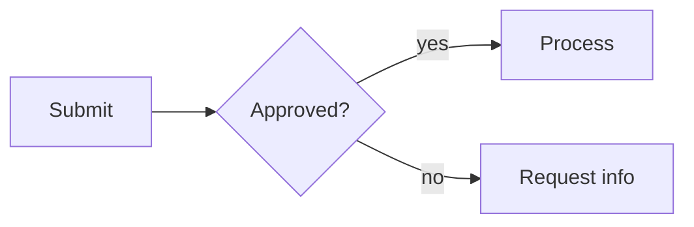
````

**Rendered example:**


Keep labels short. [Every diagram type has a worked example](#markdown-diagram-gallery) at the
end of this section.

**Flowchart syntax.** Everything in the usual Mermaid flowchart grammar that affects the
drawing is supported:

| Syntax | Result |
|--------|--------|
| `A --> B`, `A --- B`, `A -.-> B`, `A ==> B` | solid, plain line, dotted and thick edges (extra dashes are fine) |
| `A -- text --> B`, `A -->\|text\| B`, `A -. text .-> B`, `A == text ==> B` | labelled edges, quoted or not |
| `A --o B`, `A --x B`, `A <--> B`, `A o--o B` | circle and cross ends, two-way arrows |
| `A --> B & C`, `B & C --> D` | fan out and in |
| `A([x])`, `A((x))`, `A[(x)]`, `A{{x}}`, `A[[x]]`, `A>x]`, `A[/x/]`, `A[\x\]`, `A[/x\]`, `A[\x/]` | stadium, circle, cylinder, hexagon, subroutine, flag, parallelograms, trapezoids |
| `classDef name fill:#d4edda,stroke:#28a745,color:#14532d`, `A:::name`, `class A,B name`, `style A fill:#fff` | per-node overrides (`fill`, `stroke`, `stroke-width`, `stroke-dasharray`, `color`) |
| `linkStyle 0,2 stroke:#dc3545,stroke-width:2px`, `linkStyle default ...` | per-edge overrides, numbered in the order edges appear |
| `subgraph id [Title]`, `subgraph "Title"`, nested `subgraph` | framed groups |
| `A@{ shape: doc, label: "Spec" }` | Mermaid 11 shape names and aliases (`rect`, `rounded`, `stadium`, `diam`, `hex`, `cyl`, `doc`, `circle`, `lean-r`, `subproc`, ...) |
| `A --> Group`, `Group --> B` | edges to and from a subgraph attach to its first or last member |

Nodes are laid out in ranks with crossings minimised, long and looping edges run in their own
lanes, and edges leaving one node fan out instead of sharing a line. Override individual nodes
with `classDef` or `style`.

**How diagrams look.** Every diagram type shares one design system, so a document's diagrams
read as a set:

- *Size.* A diagram renders at its natural size, with 12px labels that sit beside body text.
  When a flowchart, state, ER or class diagram would be wider than the text column, long node
  labels wrap, and if it is still too wide it is laid out in the other direction (left-to-right
  becomes top-down) instead of shrinking its text. Turn that off for one diagram with
  `%%{init: {"flowchart": {"autoFit": false}}}%%`. Word and PowerPoint use the same sizes.
- *Fonts.* Diagrams use the theme's `body` font. Boxes are sized by measuring text with the font
  file that will actually draw it, so wide faces such as DejaVu Sans never overflow. Fonts added
  with the [`fonts`](#configuration) key are used in diagrams too, including the images embedded
  in Word and PowerPoint.
- *Structural diagrams* (flowchart, state, sequence, ER, timeline, mind map) take their colours
  from the theme: light brand-tinted cards with a hairline border, the primary colour for start
  and end shapes and ER headers, and the accent for decisions.
- *Data charts* (pie, donut, bar, Gantt and the other multi-series diagrams) draw eight series
  colours in a fixed order. With a branded theme the series start with the **primary and accent
  colours**, then continue with the built-in colour-blind-safe colours that stay clearly different
  from them; without a brand they are the built-in palette. A theme can set the series itself, or
  switch back to the built-in palette: see [Diagram colours in the theme](#themes-diagram-colours).
  Past eight slices the smallest fold into "Other". Labels and values are always in text colours,
  never the series colour.
- Bars are thin with rounded ends, gridlines are solid hairlines, axis ticks are round numbers
  (0, 50, 100), large numbers are compacted (1.3K, 2.5M), and values are labelled only where
  they fit.

**Other diagram syntax.**

| Diagram | Supported beyond the basics |
|---------|------------------------------|
| Sequence | `participant A as Alice`, `actor`, `autonumber`, `Note left of / right of / over A,B`, `loop` / `alt` / `else` / `opt` / `par` / `and` / `critical` / `break` / `rect` blocks, `activate` / `deactivate` and `->>+` / `-->>-`, arrows `->>` `-->>` `->` `-->` `-x` `--x` `-)` `--)` `<<->>` |
| Pie / donut | `pie showData title …` on the first line; legend with percentages (and values with `showData`) |
| Bar | `xychart-beta`, `title`, `x-axis "Title" [..]`, `y-axis "Title" 0 --> 200`, several `bar [..]` and `line [..]` series, `horizontal` |
| Gauge | `title`, `value`, `min`, `max`, `label`, written as `value 72` or `value: 72` |
| Gantt | `done`, `active`, `crit` and `milestone` tags, `after id`, durations or end dates; bars coloured by section on a calendar-aligned axis |
| ER | attribute keys (`int id PK`, `string ref FK`, `PK,FK`), identifying `--` and non-identifying `..` links, crow's-foot ends for every cardinality |
| Timeline | `title`, `section`, several events per period (`2022 : A : B`, or a line starting with `:`) |
| Mind map | node shapes `((x))`, `(x)`, `[x]`, `{{x}}`, `))x((`; branches balanced either side of the root, one colour per branch |
| Class | `class X { ... }` bodies or `X : +member`, visibility `+ - # ~`, static `$` (underlined), abstract `*` (italic), generics `List~int~`, `<<interface>>` and other stereotypes, `direction`, `namespace`, `note for X "..."`, relationships `<\|--` `*--` `o--` `-->` `--` `..>` `..\|>` `..` (either way round) with cardinalities `"1" --> "*"` and `: labels` |
| User journey | `title`, `section`, `Task: score: Actor, Actor` (score 1-5 drawn as a satisfaction curve in good-to-bad status colours, actors as dots with a legend) |
| Git graph | `commit` (`id`, `tag`, `type: HIGHLIGHT \| REVERSE`, `msg`), `branch` (`order`), `checkout` / `switch`, `merge` (`id`, `tag`), `cherry-pick id: "..."`, `gitGraph TB:` for a vertical graph |
| Quadrant | `title`, `x-axis Low --> High`, `y-axis`, `quadrant-1`..`4`, points `Name: [x, y]` with `radius`, `color`, `stroke-color`, `stroke-width` or `:::class` + `classDef`; labels move to stay clear of each other |
| Sankey | CSV rows `source,target,value` (quote names containing commas); config `sankey`: `showValues`, `nodeAlignment`, `linkColor` (`source`, `target` or a hex colour), `nodeWidth`, `nodePadding`, `nodeColors` |
| Radar | `title`, `axis id["Label"], ...`, `curve id["Label"]{1, 2, 3}` or `{axis: value, ...}`, `max`, `min`, `ticks`, `graticule circle \| polygon`, `showLegend` |
| Treemap | quoted section names and `"Leaf": value` lines, nested by indentation; config `treemap.valueFormat` (`,`, `$`, `$,.2f`, `.1%`) |
| Packet | `start-end: "Field"`, `bit: "Flag"`, `+bits: "Field"`, `title`; config `packet`: `bitsPerRow`, `showBits`, `bitOrder: descending` |
| Block | `columns N`, `id:span`, `space` / `space:N`, flowchart node shapes, nested `block:id:span ... end`, block arrows `id<["label"]>(right \| left \| up \| down \| x \| y)`, edges with labels, `style`, `classDef`, `class` |
| Kanban | columns `id[Title]` (or bare titles), indented tasks `id[Text]@{ ticket: ..., assigned: ..., priority: 'Very High' \| 'High' \| 'Low' \| 'Very Low' }` |
| Architecture | `group id(icon)[Title] in parent`, `service id(icon)[Title] in group`, `junction id`, edges `a:R --> L:b` (sides `L R T B`, `<`/`>` arrows, `{group}`), `align row \| column`; icons `cloud`, `database`, `disk`, `internet`, `server` (other icon names show a generic tile) |
| C4 | `Person`, `System`, `Container`, `Component` with `Db` / `Queue` / `_Ext` variants, `Boundary`, `Enterprise_Boundary`, `System_Boundary`, `Container_Boundary`, `Deployment_Node` / `Node` blocks, `Rel`, `BiRel`, `Rel_U/D/L/R`, `Rel_Back`, `RelIndex`, `$named` arguments, `UpdateLayoutConfig($c4ShapeInRow, $c4BoundaryInRow)`; colours follow the C4 roles in your brand primary, grey for external |
| Requirement | `requirement`, `functionalRequirement`, `interfaceRequirement`, `performanceRequirement`, `physicalRequirement`, `designConstraint` and `element` blocks; `a - satisfies -> b` and `b <- satisfies - a` with `contains`, `copies`, `derives`, `satisfies`, `verifies`, `refines`, `traces` |
| Use case | `actor Name`, `Id("Use case")` ellipses, `Id[Label]` boxes, `systemBoundary Name ... end`, `A --> B`, `A ..> : include B` / `: extend B` (drawn as «include» / «extend»), `A --\|> B` generalisation, `direction LR \| TB` |
| Swimlanes | `swimlane-beta LR \| TB`; each top-level `subgraph` is a lane, steps sit in their lane in flow order; full flowchart node and edge syntax |
| Agent flow | `agentflow-beta TB \| LR`, `flow id["Agent"] ... end` groups, `global ... end`, typed shapes `@{ shape: task \| tool \| input \| decision \| refdoc \| action }`, `id@{ view: collapsed }` folds a flow into one node, `--x` failure edges in red |
| Tree view | indented lines or pasted `tree` output (`├──`, `└──`); names ending `/` are folders, `## note` adds a description, `:::highlight` marks a row, `icon(...)`; config `treeView.showIcons` |
| Ishikawa | first line is the effect; indented categories alternate above and below the spine, with causes and sub-causes nested under them |
| Venn | `title`, `set Id["Label"]:size`, `union A,B["Label"]:size` (two or more sets), indented `text Id["Label"]` items, `style Id fill:...,color:...,stroke:...,fill-opacity:...` |
| Cynefin | `title`, `complex` / `complicated` / `clear` / `chaotic` / `confusion` blocks of quoted items, transitions `complex --> complicated : "Label"`; config `cynefin.showDomainDescriptions`, `cynefin.boundaryAmplitude` |
| Wardley map | `title`, `size [w, h]`, `evolution A -> B -> C` (with `@0.3` widths and `Label / Sub` pairs), `anchor` and `component Name [visibility, evolution]` with `label [dx, dy]` and `(inertia)`, `(build)`, `(buy)`, `(outsource)`, `(market)`; links `->`, `-.->`, `+>`, `+<`, `+<>`, `+'label'>`, `A -> B; label`; `evolve`, `pipeline X { ... }`, `note`, `annotations` / `annotation N,[v, e] "text"`, `accelerator`, `deaccelerator` |
| Railroad | EBNF (`=` or `::=`, `\|`, `,`, `[ ]`, `{ }`, `?`, `*`, `+`, `A - B`, `? special ?`, comments), ABNF (`/`, `*A`, `1*A`, `2*4A`, `%x41-5A`, `;` comments), PEG (`<-`, `/`, `&A`, `!A`, `.`, `#` comments) and IR constructors (`sequence`, `choice`, `optional`, `zeroOrMore`, `oneOrMore`, `terminal`, `nonterminal`, `special`); long rules wrap onto several rows |
| Event modeling | `tf` / `timeframe` and `rf` / `resetframe NN type Name`, types `ui`, `pcr` / `processor`, `cmd` / `command`, `rmo` / `readmodel`, `evt` / `event`; `Namespace.Name` adds a lane, inline `{ data }`, `[[DataBlock]]` with `data Name { ... }`, `->> NN` extra links; flows are inferred frame to frame unless a reset frame breaks them |
| ZenUML | drawn as a sequence diagram: `@Actor` / `@Database` annotators, `A as Alice`, `A->B: msg`, sync calls `A.method(args) { ... }`, `x = A.method()`, `return`, `@return`, `new A()`, `if` / `else if` / `else`, `while` / `for` / `loop`, `opt`, `par`, `try` / `catch` / `finally` |

**Themes, dark mode and titles.** A diagram can carry Mermaid's own configuration, either as
`%%{init: {...}}%%` or as a front-matter `config:` block:

````markdown
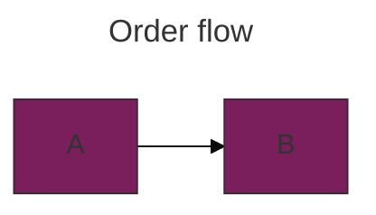
````

- `theme: dark` draws the diagram for a dark background, using lifted brand colours and the dark
  steps of the data palette. A theme whose `body` or `@page` background is dark switches every
  diagram to dark mode automatically, and Word/PowerPoint images get the dark background.
- `theme: neutral` (greys) and `theme: forest` (greens) replace the brand colours;
  `theme: default` keeps them.
- `themeVariables`: `primaryColor`, `secondaryColor` (accent), `primaryBorderColor`,
  `primaryTextColor` / `textColor`, `lineColor`, `fontFamily`, `background` and `darkMode`.
- A front-matter `title` is drawn above any diagram.

Every Mermaid diagram type is drawn, including the beta ones listed above. A diagram type
Mermaid adds later is left as an ordinary code block, with a warning in the build log, rather
than drawn incorrectly.

<a id="markdown-diagram-gallery"></a>

#### Gallery: every diagram type

Each example shows the source you type, then the diagram it produces with this handbook's theme.
Structural diagrams, and the lead colours of the data charts, follow the theme (see
[Diagram colours in the theme](#themes-diagram-colours)). The same examples are in
`examples/feature-showcase/diagram-gallery.md`.

##### Flowchart

`flowchart`, `graph`. Nodes, edge styles and labels, classes.

````markdown
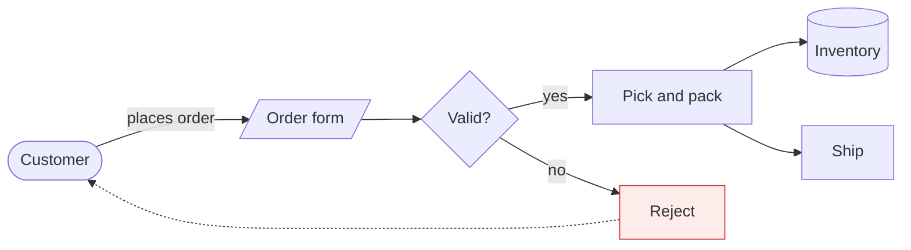
````


##### Flowchart with groups

`flowchart` with `subgraph`. Framed groups with a decision loop inside.

````markdown

````

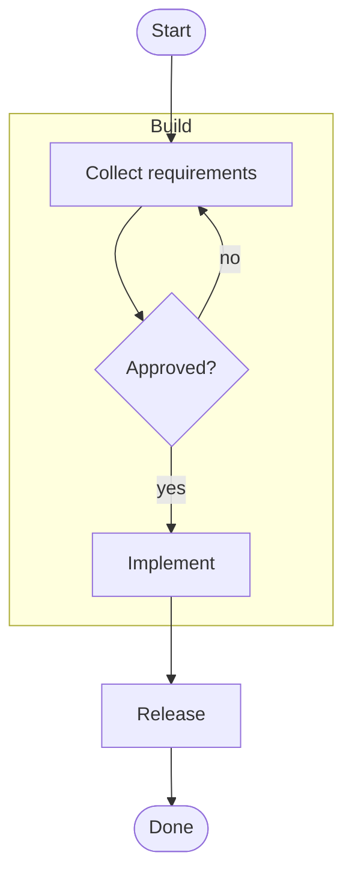

##### Sequence

`sequenceDiagram`. Participants, messages, notes and `alt` / `loop` blocks.

````markdown
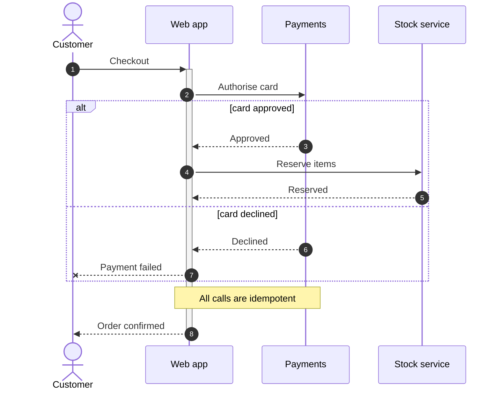
````


##### State

`stateDiagram-v2`. States, transitions, start and end markers.

````markdown
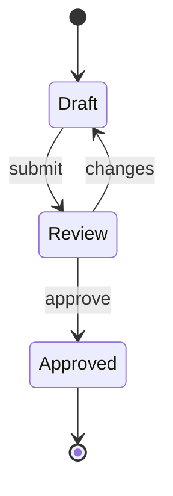
````


##### Entity-relationship

`erDiagram`. Entities with keys and crow's-foot relationships.

````markdown
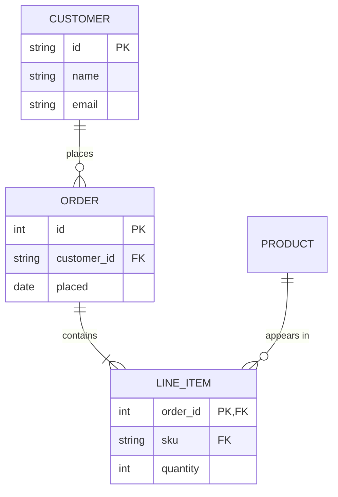
````


##### Mind map

`mindmap`. One colour per branch, balanced either side of the root.

````markdown
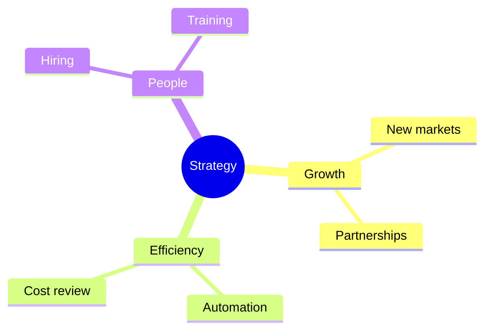
````


##### Timeline

`timeline`. Periods with one or more events.

````markdown
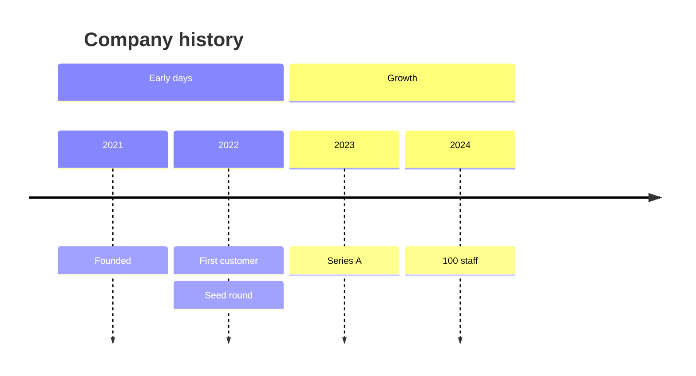
````


##### Gantt

`gantt`. Sections, task tags, dependencies; bars take the series palette.

````markdown
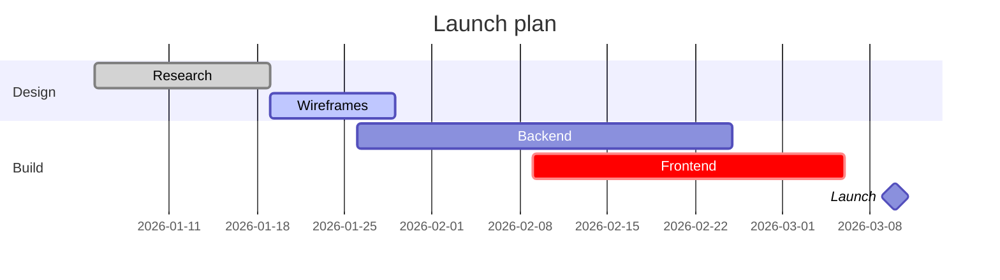
````


##### Pie

`pie`. Slices in the series palette, with a percentage legend.

````markdown
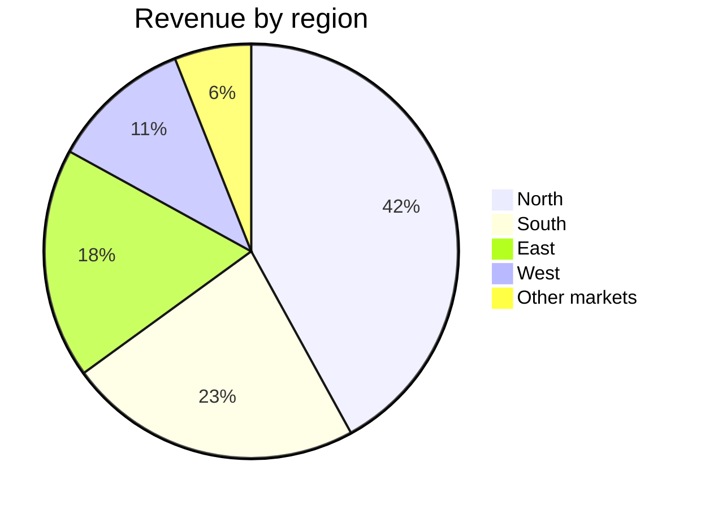
````

```mermaid
pie title Revenue by region
    "North" : 42
    "South" : 23
    "East" : 18
    "West" : 11
    "Other markets" : 6
```

##### Donut

`donut`. The same data as a pie, with a total in the centre.

````markdown
```mermaid
donut showData
    "Done" : 64
    "In progress" : 24
    "Blocked" : 12
```
````

```mermaid
donut showData
    "Done" : 64
    "In progress" : 24
    "Blocked" : 12
```

##### Bar and line

`xychart-beta`. Bar and line series on round-number axes.

````markdown
```mermaid
xychart-beta
    title "Quarterly revenue"
    x-axis [Q1, Q2, Q3, Q4]
    y-axis "Revenue ($K)"
    bar [120, 145, 160, 190]
    line [110, 140, 150, 170]
```
````

```mermaid
xychart-beta
    title "Quarterly revenue"
    x-axis [Q1, Q2, Q3, Q4]
    y-axis "Revenue ($K)"
    bar [120, 145, 160, 190]
    line [110, 140, 150, 170]
```

##### Gauge

`gauge`. A single value on a dial.

````markdown
```mermaid
gauge
    title Customer satisfaction
    value: 72
    max: 100
```
````

```mermaid
gauge
    title Customer satisfaction
    value: 72
    max: 100
```

##### Class

`classDiagram`. Members, visibility, relationships and cardinalities.

````markdown
```mermaid
classDiagram
    class Animal {
        <<abstract>>
        +String name
        -int age
        +makeSound()* void
        +getCount()$ int
    }
    class Duck {
        +swim()
        +quack()
    }
    class Fish {
        -int sizeInFeet
        -canEat()
    }
    class Pond {
        +List~Duck~ ducks
    }
    Animal <|-- Duck
    Animal <|-- Fish
    Pond "1" *-- "many" Duck : contains
    Duck ..> Fish : eats
```
````

```mermaid
classDiagram
    class Animal {
        <<abstract>>
        +String name
        -int age
        +makeSound()* void
        +getCount()$ int
    }
    class Duck {
        +swim()
        +quack()
    }
    class Fish {
        -int sizeInFeet
        -canEat()
    }
    class Pond {
        +List~Duck~ ducks
    }
    Animal <|-- Duck
    Animal <|-- Fish
    Pond "1" *-- "many" Duck : contains
    Duck ..> Fish : eats
```

##### User journey

`journey`. Task scores drawn as a satisfaction curve.

````markdown
```mermaid
journey
    title My working day
    section Go to work
      Make tea: 5: Me
      Go upstairs: 3: Me
      Do work: 1: Me, Cat
    section Go home
      Go downstairs: 5: Me
      Sit down: 4: Me, Cat
```
````

```mermaid
journey
    title My working day
    section Go to work
      Make tea: 5: Me
      Go upstairs: 3: Me
      Do work: 1: Me, Cat
    section Go home
      Go downstairs: 5: Me
      Sit down: 4: Me, Cat
```

##### Git graph

`gitGraph`. Branches, commits, merges, tags.

````markdown
```mermaid
gitGraph
    commit id: "init"
    commit
    branch develop
    checkout develop
    commit id: "feature-a"
    branch feature
    checkout feature
    commit id: "wip" type: HIGHLIGHT
    checkout main
    merge develop tag: "v1.0"
    checkout feature
    commit
    checkout develop
    merge feature
    checkout main
    commit tag: "v1.1"
```
````

```mermaid
gitGraph
    commit id: "init"
    commit
    branch develop
    checkout develop
    commit id: "feature-a"
    branch feature
    checkout feature
    commit id: "wip" type: HIGHLIGHT
    checkout main
    merge develop tag: "v1.0"
    checkout feature
    commit
    checkout develop
    merge feature
    checkout main
    commit tag: "v1.1"
```

##### Dark diagram

`%%{init: {'theme':'dark'}}%%`. Drawn on its own dark panel so it reads on a light page.

````markdown
```mermaid
%%{init: {'theme': 'dark'}}%%
flowchart LR
    A([Request]) --> B{Cached?}
    B -->|yes| C[Serve cache]
    B -->|no| D[Render page]
    D --> C
```
````

```mermaid
%%{init: {'theme': 'dark'}}%%
flowchart LR
    A([Request]) --> B{Cached?}
    B -->|yes| C[Serve cache]
    B -->|no| D[Render page]
    D --> C
```

##### Quadrant chart

`quadrantChart`. Points on a two-axis grid with quadrant labels.

````markdown
```mermaid
quadrantChart
    title Reach and engagement of campaigns
    x-axis Low Reach --> High Reach
    y-axis Low Engagement --> High Engagement
    quadrant-1 We should expand
    quadrant-2 Need to promote
    quadrant-3 Re-evaluate
    quadrant-4 May be improved
    Campaign A: [0.3, 0.6]
    Campaign B: [0.45, 0.23]
    Campaign C: [0.57, 0.69]
    Campaign D: [0.78, 0.34]
    Campaign E: [0.40, 0.34]
    Campaign F:::hot: [0.35, 0.78]
    classDef hot color: #d03b3b, radius : 7
```
````

```mermaid
quadrantChart
    title Reach and engagement of campaigns
    x-axis Low Reach --> High Reach
    y-axis Low Engagement --> High Engagement
    quadrant-1 We should expand
    quadrant-2 Need to promote
    quadrant-3 Re-evaluate
    quadrant-4 May be improved
    Campaign A: [0.3, 0.6]
    Campaign B: [0.45, 0.23]
    Campaign C: [0.57, 0.69]
    Campaign D: [0.78, 0.34]
    Campaign E: [0.40, 0.34]
    Campaign F:::hot: [0.35, 0.78]
    classDef hot color: #d03b3b, radius : 7
```

##### Sankey

`sankey`. Flow quantities as ribbons.

````markdown
```mermaid
sankey
Electricity grid,Heating and cooling - homes,113.726
Electricity grid,Industry,342.165
Electricity grid,Losses,56.691
Wind,Electricity grid,289.366
Solar,Electricity grid,59.901
Nuclear,Electricity grid,839.978
Gas,Electricity grid,26.861
Gas,Industry,46.477
Electricity grid,"Heating and cooling, commercial",88.14
```
````

```mermaid
sankey
Electricity grid,Heating and cooling - homes,113.726
Electricity grid,Industry,342.165
Electricity grid,Losses,56.691
Wind,Electricity grid,289.366
Solar,Electricity grid,59.901
Nuclear,Electricity grid,839.978
Gas,Electricity grid,26.861
Gas,Industry,46.477
Electricity grid,"Heating and cooling, commercial",88.14
```

##### Radar

`radar-beta`. Several curves over shared axes.

````markdown
```mermaid
radar-beta
  title Restaurant comparison
  axis food["Food"], service["Service"], price["Price"]
  axis ambiance["Ambiance"], wait["Wait time"]
  curve a["Restaurant A"]{4, 3, 2, 4, 3}
  curve b["Restaurant B"]{3, 4, 3, 3, 5}
  max 5
```
````

```mermaid
radar-beta
  title Restaurant comparison
  axis food["Food"], service["Service"], price["Price"]
  axis ambiance["Ambiance"], wait["Wait time"]
  curve a["Restaurant A"]{4, 3, 2, 4, 3}
  curve b["Restaurant B"]{3, 4, 3, 3, 5}
  max 5
```

##### Treemap

`treemap-beta`. Nested areas sized by value.

````markdown
```mermaid
treemap-beta
"Products"
    "Electronics"
        "Phones": 50
        "Computers": 30
        "Accessories": 20
    "Clothing"
        "Men's": 40
        "Women's": 40
"Services"
    "Support": 35
    "Training": 15
```
````

```mermaid
treemap-beta
"Products"
    "Electronics"
        "Phones": 50
        "Computers": 30
        "Accessories": 20
    "Clothing"
        "Men's": 40
        "Women's": 40
"Services"
    "Support": 35
    "Training": 15
```

##### Packet

`packet`. Bit-level protocol layouts.

````markdown
```mermaid
---
title: "TCP Packet"
---
packet
0-15: "Source Port"
16-31: "Destination Port"
32-63: "Sequence Number"
64-95: "Acknowledgment Number"
96-99: "Data Offset"
100-105: "Reserved"
106: "URG"
107: "ACK"
108: "PSH"
109: "RST"
110: "SYN"
111: "FIN"
112-127: "Window"
128-143: "Checksum"
144-159: "Urgent Pointer"
160-191: "(Options and Padding)"
192-255: "Data (variable length)"
```
````

```mermaid
---
title: "TCP Packet"
---
packet
0-15: "Source Port"
16-31: "Destination Port"
32-63: "Sequence Number"
64-95: "Acknowledgment Number"
96-99: "Data Offset"
100-105: "Reserved"
106: "URG"
107: "ACK"
108: "PSH"
109: "RST"
110: "SYN"
111: "FIN"
112-127: "Window"
128-143: "Checksum"
144-159: "Urgent Pointer"
160-191: "(Options and Padding)"
192-255: "Data (variable length)"
```

##### Block

`block`. A grid of blocks with spans, arrows and links.

````markdown
```mermaid
block
columns 1
  db(("DB"))
  blockArrowId6(down)
  block:ID
    A
    B["A wide one in the middle"]
    C
  end
  space
  D
  ID --> D
  C --> D
  style B fill:#e8eefc,stroke:#3c5aa8
```
````

```mermaid
block
columns 1
  db(("DB"))
  blockArrowId6(down)
  block:ID
    A
    B["A wide one in the middle"]
    C
  end
  space
  D
  ID --> D
  C --> D
  style B fill:#e8eefc,stroke:#3c5aa8
```

##### Kanban

`kanban`. Columns of tickets with metadata.

````markdown
```mermaid
kanban
  Todo
    [Create Documentation]
    docs[Create Blog about the new diagram]
  [In progress]
    id6[Create renderer so that it works in all cases]@{ priority: 'High' }
  id9[Ready for deploy]
    id8[Design grammar]@{ assigned: 'knsv' }
  id10[Ready for test]
    id4[Create parsing tests]@{ ticket: MC-2038, assigned: 'K.Sveidqvist', priority: 'High' }
    id66[last item]@{ priority: 'Very Low', assigned: 'knsv' }
  id11[Done]
    id5[define getData]
    id2[Title of diagram is more than 100 chars]@{ ticket: MC-2036, priority: 'Very High'}
```
````

```mermaid
kanban
  Todo
    [Create Documentation]
    docs[Create Blog about the new diagram]
  [In progress]
    id6[Create renderer so that it works in all cases]@{ priority: 'High' }
  id9[Ready for deploy]
    id8[Design grammar]@{ assigned: 'knsv' }
  id10[Ready for test]
    id4[Create parsing tests]@{ ticket: MC-2038, assigned: 'K.Sveidqvist', priority: 'High' }
    id66[last item]@{ priority: 'Very Low', assigned: 'knsv' }
  id11[Done]
    id5[define getData]
    id2[Title of diagram is more than 100 chars]@{ ticket: MC-2036, priority: 'Very High'}
```

##### Architecture

`architecture-beta`. Groups, services and directional connections.

````markdown
```mermaid
architecture-beta
    group api(cloud)[API]
    service db(database)[Database] in api
    service disk1(disk)[Storage] in api
    service disk2(disk)[Storage] in api
    service server(server)[Server] in api
    service web(internet)[Internet]
    db:L -- R:server
    disk1:T -- B:server
    disk2:T -- B:db
    web:R --> L:server
```
````

```mermaid
architecture-beta
    group api(cloud)[API]
    service db(database)[Database] in api
    service disk1(disk)[Storage] in api
    service disk2(disk)[Storage] in api
    service server(server)[Server] in api
    service web(internet)[Internet]
    db:L -- R:server
    disk1:T -- B:server
    disk2:T -- B:db
    web:R --> L:server
```

##### C4 container

`C4Container`. People, systems, containers and relationships in C4 roles.

````markdown
```mermaid
C4Container
    title Container diagram for Internet Banking System
    System_Ext(email_system, "E-Mail System", "The internal Microsoft Exchange system")
    Person(customer, Customer, "A customer of the bank, with personal bank accounts")
    Container_Boundary(c1, "Internet Banking") {
        Container(spa, "Single-Page App", "JavaScript, Angular", "Provides all the Internet banking functionality to customers via their web browser")
        Container_Ext(mobile_app, "Mobile App", "C#, Xamarin", "Provides a limited subset of the Internet banking functionality")
        Container(web_app, "Web Application", "Java, Spring MVC", "Delivers the static content and the SPA")
        ContainerDb(database, "Database", "SQL Database", "Stores user registration information, hashed credentials, access logs")
        ContainerDb_Ext(backend_api, "API Application", "Java, Docker Container", "Provides Internet banking functionality via API")
    }
    System_Ext(banking_system, "Mainframe Banking System", "Stores all of the core banking information")
    Rel(customer, web_app, "Uses", "HTTPS")
    Rel(customer, spa, "Uses", "HTTPS")
    Rel(customer, mobile_app, "Uses")
    Rel_Back(database, backend_api, "Reads from and writes to", "sync, JDBC")
    Rel(email_system, customer, "Sends e-mails to")
    Rel(backend_api, email_system, "Sends e-mails using", "sync, SMTP")
    Rel(backend_api, banking_system, "Uses", "sync/async, XML/HTTPS")
    UpdateLayoutConfig($c4ShapeInRow="3", $c4BoundaryInRow="1")
```
````

```mermaid
C4Container
    title Container diagram for Internet Banking System
    System_Ext(email_system, "E-Mail System", "The internal Microsoft Exchange system")
    Person(customer, Customer, "A customer of the bank, with personal bank accounts")
    Container_Boundary(c1, "Internet Banking") {
        Container(spa, "Single-Page App", "JavaScript, Angular", "Provides all the Internet banking functionality to customers via their web browser")
        Container_Ext(mobile_app, "Mobile App", "C#, Xamarin", "Provides a limited subset of the Internet banking functionality")
        Container(web_app, "Web Application", "Java, Spring MVC", "Delivers the static content and the SPA")
        ContainerDb(database, "Database", "SQL Database", "Stores user registration information, hashed credentials, access logs")
        ContainerDb_Ext(backend_api, "API Application", "Java, Docker Container", "Provides Internet banking functionality via API")
    }
    System_Ext(banking_system, "Mainframe Banking System", "Stores all of the core banking information")
    Rel(customer, web_app, "Uses", "HTTPS")
    Rel(customer, spa, "Uses", "HTTPS")
    Rel(customer, mobile_app, "Uses")
    Rel_Back(database, backend_api, "Reads from and writes to", "sync, JDBC")
    Rel(email_system, customer, "Sends e-mails to")
    Rel(backend_api, email_system, "Sends e-mails using", "sync, SMTP")
    Rel(backend_api, banking_system, "Uses", "sync/async, XML/HTTPS")
    UpdateLayoutConfig($c4ShapeInRow="3", $c4BoundaryInRow="1")
```

##### Requirement

`requirementDiagram`. Requirements, elements and typed relations.

````markdown
```mermaid
requirementDiagram
  requirement checkout_req {
    id: 1
    text: Orders must be payable online.
    risk: high
    verifymethod: test
  }
  functionalRequirement payment_req {
    id: 1.1
    text: Card payments must be authorised.
    risk: high
    verifymethod: test
  }
  element checkout_service {
    type: service
    docref: docs/checkout.md
  }
  checkout_req - contains -> payment_req
  checkout_service - satisfies -> payment_req
```
````

```mermaid
requirementDiagram
  requirement checkout_req {
    id: 1
    text: Orders must be payable online.
    risk: high
    verifymethod: test
  }
  functionalRequirement payment_req {
    id: 1.1
    text: Card payments must be authorised.
    risk: high
    verifymethod: test
  }
  element checkout_service {
    type: service
    docref: docs/checkout.md
  }
  checkout_req - contains -> payment_req
  checkout_service - satisfies -> payment_req
```

##### ZenUML

`zenuml`. Call-style sequence notation.

````markdown
```mermaid
zenuml
    title Order service
    @Actor Client
    @Database DB
    Client->OrderService.create(order) {
      valid = Validator.check(order)
      if(valid) {
        DB.save(order)
        return id
      } else {
        @return
        OrderService->Client: rejected
      }
    }
    par {
      OrderService->Email: confirmation
      OrderService->Analytics: track
    }
```
````

```mermaid
zenuml
    title Order service
    @Actor Client
    @Database DB
    Client->OrderService.create(order) {
      valid = Validator.check(order)
      if(valid) {
        DB.save(order)
        return id
      } else {
        @return
        OrderService->Client: rejected
      }
    }
    par {
      OrderService->Email: confirmation
      OrderService->Analytics: track
    }
```

##### Use case

`usecase-beta`. Actors, use cases, boundaries, includes and extends.

````markdown
```mermaid
usecase-beta
direction LR
actor Customer
actor Support
systemBoundary Storefront
  Browse("Browse catalogue")
  Checkout("Checkout")
end
systemBoundary Fulfilment
  Track("Track delivery")
end
Customer --> Browse
Customer --> Checkout
Customer --> Track
Support --> Track
Checkout ..> : include Browse
```
````

```mermaid
usecase-beta
direction LR
actor Customer
actor Support
systemBoundary Storefront
  Browse("Browse catalogue")
  Checkout("Checkout")
end
systemBoundary Fulfilment
  Track("Track delivery")
end
Customer --> Browse
Customer --> Checkout
Customer --> Track
Support --> Track
Checkout ..> : include Browse
```

##### Swimlanes

`swimlane-beta`. A flow split into lanes by owner.

````markdown
```mermaid
swimlane-beta LR
  subgraph Customer
    request[Request service]
    receive[Receive update]
  end
  subgraph Support
    triage[Triage request]
    answer[Send answer]
  end
  subgraph Engineering
    investigate[Investigate issue]
    fix[Prepare fix]
  end
  request --> triage
  triage -->|Known issue| answer
  triage -->|Needs code| investigate
  investigate --> fix --> answer
  answer --> receive
```
````

```mermaid
swimlane-beta LR
  subgraph Customer
    request[Request service]
    receive[Receive update]
  end
  subgraph Support
    triage[Triage request]
    answer[Send answer]
  end
  subgraph Engineering
    investigate[Investigate issue]
    fix[Prepare fix]
  end
  request --> triage
  triage -->|Known issue| answer
  triage -->|Needs code| investigate
  investigate --> fix --> answer
  answer --> receive
```

##### Agent flow

`agentflow-beta`. Agents, tools and failure paths.

````markdown
```mermaid
agentflow-beta TB
  brief@{ shape: input, label: "Release brief" }
  flow drafting["Drafting Agent"]
    draft@{ shape: task, label: "Draft the notes" }
    search@{ shape: tool, label: "changelog_search" }
    tone@{ shape: refdoc, label: "Tone of voice" }
    draft --> search
    draft -.-> tone
  end
  flow review["Review Agent"]
    check@{ shape: task, label: "Check the claims" }
    ok@{ shape: decision, label: "Accurate?" }
    check --> ok
  end
  publish@{ shape: action, label: "Publish" }
  brief --> draft
  tone --> check
  ok -->|yes| publish
  ok --x|no| draft
```
````

```mermaid
agentflow-beta TB
  brief@{ shape: input, label: "Release brief" }
  flow drafting["Drafting Agent"]
    draft@{ shape: task, label: "Draft the notes" }
    search@{ shape: tool, label: "changelog_search" }
    tone@{ shape: refdoc, label: "Tone of voice" }
    draft --> search
    draft -.-> tone
  end
  flow review["Review Agent"]
    check@{ shape: task, label: "Check the claims" }
    ok@{ shape: decision, label: "Accurate?" }
    check --> ok
  end
  publish@{ shape: action, label: "Publish" }
  brief --> draft
  tone --> check
  ok -->|yes| publish
  ok --x|no| draft
```

##### Tree view

`treeView-beta`. Folder trees with notes and highlights.

````markdown
```mermaid
treeView-beta
src/
  App.tsx :::highlight ## main component
  index.ts ## entry point
  components/
    Button.tsx
    Card.tsx
.env ## environment variables
package.json
```
````

```mermaid
treeView-beta
src/
  App.tsx :::highlight ## main component
  index.ts ## entry point
  components/
    Button.tsx
    Card.tsx
.env ## environment variables
package.json
```

##### Ishikawa

`ishikawa-beta`. Cause-and-effect fishbone.

````markdown
```mermaid
ishikawa-beta
Blurry photo
  Process
    Out of focus
    Shutter speed too slow
  Equipment
    Lens
      Dirty lens
    Sensor
  User
    Shaky hands
  Environment
    Too dark
    Subject moved
```
````

```mermaid
ishikawa-beta
Blurry photo
  Process
    Out of focus
    Shutter speed too slow
  Equipment
    Lens
      Dirty lens
    Sensor
  User
    Shaky hands
  Environment
    Too dark
    Subject moved
```

##### Venn

`venn-beta`. Overlapping sets with sized unions.

````markdown
```mermaid
venn-beta
  title What makes a good feature
  set Desirable
  set Feasible
  set Viable
  union Desirable,Feasible["Buildable"]
  union Feasible,Viable["Sustainable"]
  union Desirable,Viable["Marketable"]
  union Desirable,Feasible,Viable["Ship it"]
```
````

```mermaid
venn-beta
  title What makes a good feature
  set Desirable
  set Feasible
  set Viable
  union Desirable,Feasible["Buildable"]
  union Feasible,Viable["Sustainable"]
  union Desirable,Viable["Marketable"]
  union Desirable,Feasible,Viable["Ship it"]
```

##### Cynefin

`cynefin-beta`. The five domains with transitions.

````markdown
```mermaid
cynefin-beta
  title Incident response
  complex
    "Investigate root cause"
    "Run chaos experiment"
  complicated
    "Analyse performance data"
  clear
    "Restart service"
    "Apply known fix"
  chaotic
    "Page on-call immediately"
  confusion
    "Unknown failure mode"
  chaotic --> complex : "Stabilised"
  complex --> complicated : "Pattern found"
```
````

```mermaid
cynefin-beta
  title Incident response
  complex
    "Investigate root cause"
    "Run chaos experiment"
  complicated
    "Analyse performance data"
  clear
    "Restart service"
    "Apply known fix"
  chaotic
    "Page on-call immediately"
  confusion
    "Unknown failure mode"
  chaotic --> complex : "Stabilised"
  complex --> complicated : "Pattern found"
```

##### Wardley map

`wardley-beta`. Components by visibility and evolution.

````markdown
```mermaid
wardley-beta
title Tea shop value chain
anchor Business [0.95, 0.63]
component Cup of Tea [0.79, 0.61]
component Tea [0.63, 0.81]
component Hot Water [0.52, 0.80]
component Kettle [0.43, 0.35] (build)
component Power [0.10, 0.70] (outsource)
Business -> Cup of Tea
Cup of Tea -> Tea
Cup of Tea -> Hot Water
Hot Water -> Kettle
Kettle -> Power
evolve Kettle 0.62
note "Standard power lets kettles evolve" [0.28, 0.40]
```
````

```mermaid
wardley-beta
title Tea shop value chain
anchor Business [0.95, 0.63]
component Cup of Tea [0.79, 0.61]
component Tea [0.63, 0.81]
component Hot Water [0.52, 0.80]
component Kettle [0.43, 0.35] (build)
component Power [0.10, 0.70] (outsource)
Business -> Cup of Tea
Cup of Tea -> Tea
Cup of Tea -> Hot Water
Hot Water -> Kettle
Kettle -> Power
evolve Kettle 0.62
note "Standard power lets kettles evolve" [0.28, 0.40]
```

##### Railroad

`railroad-ebnf-beta`. Syntax rules drawn as tracks.

````markdown
```mermaid
railroad-ebnf-beta
title "Arithmetic expressions"
expression = term ( ( "+" | "-" ) term )* ;
term = factor ( ( "*" | "/" ) factor )* ;
factor = number | "(" expression ")" ;
number = digit+ ;
```
````

```mermaid
railroad-ebnf-beta
title "Arithmetic expressions"
expression = term ( ( "+" | "-" ) term )* ;
term = factor ( ( "*" | "/" ) factor )* ;
factor = number | "(" expression ")" ;
number = digit+ ;
```

##### Event modeling

`eventmodeling`. Frames across UI, command, event and read-model lanes.

````markdown
```mermaid
eventmodeling
tf 01 ui CartUI
tf 02 cmd AddItem { description: string, price: number }
tf 03 evt ItemAdded
tf 04 rmo CartItems ->> 03
tf 05 ui CartUI
rf 06 evt External.InventoryChanged
tf 07 pcr InventoryProcessor
tf 08 cmd ChangeInventory
tf 09 evt Cart.InventoryChanged
```
````

```mermaid
eventmodeling
tf 01 ui CartUI
tf 02 cmd AddItem { description: string, price: number }
tf 03 evt ItemAdded
tf 04 rmo CartItems ->> 03
tf 05 ui CartUI
rf 06 evt External.InventoryChanged
tf 07 pcr InventoryProcessor
tf 08 cmd ChangeInventory
tf 09 evt Cart.InventoryChanged
```

<a id="markdown-values-and-placeholders"></a>

### Values and placeholders

| Syntax | Meaning | Where |
|--------|---------|-------|
| `{{ variable }}` | Filled in at build time from `_meta.yml` or frontmatter | all formats |
| `` | Insert a shared fragment from a `templates/` folder | all formats |
| ``, ``, ``, `` | Conditions, loops, variables and reusable blocks, resolved at build time | all formats; see [Logic in templates](#markdown-logic-in-templates) |
| `[[field]]` | Word merge or form field, declared in `_merge_fields.yml` | `.dotx` |
| `?[type: name]` | Fillable PDF field | `pdf_forms: true` PDF; Word forms in `.dotx` |
| `<!-- notes: … -->`, `<!-- slide … -->` | Speaker notes and slide layouts | `pptx` |

`{{ }}` supports Jinja2 filters (`{{ status | upper }}`, `{{ x | default("n/a") }}`). Fragment
lookup order: the document's folder, a local `templates/`, ancestor `templates/` folders
(deepest first), then the repo-root `templates/`. The first match wins, except for macro
libraries, which are layered (see [Macros](#markdown-logic-macros)).

<a id="markdown-logic-in-templates"></a>

### Logic in templates (Jinja2)

The body of every document is a [Jinja2](https://jinja.palletsprojects.com/) template. It is
rendered once, at build time, with every key of the [config cascade](#configuration) as a
variable, and the result is what the PDF, Word and slide builders see. So a document can show
or hide sections, repeat rows, compute totals and share building blocks without any scripting.

```markdown
Gold terms apply for {{ client }}.


- {{ loop.index }}. {{ item | upper }}

```

This page covers what works, how to write it, and the few places that surprise people. For plain
`{{ variable }}` and `` see [Values and placeholders](#markdown-values-and-placeholders).

<a id="markdown-logic-variables"></a>

#### Where variables come from

Every key in the merged config is available by name: your own keys (`client`, `tier`, `rates`),
and the built-in ones (`title`, `status`, `author`, `version`, `outputs`, ...). The cascade is the
usual one: repo root `_meta.yml`, then each folder's `_meta.yml` down to the document, then the
document's frontmatter, with the deepest value winning.

```yaml
# workspace/acme/_meta.yml
client: Acme Pty Ltd
tier: gold
rates:
  gold:   {setup: 500, monthly: 90}
  silver: {setup: 250, monthly: 60}
team:
  - {name: Ann, role: Lead,      days: 10, active: true}
  - {name: Bob, role: Developer, days: 20, active: true}
  - {name: Cy,  role: Analyst,   days: 5,  active: false}
```

Things to know about the data:

- **Merging is shallow.** A key in a deeper file *replaces* the shallower value completely. A
  folder that sets `team: [...]` does not add to the parent's `team`, it overrides it. Likewise
  a document that sets `rates:` loses the parent's other rates.
- **YAML types apply.** Numbers and booleans arrive as numbers and booleans, so `days * rate`
  works. Be careful with words YAML reads as booleans: `extra: yes` or `on` becomes `True`.
  Quote a string you mean literally (`extra: "yes"`).
- **Frontmatter values are templated too**, but separately: any string value containing `{{`
  (for example `title: "Proposal for {{ client }}"`) is rendered against the config before the
  builders use it, and an unknown name is left as `{{ name }}` rather than becoming empty. The
  frontmatter block is copied into the document untouched; only the body is rendered as a
  template, so put logic in the body.
- **Includes and macros see them too.** A fragment, an included file and an imported macro all
  read the variables of the document that uses them, so shared templates automatically pick up
  the values of the folder the document lives in (see [Macros](#markdown-logic-macros)).
- **Fillable fields are not variables.** `[[field]]` (Word merge and form fields) and `?[...]`
  (PDF form fields) are left alone by Jinja; they are filled in later, by whoever opens the file.

<a id="markdown-logic-conditions"></a>

#### Conditions

```markdown

This version is approved.

**Not final** ({{ status }}).

Status unknown.

```

- Comparisons: `==`, `!=`, `<`, `>`, `<=`, `>=`. Combine with `and`, `or`, `not`, and group with
  parentheses.
- Membership: `"pdf" in outputs`, `tier in ["gold", "silver"]`.
- Presence: ``, ``, `` (a list is
  true when it has items). Other tests include `is string`, `is number`, `is even`, `is odd`.
- One-liners: `{{ "Gold" if tier == "gold" else "Standard" }}` and
  ``.

Branches can wrap anything, including whole tables, headings, `` lines and
`<!-- pagebreak -->`:

```markdown



```

<a id="markdown-logic-loops"></a>

#### Loops

```markdown

- {{ p.name }}, {{ p.role }}

```

- Filter inside the loop header with `if` (above), or sort first: ``.
- Inside a loop: `loop.index` (from 1), `loop.index0`, `loop.first`, `loop.last`, `loop.length`.
- Dictionaries: ``.
- `` after the body runs when there was nothing to loop over.
- `range` makes counters: ``.

**Building a table.** Put the header and separator rows outside the loop and one row inside it,
all on lines of their own so each row is its own line:

```markdown
| Name | Role | Days |
| --- | --- | ---: |

| {{ p.name }} | {{ p.role }} | {{ p.days }} |

```

<a id="markdown-logic-variables-set"></a>

#### Setting variables and totals

`` creates a variable for the rest of the template:

```markdown

Setup is ${{ rate.setup }} and the monthly fee is ${{ rate.monthly }}.
```

A `set` *inside* a loop is local to that pass, so it cannot add up a total. Use a `namespace`:

```markdown




Total: ${{ "{:,}".format(total.value) }}
```

For simple sums a filter is shorter: `{{ team | sum(attribute="days") }}`.

<a id="markdown-logic-filters"></a>

#### Filters

A filter transforms a value: `{{ value | filter(arguments) }}`, and they chain left to right.

- `default`: `{{ phone | default("n/a") }}` prints the value, or `n/a` when it is missing.
- `upper`, `lower`, `title`: change case, `{{ client | lower }}`.
- `replace`: `{{ client | replace("Pty", "Proprietary") }}` substitutes text.
- `join`: `{{ items | join(", ") }}` gives `Alpha, Beta, Gamma`.
- `length`: `{{ team | length }}` is the number of items.
- `sum`: `{{ team | sum(attribute="days") }}` adds up one field (`35`).
- `sort`, `first`, `last`: `{{ team | sort(attribute="days") | map(attribute="name") | first }}`
  is the name with the fewest days.
- `map`, `selectattr`: `{{ team | selectattr("active") | map(attribute="name") | join(", ") }}`
  gives `Ann, Bob`.
- `round`: `{{ 3.14159 | round(2) }}` gives `3.14`.
- `format`: `{{ "%.2f" | format(price) }}` gives `1234.50`, and `{{ "{:,}".format(1234567) }}` gives
  `1,234,567`.
- `trim`, `truncate`: `{{ summary | truncate(80) }}` shortens long text.

The other built-in Jinja2 filters work too. There is no way to add your own filters or functions.

<a id="markdown-logic-macros"></a>

#### Macros: shared building blocks that follow the folder they are used in

A macro is a small template you call like a function. Define your common macros once, in a
`macros.md` under a `templates/` folder, and import them wherever you need them:

```markdown
<!-- templates/macros.md -->
**[{{ level | upper }}]** {{ text }}
Regards, {{ name }}, {{ client }}
```

```markdown

{{ badge("Check the totals", "warn") }}
{{ sign_off("Greg") }}
```

That prints `**[WARN]** Check the totals` and `Regards, Greg, Acme Pty Ltd`.

**Variables come from where the document is.** Inside a macro, `{{ client }}` and every other
config value is the one resolved for the *document that uses it*: its frontmatter, its folder's
`_meta.yml`, then each parent folder's. The same `sign_off` macro prints "Acme" in
`workspace/acme/` and "Blueshift" in `workspace/blueshift/`, with no copy of the macro and no
arguments to pass. Two limits:

- A macro argument with the same name as a variable wins inside the macro
  (`` uses the argument).
- Variables the *document itself* creates, with `` or a loop, are not visible inside an
  imported macro. Pass them as arguments, or import with
  ``.

**Macro files layer down the folders.** Put the common macros at the top and let any folder add
to them or replace single ones. For a file named `macros.md`, or ending `-macros.md` or
`_macros.md` (for example `legal-macros.md`), *every* copy found along the usual lookup path is
combined, shallowest first, so a macro defined in a deeper file replaces the shared macro of the
same name and every other shared macro is still available:

```
templates/macros.md                      sign_off, badge          (shared by everyone)
workspace/acme/templates/macros.md       badge                    (Acme's own version)
workspace/acme/proposals/templates/macros.md   extra              (only for proposals)
```

A document in `workspace/acme/proposals/` can import `sign_off` (from the top), `badge` (Acme's
version) and `extra` with a single ``. A
document in another client's folder gets the shared `sign_off` and `badge`. Ordinary fragments
(anything not named like a macro library) are not layered: the deepest file replaces the shared
one, as described in [Values and placeholders](#markdown-values-and-placeholders).

Because the layers are joined into one file before it is read, a line number in an error from a
macro file counts across all the layers. Keep each layer small and the message names the macro.

<a id="markdown-logic-includes"></a>

#### Includes with logic

A fragment pulled in with `` shares the current variables, including loop
variables, so it can be used inside loops and conditions. The lookup order is the one described
in [Values and placeholders](#markdown-values-and-placeholders).

```markdown
              {# terms-au.md or terms-nz.md #}
  {# no error if the file is absent #}
```

`~` joins strings. Choosing a fragment from a variable is the usual way to vary clauses by
region, product or customer tier without copying the document.

<a id="markdown-logic-whitespace"></a>

#### Comments, whitespace and blank lines

- `{# like this #}` is a comment and produces nothing.
- The renderer already removes the line a `` tag sits on, so tags on their own lines do
  not leave blank lines behind. Add a minus sign to strip more: `` removes the space
  before the tag and `` the space after it.
- Markdown still needs its blank lines. Keep a blank line between a paragraph and a table, and
  between list items you want separated, whether or not they come from a loop.

<a id="markdown-logic-literal-braces"></a>

#### Showing Jinja syntax and literal braces

Jinja runs **everywhere in the body, including fenced code blocks and inline code.** Text such as
`{{ client }}` in a code sample is replaced by the client name unless you escape it. Print the
delimiters from a string expression:

| To print | Write |
|----------|-------|
| `{{` and `}}` | `{{ '{{' }}` and `{{ '}}' }}` |
| `` | `{{ '' }}` |
| `{#` | `{{ '{#' }}` |

so a code sample showing a variable is written:

````markdown
```jinja
{{ '{{' }} client {{ '}}' }}
```
````

and renders as `{{ client }}`. For a longer passage, a **raw block** is easier: open it with the
`raw` tag and close it with the matching `endraw` tag, and everything between is copied through
untouched. (This handbook is wrapped in one, which is why its examples appear as written.) Raw
blocks cannot be nested, and the closing tag cannot appear inside one, so use the string form
above to show the raw tags themselves.

Two other places bite:

- **Heading anchors.** `## Scope {#scope}` fails with *Missing end of comment tag*, because
  `{#` starts a Jinja comment. Write `## Scope {{ '{#scope}' }}`, or leave the explicit id off
  (headings get automatic anchors).
- **LaTeX and other brace-heavy text.** A `{%` or `{{` inside maths or code will be read as
  Jinja. Escape it as above, or wrap the passage in a raw block.

<a id="markdown-logic-errors"></a>

#### Missing values and errors

| Situation | Normal build | `--strict` build, `lint --render` |
|-----------|--------------|-----------------------------------|
| `{{ missing }}` | blank | error: `'missing' is undefined` |
| `` | false | error |
| `` | false | false (no error) |
| `{{ team[5].name }}` where item 5 does not exist | error | error |
| Unclosed `` or a stray `{#` | error | error |

A `default` filter avoids the error in both modes: `{{ missing | default("x") }}` prints `x`.

Reading a *property of something missing* is an error even in a normal build, so guard it with
`is defined`, or loop instead of indexing.

`md-doc lint` reports Jinja syntax errors, unresolved `{{ variables }}` (a warning), and
unresolvable `` targets; add `--render` to also run a strict render of every
document, which turns every blank-where-a-value-should-be into a visible error:

```bash
uv run md-doc lint workspace/acme/ --render
uv run md-doc build workspace/acme/ --strict
```

<a id="markdown-logic-limits"></a>

#### What logic cannot do

- **It runs at build time, once.** The output is fixed text. A `.dotx` cannot branch on a
  `[[field]]` when someone fills it in, because Word has no knowledge of the template. Choose
  the branch from `_meta.yml` or frontmatter, and build one template per variant if the variants
  differ (for example one folder per customer type, each with its own `_meta.yml`).
- **The template does not know which format it is being built for.** The same rendered text
  goes to every builder; `outputs` lists the formats the document declares, not the one running.
  Use [`<!-- pagebreak -->`, section breaks and the format differences](#markdown-differences-between-formats)
  for layout, or keep separate documents for content that must differ per format.
- **It is sandboxed.** Templates cannot read files, run commands or reach Python internals
  (names starting with an underscore are blocked), so a document from someone else cannot run
  code on your machine. Plain data, filters, macros and includes are unaffected.
- **Loops produce text, not structure.** To change layout per row (page breaks, landscape
  sections), emit the marker comments from inside the loop:
  `{% if loop.index % 10 == 0 %}<!-- pagebreak -->`.

<a id="markdown-logic-example"></a>

#### Worked example: a tiered proposal

`workspace/acme/_meta.yml` as above, plus `day_rate: 800` and `region: au`, with fragments
`templates/gold-perks.md`, `templates/terms-au.md` and `templates/terms-nz.md`:

```markdown
---
title: "Proposal for {{ client }}"
status: draft
---
# Proposal for {{ client }}





Setup is ${{ "{:,}".format(rate.setup) }} and the monthly fee is ${{ rate.monthly }}.

| Name | Role | Days | Cost |
| --- | --- | ---: | ---: |


| {{ p.name }} | {{ p.role }} | {{ p.days }} | ${{ "{:,}".format(p.days * day_rate) }} |


| **Total** | | | **${{ "{:,}".format(total.value) }}** |

Contact to be confirmed.Contact: {{ contact }}.


```

With `tier: gold` and `region: au` this builds to:

```markdown
# Proposal for Acme Pty Ltd

Gold perks: priority support, quarterly review.
Setup is $500 and the monthly fee is $90.

| Name | Role | Days | Cost |
| --- | --- | ---: | ---: |
| Ann | Lead | 10 | $8,000 |
| Bob | Developer | 20 | $16,000 |
| **Total** | | | **$24,000** |

Contact to be confirmed.
Governed by Australian law.
```

Change `tier` to `silver` in a customer folder's `_meta.yml` and the perks vanish and the prices
change; set `region: nz` and the terms switch. Cy is skipped because `active` is false.

<a id="markdown-differences-between-formats"></a>

### Differences between formats

- Interactive fields exist only in PDF (`pdf_forms`) and `.dotx`; plain `.docx` shows bordered
  boxes for print-and-write.
- Cover pages, headers, footers, header bars and section bars render in PDF and Word;
  `cover_background` is PDF only (Word has no per-page fill).
- Math is native and editable in Word, static SVG in PDF, and not supported in PowerPoint.
- `css_vars` and `@page` margin boxes are PDF CSS; Word mirrors the footer boxes and page
  geometry (see the [theming guide](#themes)).


<a id="forms"></a>

## Forms

For interactive PDF output set `pdf_forms: true` and `outputs: [pdf]`. Use
`cover_page: false` for a form without a cover. Shorthand is wrapped in a form
automatically; explicit `<form markdown="1">` tags are needed only for raw HTML.

<a id="forms-the--shorthand-recommended"></a>

### The `?[...]` shorthand (recommended)

Instead of raw HTML you can write fields with a compact marker. The shorthand
produces the same interactive fields, adds insurance-form layout constructs,
gets linted (`md-doc lint` catches typo'd types, duplicate names, and a
missing `pdf_forms: true`), **and maps to fillable Word form fields in
`.dotx` output** — one source, fillable PDF *and* fillable Word template.

<a id="forms-field-types"></a>

#### Field types

```markdown
?[text: full_name, required]            text input (also: email, date, number, tel, url)
?[text: abn, maxlength=14]              maxlength carries into the PDF
?[text: quote_ref, readonly, value=Q-1024]   prefilled + locked
?[text: email, title=Where documents are sent]   title= becomes the hover tooltip
?[textarea: notes, rows=4]              multiline text
?[checkbox: agree, label=I agree]       single checkbox (+ checked to pre-tick)
?[yesno: cover_required]                Yes/No checkbox pair (fields <name>_yes / <name>_no)
?[select: region | -- Select -- | North | South]   dropdown
?[radio-inline: priority | Low | Medium | High]    radio group
?[signature: signed_by]                 signature line
?[submit Send]                          submit button
```

<a id="forms-commas-and-quotation-marks-in-attributes"></a>

#### Commas and quotation marks in attributes

Numeric thousands separators are preserved: `label=$10,000,000` renders the
complete amount. For other comma-containing labels or attributes, quote the
value or escape each comma with a backslash:

```markdown
?[checkbox: amount, label="$10,000,000", checked]
?[checkbox: consent, label="I agree, including the conditions", required]
?[checkbox: consent, label=I agree\, including the conditions]
?[checkbox: consent, label='Say "yes", then continue']
?[text: reference, title="Reference, including prefix", value="ACME, 2026"]
```

Quotes around the value are removed. Within a quoted value, escape a matching
quote with a backslash (`\"` or `\'`); `\\` produces a literal backslash.
Attributes such as `required` and `checked` still follow the closing quote.
This syntax is shared by PDF, DOCX, DOTX and linting.

<a id="forms-layout-constructs"></a>

#### Layout constructs

**Bordered field grid** (`?[box]`) — the insurance-application look: every
line is a row, cells split on `|`, labels and `*hints*` live inside the
bordered cells, and inputs fill the remaining space:

```markdown
?[box]
**Insured Name** *Including any registered business name* ?[text: insured_name]
**City** ?[text: city] | **State** ?[text: state] | **Post Code** ?[text: post_code]
?[/box]

?[box: widths=72,28]
Do you require cover for agistment? *If No, go to Section 8.* | ?[yesno: agistment]
What is the maximum value horse on agistment? | $ ?[number: max_value]
?[textarea: further_details, rows=3]
?[/box]
```

`widths=` fixes column proportions; rows with fewer cells span the full grid.

**Side-by-side fields without borders** (`?[row]`):

```markdown
?[row]
?[signature: applicant] | **Date** ?[date: signed_on]
?[/row]
```

**Fillable cells in ordinary markdown tables** — put a field in a cell and it
renders borderless, filling the cell:

```markdown
| Activity | % of turnover | $ amount |
|:---------|:--------------|:---------|
| Agistment | ?[number: agistment_pct] | ?[number: agistment_amt] |
```

<a id="forms-what-actually-reaches-the-pdf-verified-on-weasyprint-68x"></a>

#### What actually reaches the PDF (verified on WeasyPrint 68.x)

| Attribute | Carried by WeasyPrint | md-doc adds it |
|-----------|----------------------|----------------|
| `name`, `value`, `checked`, `maxlength` | ✅ native | — |
| `required` | ❌ dropped | ✅ `/Ff` Required flag |
| `readonly` | ❌ dropped | ✅ `/Ff` ReadOnly flag |
| `title` (tooltip) | ❌ dropped | ✅ `/TU` (hover text + screen readers) |
| `<option selected>` default | ❌ dropped | ✅ `/V` on the dropdown |

md-doc patches the missing ones into the PDF automatically (for both the
shorthand and raw-HTML forms), so `required`/`readonly`/`title` behave as
documented in any AcroForm viewer.

<a id="forms-word-output"></a>

#### Word output

- **`.dotx`** — `?[...]` fields become real Word form fields: text-ish types →
  Text Form Fields, `checkbox`/`yesno` → legacy checkboxes (FORMCHECKBOX),
  `select`/`radio` → dropdowns (FORMDROPDOWN). Protect the template for
  filling in Word (Review → Restrict Editing → Filling in forms).
- **`.docx`** — fields render as bordered, PDF-sized boxes (grid cells stay blank, `?[row]` inputs become rules, signatures keep their rule and caption) for print-and-write; the submit button is omitted.


<a id="forms-raw-html-forms"></a>

### Raw HTML forms

A complete guide to building interactive fillable PDF forms with md-doc-pipeline. Covers every field type, layout pattern, and best practice.

<a id="forms-getting-started"></a>

### Getting Started

<a id="forms-minimum-setup"></a>

#### Minimum setup

Add `pdf_forms: true` to your document frontmatter. That's it — the pipeline handles the rest.

```yaml
---
title: My Form
outputs: [pdf]
pdf_forms: true
cover_page: false
---
```

The output file gets an automatic `-form` suffix: `my-form.md` becomes `my-form-form.pdf`.

<a id="forms-the-golden-rule"></a>

#### The golden rule

**Raw HTML form fields must be inside a `<form>` tag.** Fields outside `<form>` render as static, non-interactive content. Open the form tag early, close it at the end.

```markdown
# My Form

<form markdown="1">

## Section One

... fields here ...

## Section Two

... more fields here ...

</form>
```

The `markdown="1"` attribute tells the Markdown processor to keep rendering headings, bold text, lists, and other Markdown syntax inside the HTML block. Without it, everything inside `<form>` becomes raw text.

---

<a id="forms-field-types"></a>

### Field Types

<a id="forms-text-input"></a>

#### Text input

A single-line text field. The most common field type.

```html
<strong>Full name</strong> *
<input type="text" name="full_name" required maxlength="100">
```

Attributes:
- `name` — field name in the PDF (required, use snake_case)
- `required` — field must be filled before submission
- `maxlength` — maximum character count

<a id="forms-email-input"></a>

#### Email input

Identical to text, but hints at email format in some PDF readers.

```html
<strong>Email</strong>
<input type="email" name="email" required>
```

<a id="forms-date-input"></a>

#### Date input

Some PDF readers show a date picker; others treat it as a text field.

```html
<strong>Start date</strong>
<input type="date" name="start_date">
```

<a id="forms-number-input"></a>

#### Number input

Hints at numeric input. `min` and `max` may be honoured by some readers.

```html
<strong>Years of experience</strong>
<input type="number" name="years" min="0" max="50">
```

<a id="forms-dropdown-select"></a>

#### Dropdown (select)

A dropdown menu with predefined options.

```html
<strong>Department</strong>
<select name="department">
  <option value="">— Select —</option>
  <option value="engineering">Engineering</option>
  <option value="sales">Sales</option>
  <option value="marketing">Marketing</option>
</select>
```

Always include a blank/placeholder option as the first choice.

<a id="forms-textarea-multiline-text"></a>

#### Textarea (multiline text)

A multi-line text area. `rows` controls the visible height.

```html
<strong>Comments</strong>
<textarea name="comments" rows="4"></textarea>
```

<a id="forms-checkbox"></a>

#### Checkbox

A single checkbox for yes/no or agreement fields.

```html
<div>
<label><input type="checkbox" name="agree_terms" required> I agree to the terms and conditions</label>
</div>
```

<a id="forms-radio-buttons-single-choice"></a>

#### Radio buttons (single choice)

A group of mutually exclusive options. All radios with the same `name` form one group — selecting one deselects the others.

**Vertical layout** (one per line):

```html
<div>
<label><input type="radio" name="priority" value="high"> High</label><br>
<label><input type="radio" name="priority" value="medium"> Medium</label><br>
<label><input type="radio" name="priority" value="low"> Low</label>
</div>
```

**Horizontal layout** (all on one row):

```html
<div>
<label style="display: inline; margin-right: 12pt;"><input type="radio" name="priority" value="high"> High</label>
<label style="display: inline; margin-right: 12pt;"><input type="radio" name="priority" value="medium"> Medium</label>
<label style="display: inline;"><input type="radio" name="priority" value="low"> Low</label>
</div>
```

<a id="forms-submit-button"></a>

#### Submit button

Optional — adds a submit action to the form.

```html
<input type="submit" value="Submit Form">
```

---

<a id="forms-layout-patterns"></a>

### Layout Patterns

<a id="forms-single-column-default"></a>

#### Single column (default)

Fields stack vertically, each taking the full width. This is the default and works for most forms.

```html
<strong>First name</strong>
<input type="text" name="first_name">

<strong>Last name</strong>
<input type="text" name="last_name">

<strong>Email</strong>
<input type="email" name="email">
```

<a id="forms-two-columns"></a>

#### Two columns

Use an HTML table with invisible borders to place fields side by side.

```html
<table style="border: none; width: 100%;">
<tr style="background: none;">
<td style="border: none; width: 50%; padding: 0 8pt 0 0; vertical-align: top;">
<strong>First name</strong><br>
<input type="text" name="first_name">
</td>
<td style="border: none; width: 50%; padding: 0 0 0 8pt; vertical-align: top;">
<strong>Last name</strong><br>
<input type="text" name="last_name">
</td>
</tr>
</table>
```

<a id="forms-three-columns"></a>

#### Three columns

Same pattern, with `width: 33%` on each cell.

```html
<table style="border: none; width: 100%;">
<tr style="background: none;">
<td style="border: none; width: 33%; padding: 0 8pt 0 0; vertical-align: top;">
<strong>Account name</strong><br>
<input type="text" name="account_name">
</td>
<td style="border: none; width: 33%; padding: 0 8pt; vertical-align: top;">
<strong>BSB</strong><br>
<input type="text" name="bsb" maxlength="7">
</td>
<td style="border: none; width: 33%; padding: 0 0 0 8pt; vertical-align: top;">
<strong>Account number</strong><br>
<input type="text" name="account_number" maxlength="12">
</td>
</tr>
</table>
```

<a id="forms-mixed-widths"></a>

#### Mixed widths

Vary the `width` percentages for unequal columns.

```html
<table style="border: none; width: 100%;">
<tr style="background: none;">
<td style="border: none; width: 70%; padding: 0 8pt 0 0; vertical-align: top;">
<strong>Street address</strong><br>
<input type="text" name="street">
</td>
<td style="border: none; width: 30%; padding: 0 0 0 8pt; vertical-align: top;">
<strong>Postcode</strong><br>
<input type="text" name="postcode" maxlength="4">
</td>
</tr>
</table>
```

<a id="forms-multiple-rows-in-a-grid"></a>

#### Multiple rows in a grid

Add more `<tr>` rows for a full grid of fields.

```html
<table style="border: none; width: 100%;">
<tr style="background: none;">
<td style="border: none; width: 50%; padding: 0 8pt 4pt 0; vertical-align: top;">
<strong>First name</strong><br>
<input type="text" name="first_name">
</td>
<td style="border: none; width: 50%; padding: 0 0 4pt 8pt; vertical-align: top;">
<strong>Last name</strong><br>
<input type="text" name="last_name">
</td>
</tr>
<tr style="background: none;">
<td style="border: none; width: 50%; padding: 4pt 8pt 0 0; vertical-align: top;">
<strong>Email</strong><br>
<input type="email" name="email">
</td>
<td style="border: none; width: 50%; padding: 4pt 0 0 8pt; vertical-align: top;">
<strong>Phone</strong><br>
<input type="text" name="phone">
</td>
</tr>
</table>
```

<a id="forms-horizontal-checkboxes"></a>

#### Horizontal checkboxes

Same inline pattern as horizontal radios.

```html
<div>
<label style="display: inline; margin-right: 12pt;"><input type="checkbox" name="skill_python"> Python</label>
<label style="display: inline; margin-right: 12pt;"><input type="checkbox" name="skill_js"> JavaScript</label>
<label style="display: inline; margin-right: 12pt;"><input type="checkbox" name="skill_go"> Go</label>
<label style="display: inline;"><input type="checkbox" name="skill_rust"> Rust</label>
</div>
```

---

<a id="forms-sections-and-visual-structure"></a>

### Sections and Visual Structure

<a id="forms-section-headings"></a>

#### Section headings

Use standard Markdown headings — they render normally inside `<form markdown="1">`.

```markdown
<form markdown="1">

## Personal Details

... fields ...

## Employment Details

... fields ...

</form>
```

<a id="forms-horizontal-rules"></a>

#### Horizontal rules

Use `---` between sections for visual separation.

```markdown
## Personal Details

... fields ...

---

## Employment Details

... fields ...
```

<a id="forms-field-labels"></a>

#### Field labels

Use `<strong>` tags for field labels. Add `*` to indicate required fields.

```html
<strong>Full name</strong> *
<input type="text" name="full_name" required>
```

<a id="forms-help-text"></a>

#### Help text

Add small explanatory text below a label using a paragraph or `<small>` tag.

```html
<strong>Tax File Number</strong>
<small style="display: block; color: #7f8c9a; font-size: 8pt;">Optional — provide if you want tax withheld at the standard rate</small>
<input type="text" name="tfn" maxlength="11">
```

---

<a id="forms-best-practices"></a>

### Best Practices

1. **Always open `<form markdown="1">` early** — right after any intro text, before the first field.
2. **Every field needs a `name` attribute** — it becomes the PDF field name. Use `snake_case`.
3. **Set `cover_page: false`** for most forms — forms rarely need a cover page.
4. **Use `required` on mandatory fields** — PDF readers will flag unfilled required fields.
5. **Wrap radio and checkbox groups in `<div>`** — prevents Markdown from wrapping them in `<p>` tags which can break rendering.
6. **Use `<label>` tags around radio/checkbox options** — improves clickability in PDF readers.
7. **Include a blank first option in dropdowns** — `<option value="">— Select —</option>` prevents accidental pre-selection.
8. **Test in multiple PDF readers** — Adobe Acrobat, Preview (macOS), Chrome's built-in viewer, and Firefox all handle forms slightly differently.
9. **Use tables for multi-column layouts** — `display: flex` and `display: grid` are not reliable in WeasyPrint. Tables with invisible borders are the safest approach.
10. **Keep forms on one page when possible** — if the form is long, WeasyPrint handles page breaks well, but test the output to make sure fields aren't split awkwardly.

---

<a id="forms-common-issues"></a>

### Common Issues

<a id="forms-fields-arent-interactive"></a>

#### Fields aren't interactive

- Check that all fields are inside `<form>` tags
- Check that `pdf_forms: true` is in the frontmatter
- Check that every field has a `name` attribute

<a id="forms-markdown-not-rendering-inside-form"></a>

#### Markdown not rendering inside form

- Add `markdown="1"` to the `<form>` tag: `<form markdown="1">`
- For inline elements (bold, italic), use HTML tags (`<strong>`, `<em>`) as a fallback

<a id="forms-radio-buttons-rendering-as-text-fields"></a>

#### Radio buttons rendering as text fields

- Wrap in `<div>` and `<label>` tags
- Ensure the CSS has explicit sizing for radio/checkbox:
  ```css
  input[type="radio"], input[type="checkbox"] {
    appearance: auto;
    width: 12pt;
    height: 12pt;
    display: inline-block;
  }
  ```

<a id="forms-fields-stretching-to-full-width"></a>

#### Fields stretching to full width

- For radio/checkbox: ensure the CSS sets `width: 12pt` not `width: auto` or `width: 100%`
- For text fields in multi-column layouts: the `width: 100%` is correct — it fills the table cell

<a id="forms-multi-column-layout-not-working"></a>

#### Multi-column layout not working

- Use `<table>` with inline styles, not CSS flex/grid
- Set `style="border: none;"` on the table, tr, and each td
- Set `style="background: none;"` on `<tr>` to prevent zebra striping from the theme

---

<a id="forms-field-reference"></a>

### Field Reference

| HTML | PDF Field | Key Attributes |
|------|-----------|----------------|
| `<input type="text">` | Text field | `name`, `required`, `maxlength`, `readonly` |
| `<input type="email">` | Text field | `name`, `required` |
| `<input type="date">` | Date field | `name`, `required` |
| `<input type="number">` | Numeric field | `name`, `min`, `max`, `required` |
| `<input type="checkbox">` | Checkbox | `name`, `required` |
| `<input type="radio">` | Radio group | `name`, `value`, `required` (same name = one group) |
| `<select>` | Dropdown | `name`, `required` |
| `<textarea>` | Multiline text | `name`, `rows`, `required` |
| `<input type="submit">` | Submit button | `value` (button text) |

---


<a id="slides"></a>

## Slides

md-doc turns Markdown into PowerPoint decks. You can push any document
through it, but decks read best when they're **written as decks** — short
bullets, one idea per slide, and the layout directives below. A complete
worked example lives at `examples/blueshift/decks/quarterly-review.md`.

> **Authoring with an LLM?** `docs/llm-deck-prompt.md` contains a ready-made
> prompt: give any LLM that prompt plus your raw content and it produces a
> valid deck file in this schema.

<a id="slides-setup"></a>

### Setup

```yaml
# _meta.yml (or document frontmatter)
outputs: [pptx]
slide_size: "16:9"       # or "4:3" — quote it
slide_split: h2          # h2 (default) | h1 | marker
pptx_template: templates/brand.pptx   # optional brand master
```

```bash
md-doc build decks/ --format pptx
```

<a id="slides-how-markdown-becomes-slides"></a>

### How Markdown becomes slides

| Markdown | Slide |
|----------|-------|
| first `# H1` (or `title`) | title slide (with `product` / `author` / `date`) |
| later `# H1`s | section-divider slides |
| each `## H2` | content slide (H2 → slide title) |
| `<!-- slide -->` | force a new slide anywhere |
| `<!-- notes: … -->` | speaker notes on the current slide |

Bullets (with nesting), tables, images, fenced code, blockquotes, and Mermaid
diagrams all render. Body text is set at slide sizes (18pt body / 14pt code)
using the colours and fonts from your CSS theme cascade — the same
`_pdf-theme.css` / `_theme.css` the other formats use. If a slide holds more
text than fits, it shrinks to fit rather than spilling off the canvas — but
that's a smell: split the slide instead.

<a id="slides-layout-directives"></a>

### Layout directives

A directive starts a new slide with a specific layout. Put it on its own
line, with blank lines around it. The **next heading names that slide**
instead of starting another one:

```markdown
<!-- slide: stat -->

## Q2 Highlights

- **47%** revenue growth YoY
- **12.4k** active workspaces
```

<a id="slides-section--forced-divider"></a>

#### `section` — forced divider

```markdown
<!-- slide: section background=#1b4f72 -->

# Part Two
```

You get section slides automatically from later `# H1`s; the directive is for
forcing one from an `## H2` (or adding a `background`).

<a id="slides-columns--side-by-side-content"></a>

#### `columns` — side-by-side content

`<!-- col -->` divides the columns (2–4). Text, bullets, code, tables, and
images all obey the divider:

```markdown
<!-- slide: columns -->

## Wins vs. Watch-outs

**Shipped**

- Streaming ingestion

<!-- col -->

**Needs attention**

- Support backlog
```

<a id="slides-stat--big-number-tiles"></a>

#### `stat` — big-number tiles

Each bullet becomes a tile (up to 4): the **bold** text is the big number,
the rest is the caption below it.

```markdown
<!-- slide: stat -->

## The Numbers

- **47%** YoY growth
- **99.98%** uptime
```

<a id="slides-quote--centred-pull-quote"></a>

#### `quote` — centred pull-quote

The blockquote renders large and centred; a paragraph starting with `—`
becomes the attribution:

```markdown
<!-- slide: quote -->

> Nova cut our weekly reporting from two days to twenty minutes.

— VP Data, Stormfront Inc.
```

<a id="slides-image--picture-showcase"></a>

#### `image` — picture showcase

Pictures (including Mermaid diagrams) fill the body area, centred; multiple
pictures sit side by side; any text becomes a small centred caption:

````markdown
<!-- slide: image -->

## Ingestion Pipeline

```mermaid
flowchart LR
    A[Events] --> B[Metrics]
```
````

<a id="slides-center--centred-statement"></a>

#### `center` — centred statement

Content is vertically and horizontally centred — good for closers:

```markdown
<!-- slide: center background=#1b4f72 -->

**Next quarter: self-serve onboarding.**
```

<a id="slides-background--solid-fill-on-any-layout"></a>

#### `background=` — solid fill on any layout

`background=#hex` works on every directive. Dark fills automatically flip
the slide's text to white.

<a id="slides-tips"></a>

### Tips

- **Write deck-first.** Don't reuse a print document; letterheads and legal
  disclaimers make bad slides. Keep decks in their own folder with
  `outputs: [pptx]` in `_meta.yml`.
- **One idea per slide.** If the autofit shrink kicks in, split the slide.
- **Brand masters**: point `pptx_template` at a `.pptx`/`.potx` whose
  "Title Slide", "Section Header", and "Title Only" layouts carry your brand.
- Unknown layout names degrade to the default content layout with a warning —
  a typo won't break the build.


<a id="themes"></a>

## Themes

How md-doc looks is controlled by plain CSS files that cascade down your folder tree, plus a
small set of config keys. This guide covers the theme files, how they are found, brand custom
properties, what Word reads from them, and how forms are styled. For the config keys themselves
see the [config reference](#configuration).

<a id="themes-theme-files"></a>

### Theme files

| File | Used by | Purpose |
|------|---------|---------|
| `_pdf-theme.css` | PDF | The PDF theme. `md-doc theme init` writes a complete one. |
| `_theme.css` | PDF and Word | Optional shared base. A typical project keeps the brand here and makes `_pdf-theme.css` start with `@import '_theme.css';`. |
| `_docx-theme.css` | Word (docx, dotx, pptx colours and fonts) | Optional Word-only overrides. Only create it where Word must differ. |

Commit these files; they are configuration, not build output.

<a id="themes-how-a-theme-is-found"></a>

#### How a theme is found

For each document the pipeline looks at every folder from the document up to the repo root. The
deepest folder that has a match wins.

- **PDF:** `_pdf-theme.css`, then `_theme.css`.
- **Word:** `_docx-theme.css`, then `_theme.css`, then `_pdf-theme.css`.
- A `pdf_theme: path/to/file.css` config key, or the `--theme` command-line flag, overrides the
  search for **all** formats (a path relative to the repo root, or absolute; `..` is refused).
- If no theme exists anywhere, `_pdf-theme.css` is generated at the repo root on the first
  build (it is git-ignored there).

`@import 'file.css';` is followed in every theme file (relative to the importing file), with
the importing file's rules winning. This is how a sub-folder inherits a parent theme.

<a id="themes-creating-themes"></a>

#### Creating themes

```bash
md-doc theme init workspace/acme/                       # full brand theme (interactive)
md-doc theme override workspace/acme/products/pulse/    # colour-only override of the nearest parent
```

`init` asks for organisation name, primary, accent, body-text and muted colours, body and
monospace fonts, page size and whether covers are on by default. `override` writes a small file
that `@import`s the parent and changes colours only.

<a id="themes-brand-defaults-in-css---mddoc-"></a>

### Brand defaults in CSS: `--mddoc-*`

The pure *look* values of covers, header bars and section bars can live in the theme as CSS
custom properties on `:root`. They become defaults for the matching config keys; **any YAML key
at any level still wins**. Feature switches (`page_header_bar`, `cover_page`, `section_bar`) and
content (texts, logo files) stay in YAML.

```css
:root {
  --mddoc-header-bar-color: #002a5b;        /* page_header_bar_color */
  --mddoc-header-bar-text-color: #ffffff;   /* page_header_bar_text_color */
  --mddoc-header-bar-height: 24mm;          /* page_header_bar_height */
  --mddoc-header-bar-padding: 8mm;          /* page_header_bar_padding */
  --mddoc-header-logo-height: 10mm;         /* header_logo_height */
  --mddoc-cover-bar-height: 132mm;          /* cover_bar_height */
  --mddoc-cover-bar-top-height: 20mm;       /* cover_bar_top_height */
  --mddoc-cover-bar-bottom-height: 132mm;   /* cover_bar_bottom_height */
  --mddoc-cover-stripe-height: 120mm;       /* cover_stripe_height */
  --mddoc-cover-stripe-width: 6mm;          /* cover_stripe_width */
  --mddoc-cover-footer-color: "#ffffff";    /* cover_footer_color */
  --mddoc-section-bar-color: #2563eb;       /* section_bar_color */
  --mddoc-section-bar-text-color: #ffffff;  /* section_bar_text_color */
  --mddoc-bullet-style: leaf;               /* bullet_style */
  --mddoc-bullet-color: #5ab379;            /* bullet_color */
}
```

They are read from whichever theme file the builder resolves (PDF and Word each use their own
order above), so put them in the shared `_theme.css` unless the formats should differ.

<a id="themes-per-document-assets-and-values-css_vars"></a>

### Per-document assets and values: `css_vars`

`css_vars` (PDF only) injects `:root { --name: value }` per document, so one theme can serve
documents that differ in an image or colour:

```css
/* theme */
.cover-bar-bottom::after { background: var(--cover-watermark) no-repeat center; }
```

```yaml
# frontmatter or any _meta.yml
css_vars:
  cover-watermark: assets/client-logo.png   # an image path: resolved doc folder, ancestors, repo root
  accent: "#e67e22"                          # anything else is inserted as written
```

A value ending in `.png`, `.jpg`, `.jpeg`, `.svg`, `.webp` or `.gif` is resolved through the
asset cascade and becomes `url("file://…")`.

<a id="themes-what-the-theme-colours-also-drive"></a>

### What the theme colours also drive

- **Mermaid diagrams** take their colours from the theme; see
  [Diagram colours in the theme](#themes-diagram-colours) for what is read and how to control it.
- **PDF form grids** use the same primary colour (see [Forms](#themes-forms)).

<a id="themes-diagram-colours"></a>

### Diagram colours in the theme

Mermaid diagrams are drawn from the theme CSS the PDF builder uses, and Word and PowerPoint use
that same theme, so a diagram has the same colours in every format. Nothing needs configuring:
a branded theme gives branded diagrams. To control them, describe the palette in the theme.

**What is read.** Where a theme has several layers (a client theme that `@import`s the brand
theme), the declaration that comes last wins, so a client override changes its diagrams too. A
colour can be hex, `rgb()`, `hsl()`, a name such as `crimson`, or `var(--your-variable)`.

| Diagram colour | Read from, in order |
|----------------|---------------------|
| Primary (start and end shapes, ER headers, first series) | `--mddoc-diagram-primary`, else the last of `.cover-title { color }`, `h1 { color }` and `th { background }` |
| Accent (decisions, second series) | `--mddoc-diagram-accent`, else the last of `h2`, `a` and `.cover-label` `{ color }` |
| Text | `--mddoc-diagram-text`, else `body { color }` |
| Muted text | `--mddoc-diagram-muted`, else `h3` or `em` `{ color }` |
| Font | `--mddoc-diagram-font`, else `body { font-family }` |
| Surface and mode | `--mddoc-diagram-surface` and `--mddoc-diagram-mode: light \| dark`, else a dark `body` or `@page` background switches to dark mode |

Card fills, borders, edges and frames are tints derived from the primary and accent, so
changing those two recolours the whole diagram.

**Chart series.** Pie, donut, bar, Gantt, mind map, class, user journey, quadrant, Sankey, radar, tree view,
Ishikawa and Venn diagrams colour their series from eight slots. By default the slots are the primary
colour, the accent colour, then the built-in colour-blind-safe colours that stay clearly
different from those two (and from each other). Set `--mddoc-diagram-palette` to choose the
series yourself:

```css
:root {
  /* the brand, and what diagrams should use */
  --brand: #7a1f5c;
  --brand-2: #0f766e;

  --mddoc-diagram-primary: var(--brand);
  --mddoc-diagram-accent: var(--brand-2);
  --mddoc-diagram-text: #1f2328;
  --mddoc-diagram-font: "Inter", sans-serif;

  /* series 1..8, in order (fewer than eight are topped up from the built-in colours) */
  --mddoc-diagram-palette: var(--brand), var(--brand-2), #d97706, #2563eb, #9ca3af;
}
```

- `--mddoc-diagram-palette: default` keeps the built-in palette whatever the brand colours are.
- The listed colours are used exactly as written, so pick ones that are distinguishable for
  colour-blind readers and that suit the surface. In dark mode the primary and accent are lifted
  until they read on the dark surface, but an explicit palette is not changed.
- Put these properties in the shared `_theme.css` so the PDF, Word and PowerPoint builds agree.
- A diagram's own `themeVariables` (`primaryColor`, `secondaryColor`, ...) still override the
  theme for that one diagram.

<a id="themes-page-setup"></a>

### Page setup

An `@page` rule sets paper size and margins for PDF **and** Word. Footer boxes
(`@bottom-left`, `@bottom-center`, `@bottom-right`) with `content: "…"`, `counter(page)`,
`counter(pages)` or `string(running-date)` are mirrored into the Word footer with live page
fields. `footer_left`, `footer_center` and `footer_right` config keys override those boxes
(and an empty string hides one).

Word-only header and footer distances go in the same `@page` block as custom properties, which
WeasyPrint ignores:

```css
@page {
  margin: 24mm 20mm 20mm 25mm;
  --docx-header-distance: 8mm;   /* header text 8mm from the top edge */
  --docx-footer-distance: 6mm;   /* footer 6mm from the bottom edge */
}
```

Header and footer paragraphs never inherit the body line-height or paragraph spacing.

<a id="themes-what-word-reads"></a>

### What Word reads

Word output is built with python-docx, not a browser, so it reads a defined subset of the CSS:

- **Absolute lengths only.** `pt`, `px`, `mm`, `cm` and `in` are converted. `em`, `rem`, `%`
  and `calc()` are ignored in the rules below and Word falls back to its defaults. Unitless
  `line-height` is fine.
- **Simple selectors.** `body`, `h1`–`h4`, `a`, `strong`, `em`, `code`, `pre`, `blockquote`
  (and `blockquote p`), `hr`, `li` (also `ul li`, `ol li`), `table`, `th`, `td`,
  `tr:nth-child(even) td`, `tr:last-child td`, `label`, text inputs, `textarea`, `select`,
  single-class `display: flex` rows, and `@page`. Descendant chains such as `.report-body td`
  are PDF-only.
- **Properties:** fonts and sizes, heading colours and sizes, table header colours,
  cell padding and borders, zebra and last-row rules, code and `pre` box model, blockquote
  border and background, `hr` margins, list spacing (`li { margin; line-height }`), body
  `line-height`, and the form-input box (below).

Cell and list spacing example, applied to both formats:

```css
li { margin: 0 0 2pt 0; line-height: 1.2; }
td { padding: 5pt 9pt; }
```

`body_text_align: justify` (config) justifies Word body text; wrap a section in
`<div style="text-align: left">…</div>` to override it for that section. PDF uses native CSS.

<a id="themes-pdf-to-word-parity"></a>

#### PDF to Word parity

Both builders insert the same page breaks (`<!-- pagebreak -->` and any explicitly configured
page-break rules in a custom theme), the same cover geometry, header bars, section bars
and footers, and a spacer between adjacent tables. Exact line-for-line pagination is not
guaranteed because WeasyPrint and Word lay text out differently. The
[Word and PDF parity](#word-and-pdf) page lists the known differences.

In PDF output, H2–H4 headings followed by a table (including a short introductory
paragraph before it) stay with the start of the table. The table can continue
across pages, with header rows repeated and individual rows kept together,
instead of moving the entire heading and table onto a fresh page.

<a id="themes-forms"></a>

### Forms

For documents with `pdf_forms: true` the PDF builder adds form CSS **after** your theme. It is
sized in `em`, so it follows your font size, and tinted from your primary colour:

- `?[box]` grids: outer rule 45 % toward white from the primary, inner rules 70 %, uppercase
  primary-coloured labels, cell padding from your `td` rule.
- Checkboxes and radios `1.1em`, centred on the label's cap height; `.form-group` inputs and
  selects `2em`; signature field `2.6em` with a ruled caption.
- Ordinary Markdown tables keep your normal table styling.

What you control in your theme: the layout classes of raw HTML forms (`.form-section`,
`.form-row`, `.form-group`, `.form-group label`), and the appearance of text inputs, selects and
textareas (border, background, padding, `font-size`, `margin`, `border-radius`). Word reads the
text-input rule (first of `input[type="text"]`, `input[type="email"]`, `input[type="date"]`,
`textarea`, `select`) to size its field boxes, so use absolute units there. Include `tel` and
`url` in the selector list if you use them.

Because the built-in form CSS loads after the theme, an equal-specificity theme rule loses; use
a more specific selector or `!important` to override it. Form documents hide `.running-date`.

To modernise an older theme, use [Upgrade an existing theme](theme_upgrade.md).

<a id="themes-quick-recipes"></a>

### Quick recipes

- **Different colour for one product:** `md-doc theme override workspace/acme/products/pulse/`.
- **Tight bullets everywhere:** `li { margin: 0 0 2pt 0; line-height: 1.2; }` in `_theme.css`.
- **Word needs a different font:** put `body { font-family: …; }` in `_docx-theme.css` only.
- **Brand bar colours once:** set `--mddoc-header-bar-color` and friends in `_theme.css`.
- **One-off look:** `md-doc build doc/ --theme path/to/_pdf-theme.css`.


<a id="word-and-pdf"></a>

## Word and PDF

The PDF and Word builders lay text out with different engines (WeasyPrint and Word), so the two
formats are built to *agree on the things that decide how a document reads* rather than to be
identical line for line. This page says what is kept in step, how that is checked, and what is
known to differ.

<a id="word-and-pdf-what-is-kept-in-step"></a>

### What is kept in step

- **Page geometry and breaks.** Paper size and margins come from the theme's `@page` rule;
  explicit `<!-- pagebreak -->` and custom theme page-break rules are applied
  identically; headings stay with the content that follows.
- **Covers, header bars, section bars and footers**, including logos, cover bands, running date
  and live `Page N of M` fields. Form documents hide the running date in both formats.
- **Typography.** Fonts resolve through the same matcher; heading, table, list, code, quote and
  `hr` spacing follow the theme (CSS margin collapsing is emulated in Word).
- **Tables.** Column widths come from the PDF's own layout (or `col-widths`), zebra rows follow
  CSS counting, header rows repeat, adjacent tables stay separate.
- **Forms.** `?[box]` and `?[row]` grids take their row heights from the PDF layout of the same
  markup; input boxes, choice lines, signatures and captions scale with the theme's font sizes
  and use the same theme-tinted colours.
- **Math and diagrams.** Equations are native Office Math in Word; diagrams are embedded images.

See the [theming guide](#themes) for what Word reads from a theme and the
[Markdown reference](#markdown) for per-feature differences.

<a id="word-and-pdf-how-it-is-checked"></a>

### How it is checked

- `tests/test_docx_parity.py` and the form tests assert structure (breaks, fields, spacing).
- `tests/parity/` renders controlled fixtures with LibreOffice and asserts physical geometry
  (page size, bands, footers, fonts) against the PDF within stated tolerances. It runs in CI as
  *Rendered Word/PDF parity*.
- `tools/build_sample_gallery.py` and `tools/inspect_sample_gallery.py` build every sample in
  `examples/` as PDF and DOCX and record page counts and vertical drift for review.

```sh
uv sync --group dev --group parity
MD_DOC_PARITY=1 uv run --group parity pytest tests/parity --no-cov
uv run --group parity python tools/build_sample_gallery.py --output build/sample-gallery
uv run --group parity python tools/inspect_sample_gallery.py --output build/sample-gallery
```

Install LibreOffice Writer (and its Math component for equations) and the fonts first. A gallery
run does not label samples pass or fail; it is a review aid.

<a id="word-and-pdf-known-differences"></a>

### Known differences

- **Submit buttons** have no Word equivalent and are omitted, so content after one sits one
  button-height higher in Word.
- **Checkboxes and radios** are drawn as `☐` / `○` glyphs in plain `.docx`; Yes/No text in grid
  cells sits at the bottom of its cell rather than centred. Use `.dotx` for fillable Word fields.
- **Page-boundary cases.** Where WeasyPrint moves a label and its box to the next page together,
  Word can fit them by a few points.
- **Header text** is offset about 5pt when a header bar has logos, and a right-aligned cover
  logo differs by about 9pt horizontally.
- **Tables** that overflow the right margin in the PDF (for example with oversized
  `col-widths`) are clamped to the text width in Word.
- **`.section-note` and other class-based styles** in a theme are not translated to Word.
- **Renderer artifacts.** LibreOffice keeps heading space-before at automatic page breaks (Word
  and the PDF drop it); this shows up only when checking with LibreOffice.
- **Review marks.** `review_markup: show` gives real tracked changes and comments in Word but
  coloured text and comment footnotes in the PDF; `simple` draws a margin bar in the PDF and a
  right-hand paragraph border in Word (Word draws its own change bars only for real tracked
  changes), with table rows marked at the table edge in Word;
  slides never show them.
- **PDF-only features.** Bookmarks, PDF/A/UA/X variants, embedded files, numbered headings,
  page-bottom footnotes, `<!-- columns -->` and `<!-- grid -->` blocks, duplex pages, chapter
  breaks, print marks and bleed have no Word equivalent; Word flows the content normally (see
  [PDF features](#pdf-features)). Word does take the `description` and `keywords` metadata and
  the `{chapter}`, `{section}` and `{title}` header and footer tokens.
- **Fonts and emoji.** Unsupported emoji glyphs, and fonts that are not installed on the viewing
  machine, fall back differently per application.


<a id="pdf-features"></a>

## PDF features

PDF output is produced by WeasyPrint. This page lists everything the pipeline exposes from it,
each switched by a config key (all in the [key index](#configuration-key-index)). Nothing here
changes a document that does not set the key, except bookmarks, which are on by default. These
features are **PDF only**; Word builds ignore them unless a note says otherwise. A worked
example is `examples/feature-showcase/print-features.md`.

<a id="pdf-features-outline"></a>

### Bookmarks and the document outline

Every heading becomes an entry in the PDF viewer's outline pane (the cover title too). Choose how
deep it goes, or switch it off:

```yaml
pdf_bookmark_depth: 2     # H1 and H2 only (default 3)
pdf_bookmarks: false      # no outline at all
```

<a id="pdf-features-metadata"></a>

### Metadata, standards and accessibility

The PDF carries the document's `title`, `author`, `description` (Subject), `keywords` (falling
back to `tags`), a creation date and the generator. With `pdf_custom_metadata` (on by default)
`version`, `status`, `product` and `document_type` are written as custom properties too. Word
output receives the same Subject and Keywords.

```yaml
description: Annual financial statements for FY2026
keywords: [finance, annual, audited]
lang: en-GB                 # document language; also drives hyphenation
pdf_variant: pdf/a-3b       # archival PDF/A (see the list below)
pdf_identifier: true        # file identifier (PDF/A turns this on by itself)
```

| `pdf_variant` | Use it for |
|---------------|------------|
| `pdf/a-1b`, `pdf/a-2b`, `pdf/a-3b` | Long-term archiving; `a-3b` also allows attachments. |
| `pdf/a-2u`, `pdf/a-3u`, `pdf/a-4u`, `pdf/a-4e`, `pdf/a-4f` | Archiving with Unicode text (`u`), engineering (`e`) and embedded-file (`f`) profiles. |
| `pdf/a-1a`, `pdf/a-2a`, `pdf/a-3a` | Archiving with a tagged structure (accessible). |
| `pdf/ua-1`, `pdf/ua-2` | Accessibility (screen readers); implies `pdf_tags: true`. |
| `pdf/x-1a`, `pdf/x-3`, `pdf/x-4`, `pdf/x-5g` | Print production. |

`pdf_tags: true` adds the tag structure that screen readers use without claiming a full
standard. `pdf_version` pins the PDF version (for example `2.0`). A standard variant normally
sets the version and identifier itself.

<a id="pdf-features-attachments"></a>

### Embedded files

```yaml
pdf_attach_source: true            # the rendered Markdown travels inside the PDF
pdf_attachments:                   # project files, found like logos
  - data/budget.xlsx
  - assets/terms.pdf
pdf_xmp: [metadata/rights.xml]     # extra XMP metadata packets
```

`pdf_attach_source` embeds the Markdown after variables and includes are resolved, named after
the document. Attachments must live inside the project; paths with `..` or absolute paths are
ignored. The PDF/A standard limits attachments: `pdf/a-1*` drops all of them and `pdf/a-2*`
keeps only PDF files, so use `pdf/a-3b` or later to carry the source or data files.

<a id="pdf-features-size"></a>

### File size and quality

```yaml
pdf_optimize_images: true   # lossless re-compression
pdf_jpeg_quality: 80        # 0-95
pdf_image_dpi: 150          # downsample images above 150 dpi
```

`pdf_full_fonts` embeds whole fonts instead of subsets, `pdf_hinting` keeps hinting,
`pdf_srgb` embeds the sRGB profile, `pdf_uncompressed` writes a readable, uncompressed file for
debugging, and `pdf_zoom` scales everything (physical units included, so it is rarely wanted).
`pdf_presentational_hints` makes raw-HTML attributes such as `align="center"` or `width="50%"`
count.

<a id="pdf-features-fonts"></a>

### Fonts and typography

Embed brand fonts without installing them. Paths are found like logos; formats `ttf`, `otf`,
`woff` and `woff2` work.

```yaml
fonts:
  - family: Inter
    regular: assets/fonts/Inter-Regular.ttf
    bold: assets/fonts/Inter-Bold.ttf
    italic: assets/fonts/Inter-Italic.ttf
  - family: Plex Mono
    path: assets/fonts/PlexMono-Medium.otf
    weight: 500
```

Then refer to the family in the theme (`font-family: "Inter", sans-serif`). Word cannot embed
fonts, so the font must be installed for Word to use it; the PDF always has it.

```yaml
lang: de                              # hyphenation dictionary and PDF language
hyphenate: true                       # automatic hyphenation of body text
tabular_numbers: true                 # equal-width digits in tables
font_features: '"liga", "onum"'       # OpenType features (CSS font-feature-settings)
```

<a id="pdf-features-headers"></a>

### Running titles and running headers

`header_text` and every `footer_*` slot accept tokens that WeasyPrint fills per page:

| Token | Value |
|-------|-------|
| `{page}`, `{pages}` | Current page and page count. |
| `{chapter}` | Title of the H1 the page is in (first one starting on the page). |
| `{section}` | Title of the last H2 on the page, empty before the first H2 of a chapter. |
| `{title}` | The document title. |

Word headers and footers understand the same tokens: `{page}` and `{pages}` are live page-number
fields, `{chapter}` and `{section}` are `STYLEREF "Heading 1"` / `"Heading 2"` fields that Word
fills per page (LibreOffice shows them blank), and `{title}` is plain text.

```yaml
header_text: "{title} — {chapter}"
footer_right: "{section} · {page}/{pages}"
```

By default the header and footer are three separate margin boxes. `header_layout: running`
(and `footer_layout: running`) instead lay the logo, text and tokens out as one flex row spanning
the page, with the logo and the live titles in the same line:

```yaml
header_layout: running
header_logo: assets/logo.png
header_logo_position: right
header_text: "{chapter}"
```

The running layout is ignored while `page_header_bar` is on (the bar has its own layout).
`header_first_page: false` hides the header on the first page of a document without a cover.

<a id="pdf-features-numbering"></a>

### Numbered headings

```yaml
numbered_headings: true
numbered_headings_depth: 3          # 1, 1.1, 1.1.1 (maximum 4)
heading_number_style: upper-roman   # I, I.1, I.1.1
```

Numbering starts at the first heading level that structures the document: when the only H1 is
the title at the top, the H2s are numbered 1, 2, 3 …, otherwise the H1s are. The `[TOC]` entries
show the same numbers.

<a id="pdf-features-footnotes"></a>

### Page-bottom footnotes and cross-references

```yaml
page_footnotes: true   # footnotes at the foot of the page that cites them
xref_pages: true       # "see Results (p. 12)"
```

Footnotes use the normal Markdown syntax (`text[^1]` … `[^1]: note`); without
`page_footnotes` they are collected at the end of the document as before.

An internal link with **no text** takes the heading's text: `[](#results)` renders as the
heading "Results". With `xref_pages`, every internal link outside the contents list is followed
by "(p. N)". Heading ids are the lower-cased heading text with hyphens (`## Key results` →
`#key-results`).

<a id="pdf-features-layout"></a>

### Columns and grids

Flow a section in columns or lay blocks out as cards. Both are Markdown comments, so Word builds
ignore them and flow the content normally.

```markdown
<!-- columns: 2, gap=8mm, rule=0.5pt solid #ccc -->
Text that flows from the first column into the second …

More text.
<!-- /columns -->

<!-- grid: 3, gap=6mm -->
**Plan A** — fast

**Plan B** — cheap

**Plan C** — balanced
<!-- /grid -->
```

Each paragraph, list or table directly inside a `grid` block is one cell. `columns: 3` in
config flows the whole body instead (with `column_gap` and `column_rule`); H1 headings span all
columns. `md-doc lint` reports a block that is never closed.

<a id="pdf-features-facing"></a>

### Facing pages and chapter starts

```yaml
duplex: true            # left/right pages with mirrored margins and slots
binding_margin: 8mm     # extra inner margin for binding
chapter_break: recto    # each H1 starts on a right-hand page (blank page inserted if needed)
```

Left-hand pages get the outer margin on the left and the inner (binding) margin on the right,
and the left and right header/footer slots swap, so what you put in the `right` slot stays on
the outside edge of the sheet; the theme's own footer boxes swap too. `chapter_break` accepts
`page`, `recto`, `verso`, `left` and `right`. The first heading of the document never forces a
break, and the blank pages inserted by `recto`/`verso` carry no header or footer.

`duplex` is ignored (with a warning) while `page_header_bar` is on, because the bar's full-bleed
offsets assume identical margins on every page.

<a id="pdf-features-print"></a>

### Print production

```yaml
print_marks: crop cross   # crop marks / registration crosses
bleed: 3mm                # artwork extends past the trim edge
pdf_variant: pdf/x-4
pdf_color_profile: assets/cmyk.icc   # registered as device-cmyk
```

With a profile, a theme can use `device-cmyk(0 0.8 1 0)` colours. Marks and bleed enlarge the
PDF's media box beyond the paper size. Cover bars, the header bar and other coloured boxes stop
at the trim edge; if a design must bleed, extend those boxes in the theme with negative margins
of the same size.

<a id="pdf-features-images"></a>

### Images

`image_fit` (`contain`, `cover`, `fill`, `scale-down`, `none`) controls how an image with a fixed
width and height fills its box (`{ style="width: 60mm; height: 40mm" }`). `image_resolution`
(for example `150dpi` or `2x`) sets the size a bitmap prints at.

<a id="pdf-features-checks"></a>

### Layout checks

`pdf_layout_check: true` inspects the laid-out pages before the PDF is written and prints a
warning for each problem: a heading stranded at the foot of a page, content running past the
right margin (a wide table or image) and pages with no body content. Run `md-doc --debug build`
to see the page count of every document.

<a id="pdf-features-unsupported"></a>

### What WeasyPrint cannot do

`text-wrap: balance` (balanced heading lines) is not supported by the WeasyPrint version this
pipeline uses, so it has no key. Theme CSS may use anything WeasyPrint does accept, with no key
needed: `@counter-style`, `@page :nth()` and `@page :blank` selectors, `float: footnote`,
`position: running()`, `string-set`, `font-variant-*` and `display: grid`.


<a id="configuration"></a>

## Configuration reference

Complete reference for all configuration keys available in `_meta.yml` files and document YAML frontmatter.

Configuration cascades: repo root → parent folders → document frontmatter. Deeper values override shallower ones. You only need to set what's new or different at each level.

---

<a id="configuration-general"></a>

### General

```yaml
title: Q1 Strategy Report
author: Jane Smith
date: April 2026
outputs: [pdf]
```

| Key | Type | Default | Description |
|-----|------|---------|-------------|
| `title` | string | First H1 in document | Document title. Used on cover page and in metadata. |
| `author` | string | `"Document Producer"` | Author name. Shown on cover page and page footer. |
| `date` | string | Today's date | Date string for cover page (free-form, e.g. `"April 2026"`). |
| `outputs` | list | `[pdf]` | Output formats to generate. Values: `pdf`, `docx`, `dotx`, `pptx`. |
| `output_filename` | string | `<source name>` | Override the output file name for every format. Jinja2 variables are allowed (`"{{ product }}-proposal"`); the extension is added automatically. |
| `output_dir` | string | *(alongside source)* | Directory to write built outputs into. Set at any `_meta.yml` level — cascades down, overridden by deeper levels or document frontmatter. CLI `--output` always takes precedence. Supports `~` expansion. |
| `pdf_theme` | string | Auto-resolved | Path to a custom theme file (absolute or relative to repo root). Point to `_theme.css` (shared base, used for all formats) or `_pdf-theme.css` (PDF-specific overrides that `@import '_theme.css'`). For Word output, place a `_docx-theme.css` alongside `_pdf-theme.css` — the builder picks it up automatically. |
| `css_vars` | mapping | *(none)* | PDF only. Inject CSS custom properties on `:root` so a theme can keep its styling in CSS while the asset/value is overridden per-document. A value ending in an image extension is resolved via the asset cascade and wrapped as `url("file://…")`; other values are injected literally. E.g. theme has `background: var(--cover-watermark)`, document sets `css_vars: {cover-watermark: assets/logo.png}`. |
| `pdf_forms` | boolean | `false` | Enable interactive form fields in PDF output. Output gets a `-form` suffix. |
| `dotx_field_type` | string | `"form"` | `.dotx` field type: `"form"` (Word Text Form Fields, directly fillable in Word) or `"merge"` (classic MERGEFIELDs, require a mail merge data source). |
| `slide_split` | string | `"h2"` | Slide boundaries for `pptx` output: `"h2"` (each H2 → a slide), `"h1"` (only H1s), or `"marker"` (only `<!-- slide -->`). |
| `slide_size` | string | `"16:9"` | Slide aspect for `pptx`: `"16:9"` or `"4:3"`. Quote it so YAML doesn't read `16:9` as a number. |
| `pptx_template` | string | *(built-in)* | Path to a `.pptx`/`.potx` used as the base for `pptx` output (brand master slides/layouts). Resolved doc dir → ancestors → repo root. |

**Slides (`pptx`):** the first `# H1` (or `title`) becomes a title slide, later `# H1`s become section slides, and each `## H2` a content slide. Use `<!-- slide -->` to force a break and `<!-- notes: … -->` to add speaker notes. Mermaid diagrams embed as images (needs the `[mermaid]` extra / `cairosvg`).

**Slide layout directives:** `<!-- slide: LAYOUT [background=#hex] -->` starts a new slide with a layout; the next heading titles it. Layouts: `section` (forced divider), `columns` (side-by-side body, divided by `<!-- col -->`), `stat` (big-number tiles from bullets — bold text is the number), `quote` (centred pull-quote, `— Name` paragraph = attribution), `image` (pictures fill the body, text becomes the caption), `center` (vertically centred). `background=#hex` gives any slide a solid fill; dark fills flip text to white. See `the Slides section`.

---

<a id="configuration-cover-page"></a>

### Cover Page

<a id="configuration-turning-the-cover-onoff"></a>

#### Turning the cover on/off

```yaml
cover_page: true
```

> **What it does:** When `true`, a full-bleed cover page is generated as page 1 of the PDF. The first `# H1` heading in your Markdown becomes the cover title and is removed from the body. The default is `false` — the document starts directly with your content; add `cover_page: true` (in the document's frontmatter or a parent `_meta.yml`) to opt into a cover.

<a id="configuration-cover-label"></a>

#### Cover label

```yaml
cover_label: Concept
```

> **What it does:** Renders small uppercase text above the title on the cover page. Appears in the theme's accent colour (or white when `cover_text_on_bar` is active). Use it to categorise the document — `"Report"`, `"Proposal"`, `"Draft"`, `"Concept"`, `"Strategy"`.
>
> **Default:** `"Report"`

<a id="configuration-cover-subtitle"></a>

#### Cover subtitle, version and meta lines

```yaml
cover_subtitle: Key requirements for preparing and delivering activities.
cover_version: Version 2.0 Updated • September 2026
cover_date: false
cover_meta: false
```

> **What it does:** `cover_subtitle` adds a line under the title (class `.cover-subtitle`); `cover_version` adds a line below the divider (class `.cover-version`). Both are optional, styled by the theme, and appear in PDF and Word. `cover_date: false` removes the "Date" line and `cover_meta: false` removes the whole "Prepared by / Date" block.
>
> **Defaults:** no subtitle, no version, `cover_date: true`, `cover_meta: true`

<a id="configuration-text-alignment"></a>

#### Text alignment

```yaml
cover_text_align: center
```

> **What it does:** Controls the horizontal alignment of all text on the cover — the label, title, divider, author/date metadata, and footer. The divider line and logo also reposition to match.
>
> **Values:** `left` (default), `center`, `right`
>
> **Visual:**
> - `left` — text starts from the left margin, divider line anchored left
> - `center` — everything centered on the page, divider centered
> - `right` — text right-aligned, divider anchored right

<a id="configuration-background-colour"></a>

#### Background colour

```yaml
cover_background: "#2563eb"
```

> **What it does:** Sets a full-bleed background colour on the entire cover page. When set to a dark colour, the title, label, metadata, and divider automatically appear in white (via the theme's `.cover-text-on-bar` styles if `cover_text_on_bar` is also set, or via custom CSS for the background variant).
>
> **Default:** `"white"`
>
> **Visual:** The entire A4 page fills with the specified colour. All text elements sit on top of it.

<a id="configuration-divider"></a>

#### Divider

```yaml
cover_divider: true
```

> **What it does:** Renders a short horizontal rule (3pt, theme accent colour) between the title and the author/date metadata. Helps visually separate the title block from the details.
>
> **Default:** `true`
>
> **Visual:** A 40mm-wide coloured line below the title. When centered, it's centered too. When text-on-bar is active, the line becomes semi-transparent white.

<a id="configuration-cover-logo"></a>

#### Cover logo

```yaml
cover_logo: assets/company-logo.png
```

> **What it does:** Places a logo image above the label on the cover page. The image is sized to max 50mm wide × 20mm tall. When centered, it's centered. When right-aligned, it's right-aligned.
>
> **Path resolution:** The pipeline searches for the file starting from the document's directory, then each parent directory up to the repo root. So `assets/logo.png` placed in the project root works for all documents.

---

<a id="configuration-cover-bar"></a>

### Cover Bar

A coloured horizontal band at the top and/or bottom of the cover page. The bar uses the theme's primary colour (`#2563eb` by default).

<a id="configuration-basic-bar"></a>

#### Basic bar

```yaml
cover_bar: true
cover_bar_position: top
cover_bar_height: 10mm
```

> **What it does:** Renders a solid-colour horizontal band across the full width of the page. At `10mm` height (default), it's a thin accent stripe at the top.
>
> **Visual:** A blue rectangle spanning the full 210mm page width, 10mm tall, at the very top of the cover.

<a id="configuration-top-and-bottom-bars"></a>

#### Top and bottom bars

```yaml
cover_bar: true
cover_bar_position: both
cover_bar_top_height: 130mm
cover_bar_bottom_height: 20mm
```

> **What it does:** Renders two independent bars — one at the top, one at the bottom. Each has its own height. The top bar height defines how much of the page is covered in colour from the top down. The bottom bar sits flush against the page bottom.
>
> **Visual:**
> ```
> ┌──────────────────────────┐
> │▓▓▓▓▓▓▓▓▓▓▓▓▓▓▓▓▓▓▓▓▓▓▓▓│ ← top bar (130mm of blue)
> │▓▓▓▓▓▓▓▓▓▓▓▓▓▓▓▓▓▓▓▓▓▓▓▓│
> │▓▓▓▓▓▓▓▓▓▓▓▓▓▓▓▓▓▓▓▓▓▓▓▓│
> │                          │ ← white gap
> │                          │
> │▓▓▓▓▓▓▓▓▓▓▓▓▓▓▓▓▓▓▓▓▓▓▓▓│ ← bottom bar (20mm of blue)
> └──────────────────────────┘
> ```

<a id="configuration-bottom-bar-only"></a>

#### Bottom bar only

```yaml
cover_bar: true
cover_bar_position: bottom
cover_bar_height: 8mm
```

> **What it does:** A thin accent bar at the very bottom of the page. Good for a subtle branded touch without a heavy visual at the top.

<a id="configuration-text-on-bar"></a>

#### Text on bar

```yaml
cover_bar: true
cover_bar_position: both
cover_bar_top_height: 130mm
cover_text_on_bar: true
```

> **What it does:** Instead of the bar being a separate band above the content, the top bar becomes a blue background wrapper around the title content. The label, title, divider, and metadata all render in white on top of the blue band.
>
> **Visual:**
> ```
> ┌──────────────────────────┐
> │▓▓▓▓▓▓▓▓▓▓▓▓▓▓▓▓▓▓▓▓▓▓▓▓│
> │▓▓▓▓▓  CONCEPT  ▓▓▓▓▓▓▓▓▓│ ← white label on blue
> │▓▓  Document Title  ▓▓▓▓▓│ ← white title on blue
> │▓▓▓▓▓  ─────────  ▓▓▓▓▓▓▓│ ← semi-transparent divider
> │▓▓▓  Author · Date  ▓▓▓▓▓│ ← white metadata on blue
> │▓▓▓▓▓▓▓▓▓▓▓▓▓▓▓▓▓▓▓▓▓▓▓▓│
> │                          │
> │▓▓▓▓▓▓▓▓▓▓▓▓▓▓▓▓▓▓▓▓▓▓▓▓│ ← bottom bar
> └──────────────────────────┘
> ```
>
> **Requires:** `cover_bar: true` and `cover_bar_position` set to `top` or `both`.

| Key | Type | Default |
|-----|------|---------|
| `cover_bar` | boolean | `true` |
| `cover_bar_position` | string | `"top"` — values: `top`, `bottom`, `both` |
| `cover_bar_height` | string | `"10mm"` — default for both bars |
| `cover_bar_top_height` | string | Falls back to `cover_bar_height` |
| `cover_bar_bottom_height` | string | Falls back to `cover_bar_height` |
| `cover_text_on_bar` | boolean | `false` |

---

<a id="configuration-cover-stripe"></a>

### Cover Stripe

A narrow vertical accent stripe on the left edge of the cover page.

```yaml
cover_stripe: true
cover_stripe_height: 120mm
cover_stripe_width: 6mm
```

> **What it does:** Renders a narrow vertical bar in the theme's dark accent colour, starting just below the top bar (or from the top edge if there's no bar). Gives a subtle structural accent without overwhelming the page.
>
> **Visual:**
> ```
> ┌──────────────────────────┐
> │▓▓▓▓▓▓▓▓▓▓▓▓▓▓▓▓▓▓▓▓▓▓▓▓│ ← top bar
> │█                         │
> │█  REPORT                 │ ← 6mm-wide dark stripe
> │█  Document Title         │   runs 120mm down the
> │█  ─────────              │   left edge
> │█  Author · Date          │
> │█                         │
> │                          │
> │                          │
> └──────────────────────────┘
> ```

| Key | Type | Default |
|-----|------|---------|
| `cover_stripe` | boolean | `false` |
| `cover_stripe_height` | string | `"120mm"` |
| `cover_stripe_width` | string | `"6mm"` |

---

<a id="configuration-cover-footer"></a>

### Cover Footer

Footer text at the bottom of the cover page.

<a id="configuration-standard-footer-above-bottom-bar"></a>

#### Standard footer (above bottom bar)

```yaml
cover_footer: true
cover_footer_text: "Acme Corp  ·  Confidential"
cover_footer_line: true
```

> **What it does:** Renders a line of small text near the bottom of the cover page. By default it shows `"Author  ·  Confidential"`. A thin horizontal line separates it from the content above.
>
> **Visual:**
> ```
> │                          │
> │  ────────────────────    │ ← footer line
> │  Acme Corp · Confidential│ ← 8pt grey text
> └──────────────────────────┘
> ```

<a id="configuration-footer-inside-bottom-bar"></a>

#### Footer inside bottom bar

```yaml
cover_bar: true
cover_bar_position: both
cover_bar_bottom_height: 20mm
cover_footer: true
cover_footer_line: false
cover_footer_color: "#ffffff"
```

> **What it does:** When a bottom bar exists, the footer text moves inside it and is vertically centered. Set `cover_footer_color` to white so the text is visible on the blue bar. The footer line is typically turned off in this configuration since the bar itself provides visual separation.
>
> **Visual:**
> ```
> │                          │
> │▓▓▓▓▓▓▓▓▓▓▓▓▓▓▓▓▓▓▓▓▓▓▓▓│
> │▓▓  Acme Corp · Conf  ▓▓▓│ ← white text centered in blue bar
> │▓▓▓▓▓▓▓▓▓▓▓▓▓▓▓▓▓▓▓▓▓▓▓▓│
> └──────────────────────────┘
> ```

| Key | Type | Default |
|-----|------|---------|
| `cover_footer` | boolean | `true` |
| `cover_footer_text` | string | `"<author>  ·  Confidential"` |
| `cover_footer_line` | boolean | `true` |
| `cover_footer_color` | string | `"#7f8c9a"` (grey) |

---

<a id="configuration-section-heading-bars"></a>

### Section Heading Bars

Coloured background bars on section headings within the document body.

<a id="configuration-text-on-bar-white-text-coloured-background"></a>

#### Text on bar (white text, coloured background)

```yaml
section_bar: true
section_bar_color: "#2563eb"
section_bar_text_on_bar: true
section_bar_text_color: "#ffffff"
```

> **What it does:** Applies a solid coloured background to H1 and H2 headings in the report body, with white text on top. Creates strong visual hierarchy and a professional, branded look.
>
> **Visual:**
> ```
> ┌──────────────────────────┐
> │▓▓ Executive Summary ▓▓▓▓▓│ ← white text on blue bar
> │                          │
> │  Content below heading...│
> ```

<a id="configuration-border-top-mode-coloured-line-above-heading"></a>

#### Border-top mode (coloured line above heading)

```yaml
section_bar: true
section_bar_text_on_bar: false
```

> **What it does:** Instead of a full background, renders a 4pt coloured line above each H1/H2 heading. The heading text stays in its normal colour. Subtler than text-on-bar mode.
>
> **Visual:**
> ```
> ┌──────────────────────────┐
> │  ────────────────────    │ ← 4pt blue line
> │  Executive Summary       │ ← normal heading text
> │                          │
> │  Content below heading...│
> ```

<a id="configuration-custom-heading-levels"></a>

#### Custom heading levels

```yaml
section_bar: true
section_bar_headings: "h1,h2,h3"
```

> **What it does:** Controls which heading levels get the bar treatment. Default is `"h1,h2"`. Add `h3` for deeper visual structure, or use `"h1"` alone for top-level sections only.

| Key | Type | Default |
|-----|------|---------|
| `section_bar` | boolean | `false` |
| `section_bar_color` | string | `"#2563eb"` |
| `section_bar_text_on_bar` | boolean | `true` |
| `section_bar_text_color` | string | `"#ffffff"` |
| `section_bar_headings` | string | `"h1,h2"` — comma-separated heading tags |

---

<a id="configuration-page-header-bar"></a>

### Page Header Bar

A solid coloured bar across the top of every content page (not the cover). Supports text and multiple logos positioned in left/center/right slots. Uses `position: fixed` for reliable full-bleed rendering.

<a id="configuration-basic-bar-with-text"></a>

#### Basic bar with text

```yaml
page_header_bar: true
page_header_bar_color: "#2563eb"
page_header_bar_text_color: "#ffffff"
page_header_bar_height: "12mm"
header_text: "Acme Corp — Confidential"
header_text_position: left
```

> **What it does:** Renders a full-width coloured bar at the top of every content page. Text and logos from the standard `header_text` / `header_logo` keys are placed inside the bar instead of in the margin boxes.
>
> **Visual:**
> ```
> ┌──────────────────────────┐
> │▓▓ Acme Corp — Conf ▓▓▓▓▓│ ← white text on blue bar
> │                          │
> │  Page content...         │
> ```

<a id="configuration-bar-with-logos"></a>

#### Bar with logos

```yaml
page_header_bar: true
page_header_bar_height: "24mm"
header_text: "Acme Corp"
header_text_position: left
header_logo: assets/logo.png
header_logo_position: right
```

> **What it does:** The standard `header_logo` and `header_text` fields are rendered inside the bar. The bar height should be increased (e.g. `24mm`) to accommodate logos comfortably.

<a id="configuration-multiple-logos"></a>

#### Multiple logos

```yaml
page_header_bar: true
page_header_bar_height: "24mm"
page_header_bar_logos:
  - path: assets/logo-left.png
    position: left
  - path: assets/logo-center.png
    position: center
  - path: assets/logo-right.png
    position: right
```

> **What it does:** Places up to three logos in left/center/right slots within the bar. Can be combined with `header_text` for text + multi-logo layouts.

<a id="configuration-padding-after-bar"></a>

#### Padding after bar

```yaml
page_header_bar: true
page_header_bar_padding: "8mm"
```

> **What it does:** Controls the gap between the bottom of the header bar and the start of the page content. Default is `6mm`. Increase if content feels too close to the bar.

<a id="configuration-footer-line-removal"></a>

#### Footer line removal

When `page_header_bar` is enabled, the thin grey line above the page footer is automatically removed for a cleaner look. The bar itself provides sufficient visual structure.

| Key | Type | Default |
|-----|------|---------|
| `page_header_bar` | boolean | `false` |
| `page_header_bar_color` | string | `"#2563eb"` |
| `page_header_bar_text_color` | string | `"#ffffff"` |
| `page_header_bar_height` | string | `"12mm"` |
| `page_header_bar_offset` | string | `"0mm"` — distance from the physical page top to the bar; e.g. `"2cm"` places it 20mm down in PDF and Word |
| `page_header_bar_padding` | string | `"6mm"` — gap between bar and content |
| `page_header_bar_logo` | string | — single logo path (falls back to `header_logo`) |
| `page_header_bar_logo_position` | string | `"right"` |
| `page_header_bar_logos` | list | — list of `{path, position}` objects for multi-logo |

---

<a id="configuration-page-headers"></a>

### Page Headers

Headers appear on every page except the cover. Logo and text can be placed independently in the left, center, or right margin box. When `page_header_bar` is enabled, these values are rendered inside the bar instead of in margin boxes.

<a id="configuration-logo-only"></a>

#### Logo only

```yaml
header_logo: assets/company-logo.png
header_logo_position: right
```

> **What it does:** Places a small logo image in the specified position on every content page. The logo sits in the page margin area above the content, separated by a thin border line (defined in the theme CSS).
>
> **Visual:**
> ```
> ┌──────────────────────────┐
> │                    [LOGO]│ ← right-aligned logo
> │──────────────────────────│ ← border line
> │                          │
> │  Page content...         │
> ```

<a id="configuration-text-only"></a>

#### Text only

```yaml
header_text: "Acme Corp — Confidential"
header_text_position: left
```

> **What it does:** Places small text (8pt, grey) in the specified position on every content page.
>
> **Visual:**
> ```
> ┌──────────────────────────┐
> │Acme Corp — Confidential  │ ← left-aligned text
> │──────────────────────────│
> │                          │
> │  Page content...         │
> ```

<a id="configuration-logo--text-combined"></a>

#### Logo + text combined

```yaml
header_logo: assets/logo.png
header_logo_position: right
header_text: "Acme Corp — Confidential"
header_text_position: left
```

> **What it does:** Both elements on every page — text on one side, logo on the other.
>
> **Visual:**
> ```
> ┌──────────────────────────┐
> │Acme Corp — Conf    [LOGO]│
> │──────────────────────────│
> │                          │
> │  Page content...         │
> ```

| Key | Type | Default |
|-----|------|---------|
| `header_logo` | string | — (no logo) |
| `header_logo_position` | string | `"right"` — values: `left`, `center`, `right` |
| `header_logo_height` | string | *(intrinsic, ≤8mm)* | Exact header-logo height (e.g. `"10mm"`). Default renders the logo at its natural size capped at 8mm tall (inside a `page_header_bar` the cap is 70% of the bar height instead) — identical rule in PDF and Word, so the logo matches across formats. |
| `header_text` | string | — (no text) |
| `header_text_position` | string | `"left"` — values: `left`, `center`, `right` |

---

<a id="configuration-sync--registry"></a>

### Sync & Registry

```yaml
include_md_in_share: false
sync_target: azure
sync_config:
  connection_string: "${AZURE_CONN_STRING}"
  share_name: documents
```

| Key | Type | Default | Description |
|-----|------|---------|-------------|
| `include_md_in_share` | boolean | `false` | Include source `.md` files when syncing. |
| `sync_target` | string | — | Sync backend. Values: `azure`, `s3`, `local`. |
| `sync_config` | object | — | Backend-specific connection parameters. |

---

<a id="configuration-complete-example"></a>

### Complete Example

A single document using every available cover option:

```yaml
---
title: Q1 Strategy Report
author: Jane Smith
date: April 2026

# Output
outputs: [pdf]
pdf_theme: assets/custom-theme.css

# Cover page
cover_page: true
cover_label: Strategy
cover_text_align: center
cover_background: white
cover_logo: assets/company-logo.png
cover_divider: true

# Cover bar — solid blue band top half, thin bar at bottom
cover_bar: true
cover_bar_position: both
cover_bar_top_height: 130mm
cover_bar_bottom_height: 20mm
cover_text_on_bar: true

# Cover stripe (off for this layout)
cover_stripe: false

# Cover footer — white text inside the bottom bar
cover_footer: true
cover_footer_text: "Jane Smith  ·  Confidential  ·  Q1 2026"
cover_footer_line: false
cover_footer_color: "#ffffff"

# Page headers — logo right, company name left
header_logo: assets/company-logo.png
header_logo_position: right
header_text: "Acme Corp — Confidential"
header_text_position: left
---

# Q1 Strategy Report

## Executive Summary

Content goes here...
```

> **What this produces:**
> ```
> COVER PAGE                    CONTENT PAGES
> ┌──────────────────────┐     ┌──────────────────────┐
> │▓▓▓▓▓▓▓▓▓▓▓▓▓▓▓▓▓▓▓▓▓│     │Acme Corp       [LOGO]│
> │▓▓▓▓▓▓▓▓▓▓▓▓▓▓▓▓▓▓▓▓▓│     │─────────────────────│
> │▓▓   STRATEGY   ▓▓▓▓▓│     │                      │
> │▓  Q1 Strategy  ▓▓▓▓▓│     │  Executive Summary   │
> │▓▓    Report    ▓▓▓▓▓│     │                      │
> │▓▓  ──────────  ▓▓▓▓▓│     │  Content goes here...│
> │▓▓  Jane · Apr  ▓▓▓▓▓│     │                      │
> │▓▓▓▓▓▓▓▓▓▓▓▓▓▓▓▓▓▓▓▓▓│     │                      │
> │                      │     │─────────────────────│
> │▓▓ Jane · Conf  ▓▓▓▓▓│     │Jane Smith  Page 1│
> │▓▓▓▓▓▓▓▓▓▓▓▓▓▓▓▓▓▓▓▓▓│     └──────────────────────┘
> └──────────────────────┘
> ```

---

<a id="configuration-cover-layout-recipes"></a>

### Cover Layout Recipes

<a id="configuration-classic-default"></a>

#### Classic (default)

Bar at top, left-aligned text, stripe accent.

```yaml
cover_bar: true
cover_bar_position: top
cover_stripe: true
cover_text_align: left
cover_divider: true
```

> ```
> ┌──────────────────────────┐
> │▓▓▓▓▓▓▓▓▓▓▓▓▓▓▓▓▓▓▓▓▓▓▓▓│ ← 10mm blue bar
> │█                         │
> │█  REPORT                 │ ← stripe + left-aligned text
> │█  Document Title         │
> │█  ─────────              │
> │█  Author · Date          │
> │█                         │
> │                          │
> │  ────────────────────    │
> │  Author · Confidential   │
> └──────────────────────────┘
> ```

<a id="configuration-minimal"></a>

#### Minimal

No bar, no stripe, centered text.

```yaml
cover_bar: false
cover_stripe: false
cover_text_align: center
cover_divider: true
```

> ```
> ┌──────────────────────────┐
> │                          │
> │                          │
> │       REPORT             │
> │    Document Title        │ ← centered, clean
> │      ─────────           │
> │    Author · Date         │
> │                          │
> │                          │
> │    ────────────────      │
> │    Author · Confidential │
> └──────────────────────────┘
> ```

<a id="configuration-branded"></a>

#### Branded

Bottom bar, centered text, logo-first.

```yaml
cover_bar: true
cover_bar_position: bottom
cover_bar_height: 8mm
cover_stripe: false
cover_text_align: center
cover_divider: true
cover_logo: assets/logo.png
```

> ```
> ┌──────────────────────────┐
> │                          │
> │        [LOGO]            │
> │       REPORT             │ ← centered, logo above
> │    Document Title        │
> │      ─────────           │
> │    Author · Date         │
> │                          │
> │    ────────────────      │
> │    Author · Confidential │
> │▓▓▓▓▓▓▓▓▓▓▓▓▓▓▓▓▓▓▓▓▓▓▓▓│ ← 8mm bottom bar
> └──────────────────────────┘
> ```

<a id="configuration-bold"></a>

#### Bold

Full-bleed colour background, white text.

```yaml
cover_bar: false
cover_stripe: false
cover_background: "#2563eb"
cover_text_align: center
cover_divider: true
```

> ```
> ┌──────────────────────────┐
> │▓▓▓▓▓▓▓▓▓▓▓▓▓▓▓▓▓▓▓▓▓▓▓▓│
> │▓▓▓▓▓▓▓▓▓▓▓▓▓▓▓▓▓▓▓▓▓▓▓▓│
> │▓▓▓   REPORT   ▓▓▓▓▓▓▓▓▓│ ← entire page is blue
> │▓▓  Document Title  ▓▓▓▓▓│   all text in white
> │▓▓▓  ──────────  ▓▓▓▓▓▓▓▓│
> │▓▓▓  Author · Date  ▓▓▓▓▓│
> │▓▓▓▓▓▓▓▓▓▓▓▓▓▓▓▓▓▓▓▓▓▓▓▓│
> │▓▓▓▓▓▓▓▓▓▓▓▓▓▓▓▓▓▓▓▓▓▓▓▓│
> │▓▓▓▓▓▓▓▓▓▓▓▓▓▓▓▓▓▓▓▓▓▓▓▓│
> │▓▓  Author · Conf  ▓▓▓▓▓▓│
> └──────────────────────────┘
> ```

<a id="configuration-executive-dual-bar-text-on-bar"></a>

#### Executive (dual bar, text on bar)

Solid blue band with white title text, thick bottom bar with white footer.

```yaml
cover_bar: true
cover_bar_position: both
cover_bar_top_height: 130mm
cover_bar_bottom_height: 20mm
cover_text_on_bar: true
cover_footer: true
cover_footer_line: false
cover_footer_color: "#ffffff"
```

> ```
> ┌──────────────────────────┐
> │▓▓▓▓▓▓▓▓▓▓▓▓▓▓▓▓▓▓▓▓▓▓▓▓│
> │▓▓▓▓▓▓▓▓▓▓▓▓▓▓▓▓▓▓▓▓▓▓▓▓│
> │▓▓▓  CONCEPT  ▓▓▓▓▓▓▓▓▓▓▓│ ← white text on 130mm blue band
> │▓▓  Document Title  ▓▓▓▓▓│
> │▓▓▓  ──────────  ▓▓▓▓▓▓▓▓│
> │▓▓▓  Author · Date  ▓▓▓▓▓│
> │▓▓▓▓▓▓▓▓▓▓▓▓▓▓▓▓▓▓▓▓▓▓▓▓│
> │                          │ ← white gap
> │▓▓▓▓▓▓▓▓▓▓▓▓▓▓▓▓▓▓▓▓▓▓▓▓│
> │▓▓  Author · Conf  ▓▓▓▓▓▓│ ← white footer in 20mm blue bar
> └──────────────────────────┘
> ```

<a id="configuration-output-path-base"></a>

#### Output path base

Relative `output_dir` values are resolved against the detected project root
(`.git` / `pyproject.toml`, or the topmost `_meta.yml` in a project without Git).
Both `output_dir` and CLI `--output` mirror paths relative to that root, even
when building just one document or a subfolder. For example, `clients/acme/doc.md`
with `output_dir: build` writes `build/clients/acme/doc.pdf` in every build mode.
CLI `--output` still takes precedence; its directory is resolved relative to the
current working directory. With neither setting, outputs stay beside the source.

---

<a id="configuration-key-index"></a>

### Key index

Every recognised key in one table. Any other key you add is allowed and becomes a
`{{ variable }}`; `md-doc lint` warns only when a key is a near-miss of one below (a likely typo),
with a "did you mean …?" hint. Keys can be set in document frontmatter or any `_meta.yml`; deeper levels
override shallower ones. Lengths are CSS lengths (`mm`, `pt`, `cm`, `in`, `px`).

| Key | Type | Default | Description |
|-----|------|---------|-------------|
| `title` | string | first H1 | Document title (cover page, metadata). |
| `author` | string | `"Document Producer"` | Author name for the cover and footer. |
| `date` | string | today | Date shown on the cover and as the running date. |
| `product` | string | — | Free metadata; available as `{{ product }}`. |
| `document_type` | string | — | Informational label used in the document register. |
| `version` | string | — | Free metadata; available as `{{ version }}`. |
| `status` | string | — | `draft`, `final` or `superseded`; shown in the register. |
| `outputs` | list | `[pdf]` | Formats to build: `pdf`, `docx`, `dotx`, `pptx`. |
| `output_filename` | string | source name | Output file name for every format; Jinja2 allowed; extension added. |
| `imported_from` | string | — | Informational: the file this document was imported from (set by the editor import; builders ignore it). |
| `imported_on` | string | — | Informational: the date of that import, `YYYY-MM-DD` (quote it). |
| `output_dir` | string | next to source | Directory for outputs, mirroring the source tree; `--output` wins. |
| `pdf_forms` | boolean | `false` | Interactive PDF form fields; output gets a `-form` suffix. |
| `include_md_in_share` | boolean | `false` | Include `.md` sources when syncing. |
| `pdf_theme` | string | cascade | Theme file overriding the normal search for all formats. |
| `dotx_field_type` | enum | `form` | `form` (fillable Word fields) or `merge` (MERGEFIELDs). |
| `body_text_align` | enum | theme | Word body alignment: `justify`, `left`, `center`, `right`. |
| `preserve_blank_lines` | boolean | `true` | Each blank line beyond the first adds one line of vertical space (PDF/Word); `false` collapses them like plain Markdown. Code blocks are untouched. |
| `preserve_line_breaks` | boolean | `false` | Keep single line breaks inside a paragraph or list item as line breaks (PDF/Word); off, Markdown joins them with a space (end a line with a backslash or two spaces for one break). |
| `table_col_widths` | list | auto | Relative column widths for every table, e.g. `[30, 70]`; per table use `<!-- col-widths: 30, 70 -->`. |
| `css_vars` | mapping | — | PDF only: per-document CSS custom properties; image paths resolved by the asset cascade. |
| `pptx_template` | string | built-in | `.pptx`/`.potx` base for slide output. |
| `slide_size` | enum | `16:9` | `16:9` or `4:3` (quote it). |
| `slide_split` | enum | `h2` | Slide boundaries: `h1`, `h2` or `marker`. |
| `cover_page` | boolean | `false` | Add a branded cover page. |
| `cover_label` | string | `Report` | Text above the cover title. |
| `cover_text_align` | enum | `left` | Cover content alignment: `left`, `center` or `right`. |
| `cover_background` | string | `white` | Cover page background (PDF only). |
| `cover_divider` | boolean | `true` | Rule under the cover title. |
| `cover_meta_label` | string | `Prepared by` | Label before the author on the cover. |
| `cover_meta_author` | string | `author` | Author shown on the cover only. |
| `cover_meta` | boolean | `true` | Show the "Prepared by / Date" block on the cover. |
| `cover_date` | boolean | `true` | Show the "Date" line on the cover. |
| `cover_subtitle` | string | — | Subtitle line under the cover title. |
| `cover_version` | string | — | Version line on the cover. |
| `cover_footer` | boolean | `true` | Show the cover footer. |
| `cover_footer_text` | string | `{author} · Confidential` | Cover footer text; `\n` for line breaks. |
| `cover_footer_line` | boolean | `true` | Rule above the cover footer. |
| `cover_footer_color` | string | theme | Cover footer text colour. |
| `cover_logo` | path | — | Logo on the cover (resolved like `header_logo`). |
| `cover_bar` | boolean | `true` | Coloured bar(s) on the cover. |
| `cover_bar_position` | enum | `top` | `top`, `bottom` or `both`. |
| `cover_bar_height` | length | `10mm` | Bar height for both bars. |
| `cover_bar_top_height` | length | `cover_bar_height` | Top bar height. |
| `cover_bar_bottom_height` | length | `cover_bar_height` | Bottom bar height. |
| `cover_bar_logo` | path | — | Logo inside the cover bar. |
| `cover_text_on_bar` | boolean | `false` | Place the cover text inside the top bar. |
| `cover_stripe` | boolean | `false` | Vertical accent stripe on the cover. |
| `cover_stripe_height` | length | `120mm` | Stripe height. |
| `cover_stripe_width` | length | `6mm` | Stripe width. |
| `header_logo` | path | — | Logo in the page header (document folder, ancestors, repo root). |
| `header_logo_position` | enum | `right` | `left`, `center` or `right`. |
| `header_logo_height` | length | intrinsic, max 8mm | Exact logo height. |
| `header_text` | string | — | Text in the page header; accepts the same `{page}`, `{pages}`, `{chapter}`, `{section}` and `{title}` tokens as the footer. |
| `header_text_position` | enum | `left` | `left`, `center` or `right`. |
| `footer_left` | string | theme | Left footer slot; `{page}` and `{pages}` insert live page numbers, `{chapter}`/`{section}` the running H1/H2 title (PDF), `{title}` the document title; empty string hides it. |
| `footer_center` | string | theme | Centre footer slot. |
| `footer_right` | string | theme | Right footer slot. |
| `page_header_bar` | boolean | `false` | Solid coloured bar on every content page. |
| `page_header_bar_color` | string | `#2563eb` | Bar colour. |
| `page_header_bar_text_color` | string | `#ffffff` | Text colour in the bar. |
| `page_header_bar_height` | length | `12mm` | Bar height. |
| `page_header_bar_padding` | length | `6mm` | Gap between bar and content. |
| `page_header_bar_offset` | length | `0mm` | Distance from the physical page top to the bar. |
| `page_header_bar_logo` | path | `header_logo` | Single logo in the bar. |
| `page_header_bar_logo_position` | enum | `right` | `left`, `center` or `right`. |
| `page_header_bar_logos` | list | — | Several logos: list of `{path, position}`. |
| `section_bar` | boolean | `false` | Coloured bars behind headings. |
| `section_bar_color` | string | `#2563eb` | Bar colour. |
| `section_bar_text_on_bar` | boolean | `true` | Text on the bar (`true`) or a rule above the heading (`false`). |
| `section_bar_text_color` | string | `#ffffff` | Text colour when on the bar. |
| `bullet_style` | `leaf` / `dot` / `square` / `diamond` | — | Custom bullet for unordered lists (PDF and Word). |
| `bullet_color` | string | `#2563eb` | Colour of the custom bullet (six-digit hex). |
| `toc_title` | string | — | Heading shown above a `[TOC]` list. |
| `toc_depth` | integer | all levels | Deepest heading level listed in the contents (1-6). |
| `toc_page_numbers` | boolean | `true` | PDF contents lines end in dot leaders and page numbers. |
| `section_bar_headings` | string | `h1,h2` | Which headings get bars. |
| `description` | string | — | One-line summary written to the PDF Subject (and Word Subject) property. |
| `keywords` | list | `tags` | PDF Keywords (and Word Keywords); a list or comma-separated string, falling back to `tags`. |
| `lang` | string | `en` | Document language (BCP 47, e.g. `en-GB`, `de`) for hyphenation, screen readers and PDF metadata. |
| `pdf_variant` | enum | — | PDF standard: `pdf/a-1b`…`pdf/a-4f` (archival), `pdf/ua-1`/`pdf/ua-2` (accessible), `pdf/x-1a`…`pdf/x-5g` (print). |
| `pdf_version` | string | variant's | PDF version such as `1.7` or `2.0`. |
| `pdf_identifier` | boolean or string | — | `true` writes an automatic file identifier; a string sets it. PDF/A variants always get one. |
| `pdf_tags` | boolean | `false` | Tagged PDF for screen readers (implied by `pdf/ua-*`). |
| `pdf_custom_metadata` | boolean | `true` | Also write `version`, `status`, `product` and `document_type` into the PDF properties. |
| `pdf_bookmarks` | boolean | `true` | Heading outline in the PDF viewer's sidebar. |
| `pdf_bookmark_depth` | integer | `3` | Deepest heading level in the outline (1-6). |
| `pdf_attach_source` | boolean | `false` | Embed the rendered Markdown inside the PDF. |
| `pdf_attachments` | list | — | Project files embedded in the PDF (resolved like logos). |
| `pdf_xmp` | list | — | Files of extra XMP metadata (XML) merged into the PDF. |
| `pdf_optimize_images` | boolean | `false` | Re-compress embedded images without quality loss. |
| `pdf_jpeg_quality` | integer | — | JPEG quality, 0 (smallest) to 95 (best). |
| `pdf_image_dpi` | integer | — | Downsample embedded images to at most this resolution. |
| `pdf_uncompressed` | boolean | `false` | Leave the PDF uncompressed (debugging). |
| `pdf_srgb` | boolean | `false` | Embed the sRGB profile and use it for untagged RGB colours. |
| `pdf_full_fonts` | boolean | `false` | Embed whole font files instead of subsets. |
| `pdf_hinting` | boolean | `false` | Keep hinting data in embedded fonts. |
| `pdf_presentational_hints` | boolean | `false` | Honour legacy HTML attributes (`align`, `width`, `border`) in raw HTML. |
| `pdf_zoom` | number | `1` | Scale the whole PDF (physical units are scaled too; rarely wanted). |
| `pdf_color_profile` | path | — | ICC file registered as `device-cmyk` for print colours. |
| `pdf_layout_check` | boolean | `false` | Warn about stranded headings, content past the margin and blank pages. |
| `fonts` | list | — | Fonts to embed: `{family, path}` entries or `{family, regular, bold, italic, bold_italic}`. |
| `font_features` | string | — | OpenType features, e.g. `"liga", "onum"` (CSS `font-feature-settings`). |
| `tabular_numbers` | boolean | `false` | Equal-width digits in tables so figures line up. |
| `hyphenate` | boolean | `false` | Automatic hyphenation of body text (uses `lang`). |
| `numbered_headings` | boolean | `false` | Number headings 1, 1.1, 1.1.1 (and the contents entries). |
| `numbered_headings_depth` | integer | `3` | Deepest numbered level (1-4). |
| `heading_number_style` | enum | `decimal` | Top-level style: `decimal`, `decimal-leading-zero`, `upper-roman`, `lower-roman`, `upper-alpha`, `lower-alpha`. |
| `page_footnotes` | boolean | `false` | Markdown footnotes appear at the foot of the page that cites them. |
| `xref_pages` | boolean | `false` | Internal links read "(p. N)" after the link text. |
| `header_layout` | enum | `box` | `box` (margin boxes) or `running` (one flex row with logo, text and live titles). |
| `footer_layout` | enum | `box` | Same choice for the footer. |
| `header_first_page` | boolean | `true` | `false` hides the header on the first page of a document without a cover. |
| `duplex` | boolean | `false` | Facing pages: mirrored margins and header/footer slots. |
| `binding_margin` | length | `0mm` | Extra inner margin on facing pages. |
| `chapter_break` | enum | — | Start each H1 on a new `page`, or on a `recto` (right-hand) / `verso` (left-hand) page. |
| `columns` | integer | — | Flow the whole body in 2-6 columns. |
| `column_gap` | length | `8mm` | Gap between columns. |
| `column_rule` | string | — | Rule between columns, e.g. `0.5pt solid #ccc`. |
| `image_fit` | enum | — | How images fill their box: `contain`, `cover`, `fill`, `scale-down`, `none`. |
| `image_resolution` | string | — | Intrinsic image resolution, e.g. `150dpi`, `2x` or `from-image`. |
| `print_marks` | enum | — | Printer's marks: `crop`, `cross` or `crop cross`. |
| `bleed` | length | — | Bleed beyond the trim edge, e.g. `3mm`. |
| `review_markup` | enum | `accept` | What a build does with CriticMarkup review marks: `accept` every change, `reject` every change, `show` them (PDF colours and comment footnotes, Word tracked changes and comments), `simple` (final text with change bars, highlights and comments), or `hybrid` (final text with a light highlight and bars, the changes and comments written out in a margin column). |
| `review_author` | string | `Reviewer` | Author name on Word tracked changes and comments (`show` and `simple` modes). |
| `review_exports` | list | — | Build several review versions at once, one file each: `clean`, `original`, `simple`, `hybrid`, `markup` (alias `full`). Files get a `-clean`, `-original`, `-simple`, `-hybrid` or `-markup` suffix. |
| `sync_target` | enum | — | `azure`, `s3` or `local`. |
| `sync_config` | mapping | — | Backend settings; `${NAME}` is replaced from the environment. |
| `export` | boolean | `false` | Mark a note for `md-doc export` (inheritable from `_meta.yml`). |
| `export_format` | enum | `pdf` | Format an exported note is built to. |
| `export_path` | string | mirrors source | Sub-folder inside the export destination. |
| `export_filename` | string | source name | Output name for an exported note. |
| `export_folder` | string | `SOURCE/Exports` | Default export destination (in `_meta.yml`); relative paths resolve against the source. |
| `tags` | list | — | Tags for `md-doc export --tag`. |
| `draft` | boolean | `false` | Skip this note when exporting. |

Details and examples for each group are in the sections above, the [authoring guide](#authoring), the [theming guide](#themes), the [slides guide](#slides), the [PDF forms guide](#forms) and the [export guide](#exporting).


<a id="commands"></a>

## Command reference

Every `md-doc` command, option, environment variable and the file that defines remote
workspaces. Run any command with `--help` for the same information in your terminal.

```bash
uv run md-doc <command> [options]      # from a checkout
md-doc <command> [options]             # when installed on PATH
python -m md_doc <command> [options]   # with the current Python environment
```

<a id="commands-global-options"></a>

### Global options

Place these **before** the subcommand: `md-doc --debug build workspace/`.

| Option | Description |
|--------|-------------|
| `--version` | Show the version and exit. |
| `--log-level [debug\|info\|warning\|error]` | Logging verbosity (default `warning`). |
| `--debug` | Shortcut for `--log-level debug`: sync retries, config and theme warnings, per-document timing. |
| `--quiet` | Shortcut for `--log-level error`: errors only. |

<a id="commands-commands-at-a-glance"></a>

### Commands at a glance

| Command | Purpose |
|---------|---------|
| [`build`](#commands-build) | Build Markdown documents to PDF, DOCX, DOTX and/or PPTX. |
| [`lint`](#commands-lint) | Check documents for build errors without rendering. |
| [`fields`](#commands-fields) | List the `[[merge fields]]` available at a folder. |
| [`refactor`](#commands-refactor) | Move text repeated across documents into a shared template. |
| [`new`](#commands-new) | Scaffold a folder or a document. |
| [`theme`](#commands-theme) | Create a brand theme or a colour override. |
| [`export`](#commands-export) | Build only notes marked `export: true` and collect the outputs. |
| [`extract`](#commands-extract) | Convert Word, PowerPoint, Excel, HTML or PDF back to Markdown. |
| [`sync`](#commands-sync) | Upload built files to Azure, S3 or a local folder. |
| [`register`](#commands-register) | Write a document register (JSON, Markdown, CSV). |
| [`workspaces`](#commands-workspaces) | List named remote workspaces. |
| [`doctor`](#commands-doctor) | Check that the environment can build documents. |

<a id="commands-build"></a>

### build

```
md-doc build [ROOT] [options]
```

Builds every document under `ROOT` (default: the current directory) to the formats named by its
`outputs` config. A pre-flight lint runs first; lint errors abort the build.

| Option | Description |
|--------|-------------|
| `-o, --output DIRECTORY` | Write outputs under this directory, mirroring the source tree. Wins over the `output_dir` config key. Default: next to each source file. |
| `-w, --workspace NAME` | Build a named [remote workspace](#commands-remote-workspaces-file). Overrides `ROOT`. |
| `-f, --format [pdf\|docx\|dotx\|pptx\|all]` | Force the output format(s), overriding each document's `outputs`. |
| `-t, --theme FILE` | Use this `_pdf-theme.css` instead of the normal cascade for this build. |
| `--strict` | Fail on undefined Jinja2 variables instead of rendering them empty. |
| `--no-lint` | Skip the pre-flight lint (to build anyway while iterating). |
| `--dry-run` | Print what would be built without building. |
| `--force` | Rebuild everything. By default a document is skipped when its outputs are newer than its source, config, theme, templates and the md-doc code itself. |
| `--review [accept\|reject\|show\|simple\|hybrid]` | What to do with CriticMarkup review marks for this build, overriding `review_markup` and `review_exports` (see [review markup](#markdown-review-markup)). |
| `-j, --jobs N` | Build up to N documents in parallel (process pool). Default 1. |
| `-v, --verbose` | Print full tracebacks on errors. |

```bash
md-doc build workspace/acme/                       # one company
md-doc build workspace/ --force -j 8               # everything, ignoring freshness, 8 in parallel
md-doc build workspace/acme/ --format dotx         # only the Word templates
md-doc build my-doc/ --theme brand/_pdf-theme.css  # one-off theme
md-doc build -w acme                               # a named remote workspace
```

PDF forms (`pdf_forms: true`) are written with a `-form` suffix: `intake.md` becomes
`intake-form.pdf`.

<a id="commands-lint"></a>

### lint

```
md-doc lint [ROOT] [options]
```

Checks, without invoking WeasyPrint: frontmatter YAML is valid; `outputs` are recognised
formats; Jinja2 syntax is valid; `{{ variables }}` (body and frontmatter strings) exist in the
config cascade (warning); `` targets resolve (error); `[[fields]]` exist in the
`_merge_fields.yml` cascade (warning, when a schema is present); config keys are known and well
typed; PDF form fields have valid types and unique names; CriticMarkup marks are closed, and a
`status: final` document has none left (warning). Exits non-zero on errors; warnings do
not affect the exit code.

| Option | Description |
|--------|-------------|
| `-w, --workspace NAME` | Lint a named remote workspace. |
| `--render` | Also run a strict Jinja2 render of every document so a missing variable is an error. |
| `--fix` | Repair fixable issues in place (currently CRLF to LF line endings). |

<a id="commands-fields"></a>

### fields

```
md-doc fields [DIRECTORY] [-w NAME]
```

Lists every `[[merge field]]` available at `DIRECTORY` (default: current folder), grouped by the
`_merge_fields.yml` file that defines it, shallowest first. Deeper files add to their parents.

<a id="commands-new"></a>

### new

```
md-doc new folder NAME [--in DIRECTORY]
md-doc new doc NAME [--in DIRECTORY]
```

- `new folder` creates `NAME` (nested paths allowed) with an empty `_meta.yml` and prints the
  keys it inherits. It refuses to overwrite an existing folder.
- `new doc` creates `NAME.md` with starter frontmatter. It prompts for the output format
  (`pdf`, `docx` or `dotx`) and whether to include a cover page. Answers can be piped:
  `printf 'pdf\nn\n' | md-doc new doc proposal --in clients/acme/`.

<a id="commands-theme"></a>

### theme

```
md-doc theme init [DIRECTORY] [--force]
md-doc theme override [DIRECTORY] [--force]
```

- `init` writes a complete `_pdf-theme.css` (and a starter `_meta.yml` if there is none). It
  prompts, in order, for: organisation name, primary, accent, body-text and muted colours, body
  font, monospace font, page size (A4 or Letter), and whether covers are on by default. An empty
  answer accepts the default; answers can be piped on stdin.
- `override` writes a minimal `_pdf-theme.css` in a sub-folder that `@import`s the nearest parent
  theme and overrides only colours.
- Both refuse to overwrite without `--force`. See the [theming guide](#themes).

<a id="commands-export"></a>

### export

```
md-doc export [SOURCE] [options]
```

Scans `SOURCE` for Markdown files with `export: true`, builds them and collects the outputs. See
the [export guide](#exporting) for the frontmatter keys and destination rules.

| Option | Description |
|--------|-------------|
| `-w, --workspace NAME` | Export a named remote workspace. Overrides `SOURCE`. |
| `-o, --output DIRECTORY` | Destination. Default: the `export_folder` config key, else `SOURCE/Exports/`. |
| `-f, --format [pdf\|docx\|dotx\|pptx\|all]` | Force the format. Default: each note's `export_format`, else `pdf`. |
| `-t, --tag TEXT` | Only export notes with this tag. Repeatable. |
| `--no-symlinks` | Copy the notes into the staging area instead of symlinking them (use when the source is on a filesystem that does not support symlinks). |
| `--dry-run` | Show what would be exported. |
| `-v, --verbose` | Full tracebacks on errors. |

<a id="commands-extract"></a>

### extract

```
md-doc extract FILE_PATH [--dest DESTINATION] [--force]
```

Converts a Word, PowerPoint, Excel, HTML or PDF file to Markdown, written to `DESTINATION` (default `templates/`) with the
source name and a `.md` extension. `--force` overwrites without prompting. See the
[extraction guide](#extracting).

<a id="commands-refactor"></a>

### refactor

```
md-doc refactor [DIRECTORY] [options]
```

Finds sections that appear word for word in several documents under `DIRECTORY` (a company
profile, an "about us" blurb, legal wording) and moves them into a shared template. Text is
compared block by block (paragraph, list, table, fenced code) after collapsing whitespace, and the
longest shared run of blocks is claimed first. Files starting with `_` and `templates/` folders are
skipped as sources, but their fragments are compared with the documents: text that duplicates an
existing template (even in a single document) is reported as matching it, and `--apply` replaces
it with an include of that template without creating a new file. Without `--apply` it only reports.

With `--apply`, each section is saved as a fragment in a `templates/` folder next to the
documents' closest shared parent folder (named after its first heading) and every copy is replaced
by ``. Every affected document is rendered before and after; if any output
differs, all files are restored. Only identical text matches, so make the varying part a
`{{ variable }}` first. See [``](#authoring--include----template-fragments).
The web editor has the same tool in its **Shared content** panel. There you can also pick a higher `templates/` folder for the template, and hide matches you don't want to be shown again.

| Option | Description |
|--------|-------------|
| `-w, --workspace NAME` | Scan a named remote workspace. Overrides `DIRECTORY`. |
| `--min-docs N` | Only report text found in at least `N` documents. Default: 2. |
| `--min-chars N` | Ignore shared text shorter than `N` characters. Default: 80. |
| `--templates-dir DIRECTORY` | Write fragments here instead of a `templates/` folder beside the documents. |
| `--apply` | Write the fragments and replace the repeated text. |

<a id="commands-sync"></a>

### sync

```
md-doc sync [ROOT] [-b, --backend azure|s3|local] [--dry-run] [-w, --workspace NAME]
```

Uploads built `.pdf`, `.docx`, `.dotx`, `.pptx` (and, with `include_md_in_share: true`, `.md`) files,
preserving the folder structure under `ROOT`. The backend comes from `-b` or the `sync_target`
config key; its settings come from `sync_config`. Uploads are retried; failures are reported at
the end.

`${NAME}` references anywhere in `sync_config` are replaced from the environment, so secrets stay
out of `_meta.yml`. An unset variable is an error (a `--dry-run` leaves it unexpanded).

| Backend | `sync_config` keys | Notes |
|---------|--------------------|-------|
| `azure` | `share_name` (required), `connection_string`, `directory` | Needs the `azure` extra (`uv sync --extra azure`, or see [Installation](../README.md#installation)). `connection_string` falls back to the `AZURE_STORAGE_CONNECTION_STRING` environment variable. |
| `s3` | `bucket` (required), `prefix`, `region` | Needs the `s3` extra (`uv sync --extra s3`, or see [Installation](../README.md#installation)). `region` falls back to `AWS_DEFAULT_REGION`; credentials come from boto3's normal chain (environment, profile, role). |
| `local` | `path` (required) | Copies atomically to a folder; the destination must differ from the source. |

```yaml
sync_target: azure
sync_config:
  connection_string: "${AZURE_CONN_STRING}"
  share_name: documents
  directory: acme/outgoing
```

<a id="commands-register"></a>

### register

```
md-doc register [ROOT] [-o FILE] [--md|--no-md] [-w NAME]
```

Scans built documents and their resolved config and writes `register.json` (default
`ROOT/register.json`), plus `register.md` unless `--no-md`, and `register.csv`. `README.md`,
`AGENTS.md`, `CLAUDE.md` and `GEMINI.md` are never listed.

<a id="commands-workspaces"></a>

### workspaces

```
md-doc workspaces
```

Lists the names in `workspace/remote-workspaces.yml` with their resolved path and whether it
exists (for example a share that is not mounted).

<a id="commands-doctor"></a>

### doctor

```
md-doc doctor
```

Verifies the Python version, core dependencies and WeasyPrint's system libraries (with a tiny
in-memory render), and reports which optional extras (S3, Azure, Mermaid-in-Word) are installed.
Exits non-zero if a required check fails, so it can gate CI.

<a id="commands-remote-workspaces-file"></a>

### Remote workspaces file

`workspace/remote-workspaces.yml` (at the repo root) gives names to document folders that live
elsewhere, such as a mounted share, so any command can use `-w NAME` instead of a path. Each
entry is either a path or a mapping:

```yaml
acme: /mnt/NAS/Documents/Acme
blueshift:
  path: ~/Documents/Blueshift
  description: Blueshift Labs client documents
```

`~` is expanded. A name that is not defined, or a path that does not exist, is a usage error that
lists the defined names. With `-w`, a positional `ROOT` is read as a path *relative to the
workspace*: `md-doc build -w acme products/nova`.

<a id="commands-environment-variables"></a>

### Environment variables

| Variable | Used by | Effect |
|----------|---------|--------|
| `MD_DOC_NO_COLOR` | all commands | Any non-empty value disables coloured output. |
| `AZURE_STORAGE_CONNECTION_STRING` | `sync` (azure) | Connection string when `sync_config.connection_string` is not set. |
| `AWS_DEFAULT_REGION` | `sync` (s3) | Region when `sync_config.region` is not set. |
| `AWS_ACCESS_KEY_ID`, `AWS_SECRET_ACCESS_KEY`, `AWS_PROFILE`, … | `sync` (s3) | Standard boto3 credentials. |
| anything you name | `sync_config` | Referenced as `"${NAME}"`. |

<a id="commands-exit-codes"></a>

### Exit codes

`0` on success. Non-zero when `lint` finds errors, `doctor` finds a failed required check, a
build or sync fails, or a command is misused.


<a id="exporting"></a>

## Exporting

`md-doc export` turns a folder of notes, such as an Obsidian vault, into published documents
without building everything. Only notes that opt in with `export: true` are built.

```bash
md-doc export /path/to/vault                 # scan, build, collect into vault/Exports/
md-doc export -w acme                        # a named remote workspace
md-doc export /path/to/vault --tag cheatsheet --format pdf
md-doc export /path/to/vault -o /mnt/NAS/Exports
md-doc export . --dry-run                    # show what would be exported
```

<a id="exporting-marking-a-note-for-export"></a>

### Marking a note for export

Put these keys in a note's frontmatter, or in any `_meta.yml` above it (a parent folder's
`export: true` is inherited by every note below):

```yaml
---
export: true                  # required: opts this note in
export_format: pdf            # pdf, docx, dotx or pptx (default: pdf)
export_path: Cheat Sheets     # sub-folder inside the destination (default: mirrors the source tree)
export_filename: Git Cheats   # output name; the extension is added for you
draft: true                   # skip this note even though export is true
tags: [cheatsheet, cli]       # used by --tag
---
```

Notes inside folders whose name starts with `.` are ignored. A note whose `export_path` would
land outside the destination is skipped with a warning.

<a id="exporting-what-happens"></a>

### What happens

1. The command finds every note with `export: true` and not `draft: true`. With `--tag`
   (repeatable) it keeps only notes that carry at least one of the tags.
2. The notes are staged into an internal workspace, by default as symlinks to the originals
   (`--no-symlinks` copies them), so your vault is never modified. Symlinks that resolve outside
   the source tree are refused.
3. The staged notes are built like any other documents, with the normal config cascade and
   themes. `--format` overrides each note's `export_format`.
4. The outputs are copied to the destination, honouring `export_path` and `export_filename`.

<a id="exporting-where-the-files-go"></a>

### Where the files go

In order of precedence:

1. `-o, --output DIRECTORY`
2. `export_folder` in the nearest `_meta.yml` at or above the source (a relative path is
   resolved against the source folder; `~` is expanded)
3. `SOURCE/Exports/`

```yaml
# vault/_meta.yml
export_folder: /mnt/NAS/Published
```

<a id="exporting-tips"></a>

### Tips

- Run with `--dry-run` first to confirm which notes match.
- Put brand defaults (`author`, `outputs`, theme) in the vault's `_meta.yml` so exported notes
  look consistent without per-note frontmatter.
- Combine with `md-doc sync` if outputs should also be uploaded.

See the [CLI reference](#commands) for every option and the
[config reference](#configuration) for the export keys.


<a id="extracting"></a>

## Extracting

The `md-doc extract` command converts Word, PowerPoint, Excel, HTML and PDF files to Markdown snippets, perfect for:
- Extracting reusable content from external documents
- Converting proposals into template fragments
- Breaking down multi-page contracts into manageable sections
- Building a library of common text blocks

---

<a id="extracting-basic-usage"></a>

### Basic Usage

```bash
md-doc extract <FILE> [OPTIONS]
```

Word tracked changes and comments in a `.docx` come out as [review markup](#markdown-review-markup)
(`{++added++}`, `{--deleted--}`, `{~~old~>new~~}`, `{==text==}{>>comment<<}`), so a reviewed
document keeps its edits.

<a id="extracting-merge-fields"></a>

#### Merge fields come back as `[[fields]]`

Extracting a `.docx` or `.dotx` reverses what the `.dotx` builder does: Word merge fields
(`MERGEFIELD`), text form fields (`FORMTEXT`, named in the field's properties) and plain-text
content controls (named by their tag, else their title) come out as `[[field_name]]`, ready
to rebuild as a fillable `.dotx`. Names with spaces become underscores (`First Name` →
`First_Name`). A form field with no name, and checkbox, dropdown and date controls, stay as
the text Word shows. `md-doc extract` lists the fields it found, and the editor can add them to
`_merge_fields.yml` (see [Importing in the web editor](#extracting-importing-in-the-web-editor)).

<a id="extracting-minimal-example"></a>

#### Minimal example

```bash
md-doc extract my-proposal.docx
```

Output: `templates/my-proposal.md` (default destination)

<a id="extracting-custom-destination"></a>

#### Custom destination

```bash
md-doc extract integration-guide.pdf --dest snippets/
```

Output: `snippets/integration-guide.md`

---

<a id="extracting-examples"></a>

### Examples

<a id="extracting-extract-a-docx-proposal-into-templates"></a>

#### Extract a DOCX proposal into templates

```bash
md-doc extract workspace/acme/proposals/vendor-proposal.docx --dest workspace/acme/templates/
```

Result: `workspace/acme/templates/vendor-proposal.md` is created with all the proposal content extracted and ready to include in other documents.

Use it in other documents with the include directive in your Markdown.

<a id="extracting-extract-pdf-form-into-snippets-folder"></a>

#### Extract PDF form into snippets folder

```bash
md-doc extract /downloads/intake-form.pdf --dest workspace/acme/snippets/
```

Result: `workspace/acme/snippets/intake-form.md` — reusable form content.

<a id="extracting-extract-contract-and-customize"></a>

#### Extract contract and customize

```bash
md-doc extract contract-template.docx --dest workspace/acme/legal/
# Edit workspace/acme/legal/contract-template.md as needed
# Include in DOTX merge templates with an include directive
```

---

<a id="extracting-workflow-build-a-reusable-template-library"></a>

### Workflow: Build a reusable template library

1. Collect source documents (PDFs, Word docs from clients, vendors, etc.)
2. Extract each one to a destination folder:
   ```bash
   md-doc extract client-proposal.docx --dest workspace/acme/clients/stormfront/snippets/
   md-doc extract legal-disclaimer.pdf --dest workspace/acme/templates/legal/
   ```
3. Edit the extracted Markdown as needed (clean up formatting, fix lists, etc.)
4. Use the include directive to compose larger documents. Create a Markdown file with include statements to reference:
   - `clients/stormfront/snippets/client-proposal.md`
   - `templates/legal/legal-disclaimer.md`
5. Build the final document:
   ```bash
   md-doc build workspace/acme/
   ```

---

<a id="extracting-supported-formats"></a>

### Supported Formats

| Format | Supported | Notes |
|---|---|---|
| **PDF** | ✅ Yes | Text extraction; images and complex layouts convert to text descriptions |
| **DOCX / DOTX** | ✅ Yes | Full content including tables, lists, formatting; merge fields, form fields, tracked changes and comments are kept |
| **PPTX** | ✅ Yes | One section per slide; the starter frontmatter sets `slide_split: h1` |
| **XLSX** | ✅ Yes | Sheets become tables. Needs the optional extra: `uv sync --extra xlsx` |
| **HTML** | ✅ Yes | Headings, lists, tables and links |
| **Other** | ❌ No | Convert RTF, ODT and similar to one of the formats above first |

---

<a id="extracting-output-behavior"></a>

### Output Behavior

<a id="extracting-filename"></a>

#### Filename

Source file name is preserved with `.md` extension:

| Source | Destination | Output file |
|---|---|---|
| `proposal.docx` | `templates/` | `templates/proposal.md` |
| `form.pdf` | `snippets/` | `snippets/form.md` |
| `contract.docx` | `.` (current dir) | `contract.md` |

<a id="extracting-folder-creation"></a>

#### Folder creation

If the destination folder doesn't exist, it is created automatically:

```bash
md-doc extract report.pdf --dest workspace/acme/reports/
# Creates workspace/acme/reports/ if missing, then saves to workspace/acme/reports/report.md
```

---

<a id="extracting-tips"></a>

### Tips

- **Extract in bulk:** Run multiple extracts in a loop:
  ```bash
  for file in downloads/*.pdf; do
    md-doc extract "$file" --dest workspace/acme/snippets/
  done
  ```

- **Clean up extracted content:** Extraction converts PDFs and Word docs to Markdown, but you may need to:
  - Fix table formatting (WeasyPrint may render tables differently)
  - Remove extraneous whitespace
  - Add frontmatter metadata if intended for `_meta.yml` cascade
  - Adjust heading levels to match your hierarchy

- **Use in Jinja2 templates:** Extracted Markdown can include Jinja2 variables like `{{ product }}` or `{{ version }}` that resolve from your config cascade.

---

<a id="extracting-future-interactive-extraction-ui"></a>

<a id="extracting-importing-in-the-web-editor"></a>

### Importing in the web editor

Importing has no dialogs. Pick files and they are converted and saved straight away with the
same converter as `md-doc extract`; the first one opens in the editor and a toast reports what
happened, with an **Undo**. Start an import any of these ways:

- the upload button above the file tree,
- **right-click a folder** (or the workspace root) → **Import documents here**,
- **drag files onto a folder** in the tree,
- the command palette (`Ctrl K`) → **Import documents**.

To put the converted text into the document you are editing instead, use the command palette →
**Import into this document**, or drop the files onto the editor. It is inserted at the cursor
(`Ctrl Z` undoes it).

**Where it goes:** new documents land in the folder you last clicked in the file tree (it is
highlighted), or in the open document's folder if you opened a file more recently. The same
folder is used by the **+** button (a menu of report, fillable form, slide deck and blank
document; it creates `untitled.md`, or the next free name, and opens it) and the folder
right-click menu (**New … here**).

**Name clashes:** a file name that is already taken gets the next free one (`client-letter-2.md`)
and the toast says so. Nothing is overwritten.

**Undo** moves everything the import wrote (documents, images, a newly created
`_merge_fields.yml`) to `.editor-trash`. Lines appended to an existing `_merge_fields.yml` stay.

What each import adds is set under **Settings → When importing documents**; all three are on by
default:

- **Starter frontmatter** (new documents): `title` and `output_filename` from the source file
  name, so rebuilding gives `Client Proposal.dotx` again rather than a slugged name;
  `imported_from` and `imported_on` record the source file name and the date (a browser
  never reveals the folder a file came from, so only the name is recorded); plus `outputs`
  for the kind of file (`[pdf, docx]`; `[dotx]` with `dotx_field_type: form` for a template or
  anything with merge fields; `[pptx]` with `slide_split: h1` for a deck). The new file name
  itself comes from the source name, lower-cased with hyphens.
- **Images** embedded in a Word file are saved into an `assets/` folder next to the document
  and linked with relative paths. A numeric suffix avoids overwriting existing images.
- **Merge fields** found in a Word file are added to `_merge_fields.yml` in the document's
  folder (created if missing). Fields already described there are left alone.

PDF conversion is approximate, especially for tables and multi-column layouts, so check the
result in the editor.

---

<a id="extracting-troubleshooting"></a>

### Troubleshooting

**"File not found"**
- Check that the file path is correct and the file exists
- Use absolute paths if relative paths don't work

**"Unsupported file type"**
- Supported: `.docx`, `.dotx`, `.pptx`, `.xlsx`, `.html`, `.htm` and `.pdf`
- Convert other formats (RTF, ODT, etc.) to one of these first

**Extracted Markdown looks wrong**
- Some formatting is lost in PDF→Markdown conversion (images, complex layout, embedded fonts)
- Edit the extracted Markdown as needed before using it in documents
- This is expected; the extract feature aims for usability, not pixel-perfect conversion

---

<a id="extracting-help"></a>

### Help

For issues or feature requests, see the main project README or file an issue on GitHub.


<a id="troubleshooting"></a>

## Troubleshooting

Start with the built-in preflight — it checks your Python version, the core
dependencies, WeasyPrint's system libraries, and the optional extras, and prints
an install hint for anything missing:

```bash
md-doc doctor
```

For more detail on any command, raise the log level (place the flag *before* the
subcommand):

```bash
md-doc --debug build workspace/acme/     # show config/theme warnings + timing
md-doc --quiet build workspace/          # errors only
```

<a id="troubleshooting-pdf-build-fails-with-a-libpango--libcairo--gobject-error"></a>

### PDF build fails with a `libpango` / `libcairo` / `gobject` error

WeasyPrint needs native libraries that aren't Python packages. `md-doc doctor`
reports this as a failed "render a test PDF" check.

- **Debian / Ubuntu**
  ```bash
  sudo apt-get install -y \
    libpango-1.0-0 libpangoft2-1.0-0 libpangocairo-1.0-0 \
    libgdk-pixbuf2.0-0 libcairo2 libffi-dev shared-mime-info
  ```
- **macOS (Homebrew)**
  ```bash
  brew install pango gdk-pixbuf libffi
  ```
- **Other platforms**: see the
  [WeasyPrint install guide](https://doc.courtbouillon.org/weasyprint/stable/first_steps.html).

<a id="troubleshooting-mermaid-diagrams-show-as-source-code-in-word-docx--dotx"></a>

### Mermaid diagrams show as source code in Word (.docx / .dotx)

Rasterizing diagrams for Word needs the optional `cairosvg` dependency (which in
turn needs `libcairo2`):

```bash
uv sync --extra mermaid   # + libcairo2 on Linux
```

Without it, diagrams still work in PDF; in Word they fall back to a code block
rather than breaking the build. PDF diagrams never require `cairosvg`.

<a id="troubleshooting-chart-blocks-show-as-source-code"></a>

### Chart blocks show as source code

`chart`, `vega-lite` and `vega` blocks are drawn with the optional `vl-convert-python`
dependency:

```bash
uv sync --extra charts
```

The build log names the problem when a spec is invalid (for example a missing data file) and
leaves that one block as code.

<a id="troubleshooting-s3--azure-sync-says-the-backend-isnt-available"></a>

### S3 / Azure sync says the backend isn't available

Install the matching extra:

```bash
uv sync --extra s3      # boto3
uv sync --extra azure   # azure-storage-file-share
```

Credentials come from the standard chains (env vars, `~/.aws/credentials`,
`AZURE_STORAGE_CONNECTION_STRING`) or `sync_config` in `_meta.yml`. A sync now
retries each file and reports an uploaded/failed summary; run with `--debug` to
see retry attempts.

<a id="troubleshooting-my-_metayml-change-had-no-effect"></a>

### My `_meta.yml` change had no effect

- Run `md-doc lint` — it now flags likely typos of reserved keys (e.g.
  `cover_bard` → `cover_bar`) and wrong-typed values.
- Remember the cascade is **shallow-merged**: a nested key set deeper fully
  replaces the parent's value for that key.
- Note that config keys double as Jinja variables, so an unrecognised key is
  only warned about when it closely resembles a reserved one — arbitrary custom
  variables are intentionally allowed.

<a id="troubleshooting-a-build-didnt-regenerate-an-output"></a>

### A build didn't regenerate an output

Builds are incremental: an output newer than its source, config, theme, and
`templates/` fragments is skipped. Force a full rebuild with:

```bash
md-doc build workspace/ --force
```

Forced builds skip the preliminary freshness checks and record dependencies after
each output is built. For batches of independent documents, use `-j 4` to build
with four worker processes. Each worker needs memory for its document's layout;
choose a worker count that fits your machine. Use `--debug` before `build` to see
per-document timing for sequential builds.

The browser editor also supports incremental PDF preview for inline Markdown
edits, with early updates to the visible page. It keeps layout checkpoints in
isolated workers and uses a full-render fallback for global changes or unsupported
layouts. See the [editor preview guide](../md-doc-web-editor/README.md#editing-and-preview)
for its supported WeasyPrint version and preview limitations. CLI builds and
exports continue to produce complete documents.


<a id="python-api"></a>

## Python API

The CLI is a thin wrapper around a small set of functions you can call directly
when embedding the pipeline in another tool or service.

<a id="python-api-build-a-single-document"></a>

### Build a single document

```python
from pathlib import Path

from md_doc.config import load_config
from md_doc.renderer import render
from md_doc.builders.pdf import build as build_pdf
from md_doc.builders.docx import build as build_docx  # docx / dotx
from md_doc.builders.pptx import build as build_pptx  # slide deck

doc = Path("workspace/acme/proposal.md")

config = load_config(doc)              # merged _meta.yml cascade + frontmatter
rendered_md = render(doc)             # Jinja2 (sandboxed) → Markdown string

build_pdf(rendered_md, config, Path("out/proposal.pdf"), doc_path=doc)
build_docx(rendered_md, config, Path("out/proposal.docx"), doc_path=doc)
# For a Word template, pass output_format="dotx":
build_docx(rendered_md, config, Path("out/proposal.dotx"), doc_path=doc,
           output_format="dotx")

# Slide deck (see the Slides section for the deck-first authoring schema):
deck = Path("workspace/acme/decks/review.md")
build_pptx(render(deck), load_config(deck), Path("out/review.pptx"), doc_path=deck)
```

`doc_path` lets the builders resolve the theme / asset / template cascade
relative to the document; pass `repo_root=` to pin the cascade root explicitly.

<a id="python-api-validate-config"></a>

### Validate config

```python
from md_doc.config_schema import validate_config

for severity, message in validate_config({"cover_page": "yes"}):
    print(severity, message)          # error 'cover_page' must be true or false, got str
```

<a id="python-api-sync-built-outputs"></a>

### Sync built outputs

```python
from pathlib import Path
from md_doc.sync import run as sync_run, SyncError

try:
    summary = sync_run(Path("workspace/acme/"), backend="local")
    print(summary["uploaded"], summary["failed"])
except SyncError as exc:
    ...  # at least one file failed after retries
```

<a id="python-api-render-a-mermaid-diagram-to-svg"></a>

### Render a Mermaid diagram to SVG

```python
from md_doc.mermaid import render_to_svg

svg = render_to_svg("flowchart LR\n  A --> B")
```

<a id="python-api-logging"></a>

### Logging

The package logs under the `md_doc` namespace. Configure it as you would any
logger; the CLI's `--debug` / `--quiet` flags simply set this logger's level.

```python
import logging
logging.getLogger("md_doc").setLevel(logging.DEBUG)
```

<a id="workspace-setup"></a>

## Set up a company workspace

Use this procedure when creating a new company library. It applies to people and agents
with file and shell access. Establish the company name and target path first; the usual
location is `workspace/<company-slug>/`. Do not overwrite an existing project.

### Gather the project settings

Collect the organisation/author name, desired output formats, default cover choice, supplied
brand colours/fonts, page size, logo paths, header/footer wording, document types, client or
product grouping, template wording and any Word field names. If remote sync is requested,
collect non-secret backend settings and environment-variable names for credentials.

An agent should ask for missing essential settings together and reuse information already
provided. Omit optional assets, template text and metadata that have not been supplied.
Do not manufacture brand values, legal wording, addresses or contact details. Generic theme
defaults may be used when the user has requested them. Do not leave unfinished task markers
in generated documents or configuration.

### Check the environment

```bash
uv run md-doc doctor
```

Resolve build dependency failures before claiming successful output. Check whether the target
folder already exists and whether named workspaces are configured. Install dependencies only
when setup is requested and installation is within the authorised scope.

### Create the company theme and config

```bash
uv run md-doc theme init workspace/acme/
```

The command asks for organisation name, primary/accent/body/muted colours, body and monospace
fonts, page size and default cover choice. Use the collected values. It creates a complete
`_pdf-theme.css` and, if absent, a starter `_meta.yml`. Word can use the PDF theme as fallback.
If an existing brand stylesheet was supplied, preserve it and follow the theme upgrade
procedure below when needed.

Keep only company-wide defaults in the root `_meta.yml`, for example:

```yaml
author: "Acme Corp"
outputs: [pdf]
cover_page: false
status: draft
include_md_in_share: false
```

Add supplied logo, footer and header-bar settings only when requested. Place logo assets
inside the project and reference those paths. Shared visual defaults may live in theme
`--mddoc-*` properties; feature toggles and content belong in YAML. Credentials stay in
environment variables, referenced by `${NAME}` rather than copied into config.

### Add reusable content and folders

Create `templates/company-header.md` or `templates/legal-footer.md` only when exact shared
wording is supplied. Use only defined Jinja variables. If reusable Word fields are requested,
create `_merge_fields.yml` with `field_name: description` entries; deeper files add fields or
override descriptions.

```bash
uv run md-doc new folder clients/stormfront --in workspace/acme/
uv run md-doc new folder products/pulse --in workspace/acme/
uv run md-doc new doc proposal --in workspace/acme/clients/stormfront/
```

Use the grouping the user needs. Folder `_meta.yml` files contain only new values or
overrides, such as client, account manager or product. Fill starter documents using the
Authoring, Forms or Slides sections of this handbook; keep examples clearly generic and
preserve supplied company facts. Do not edit pipeline source to set up a document library.

### Validate and hand over

```bash
uv run md-doc fields workspace/acme/clients/stormfront/
uv run md-doc lint --render workspace/acme/
uv run md-doc build workspace/acme/ --force
```

Inspect generated pages for brand, page furniture and layout, and verify interactive fields
when forms are requested. If available, a LibreOffice conversion can help inspect Word
output. Report the folder structure, settings and their locations, defaults used, checks
actually performed, and exact build commands. A company library can have its own Git
repository; initialise or commit only when requested, and do not push without instruction.

