# Diagram gallery

Every Mermaid diagram family md-doc draws, each with the syntax people use in practice. The
diagrams share one design system: structural diagrams take their colours from the theme, data
charts use a fixed accessible palette, and everything renders at body-text size.

## Flowchart


## Flowchart with groups

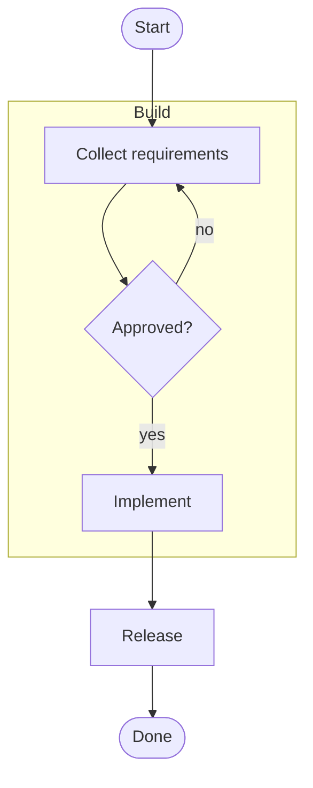

<!-- pagebreak -->

## Sequence

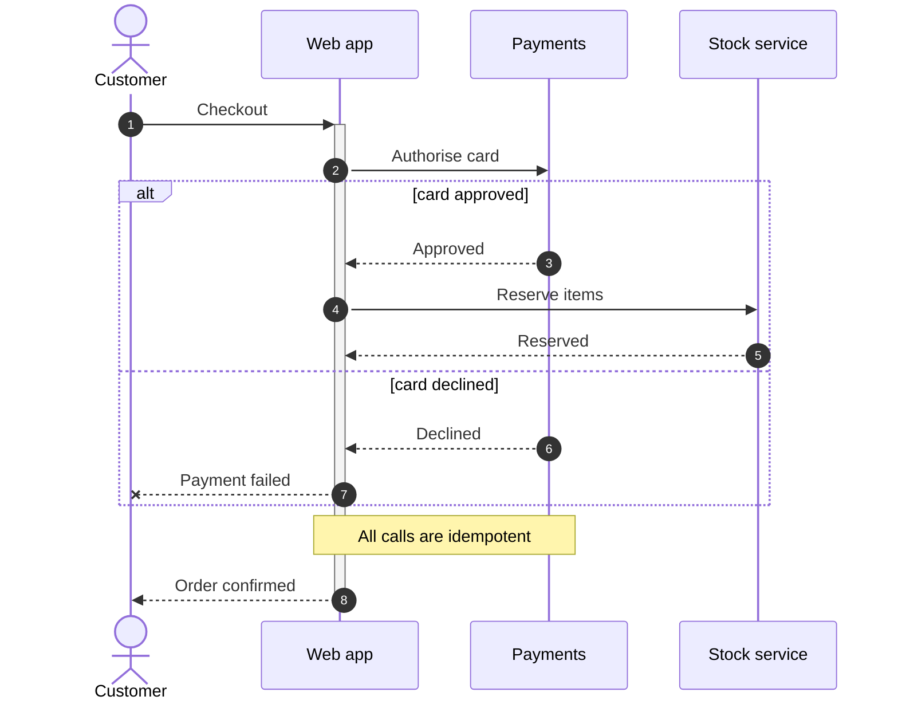

## State

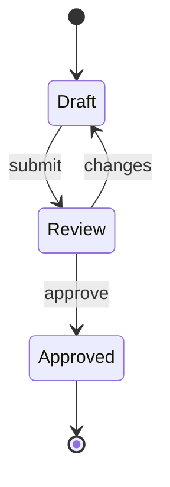

<!-- pagebreak -->

## Entity-relationship

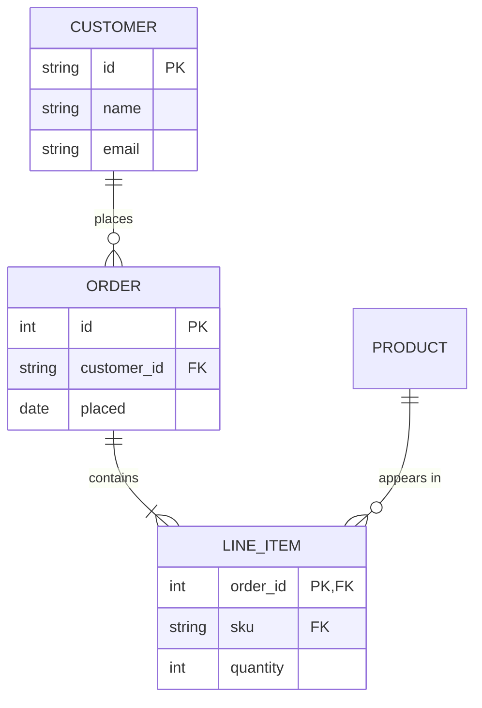

## Mind map

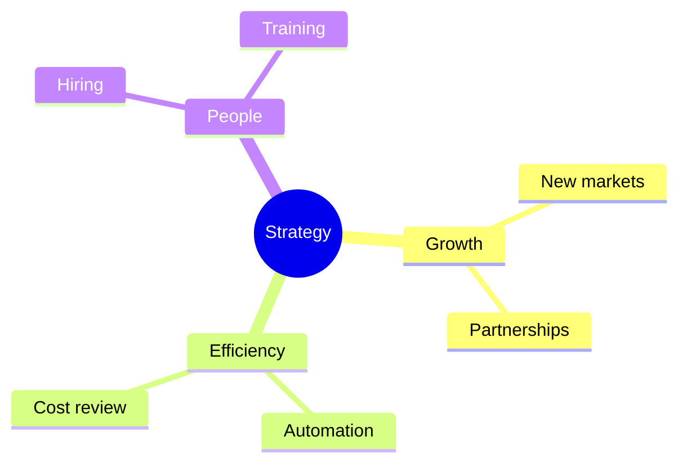

<!-- pagebreak -->

## Timeline

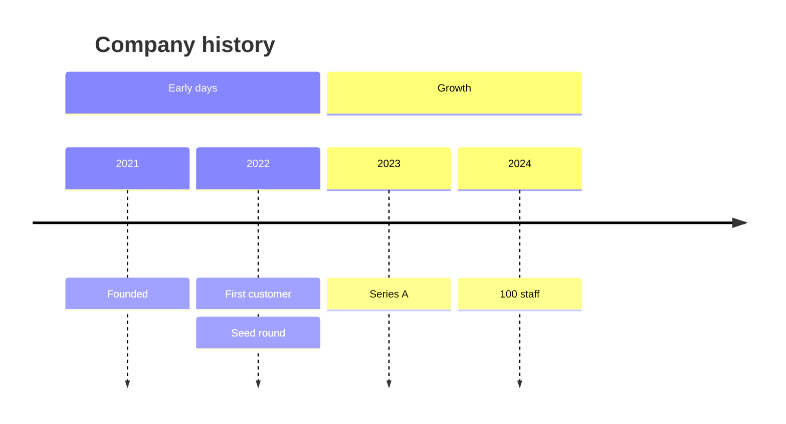

## Gantt

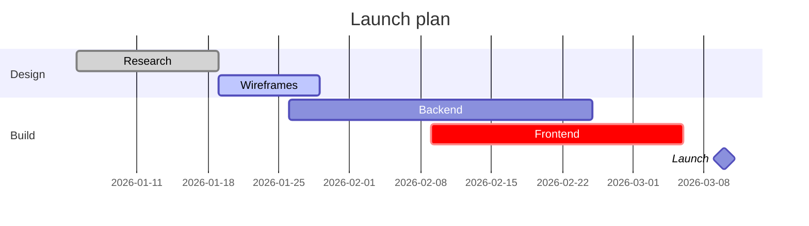

<!-- pagebreak -->

## Pie

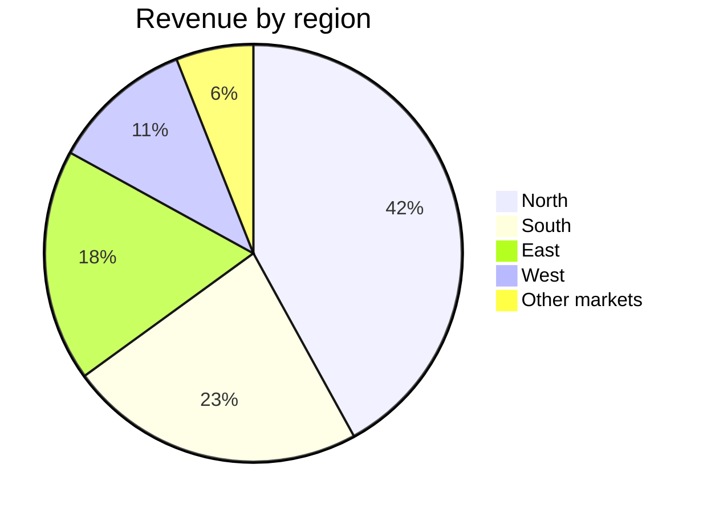

## Donut

```mermaid
donut showData
    "Done" : 64
    "In progress" : 24
    "Blocked" : 12
```

## Bar and line

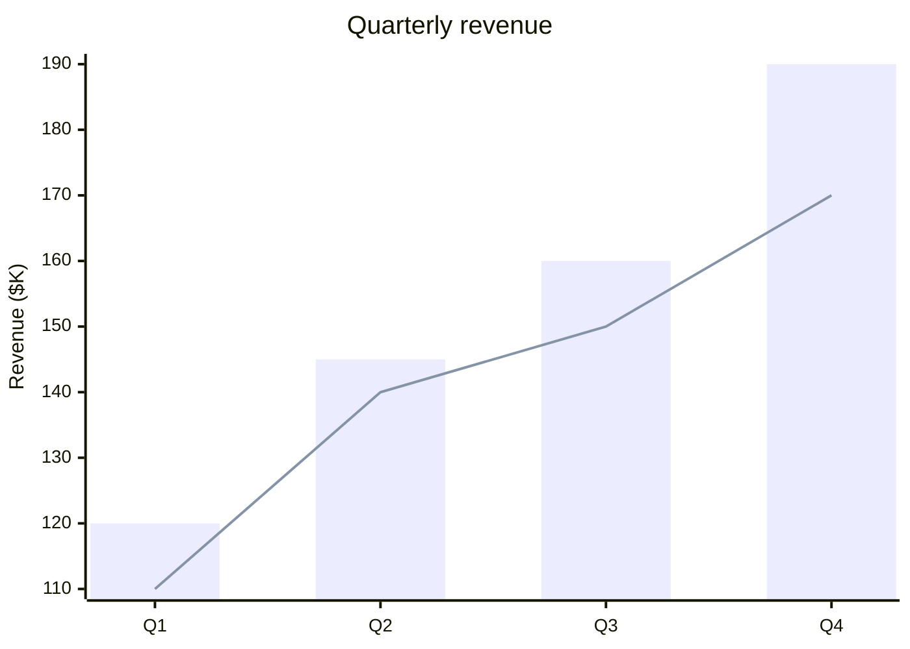

## Gauge

```mermaid
gauge
    title Customer satisfaction
    value: 72
    max: 100
```

<!-- pagebreak -->

## Class

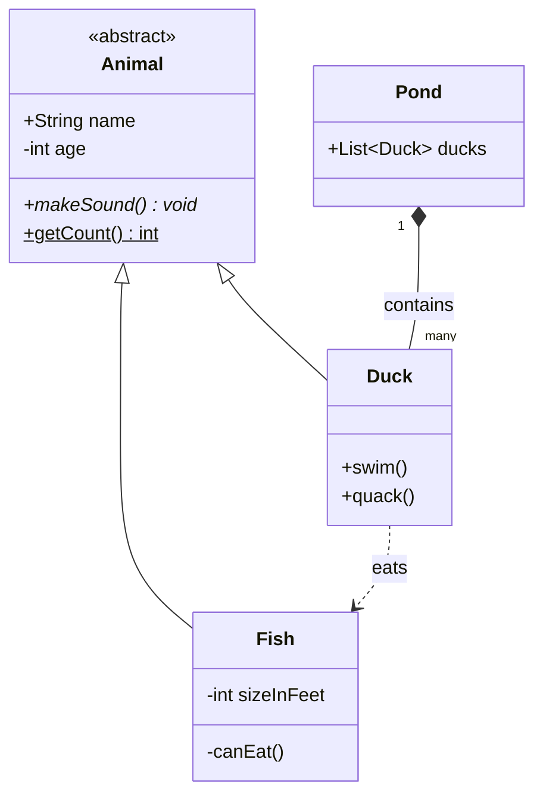

## User journey

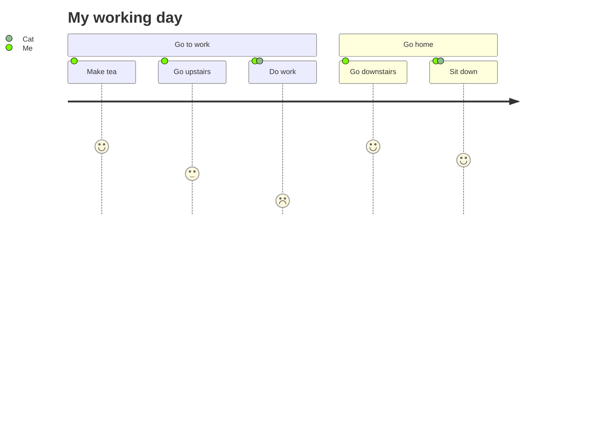

## Git graph

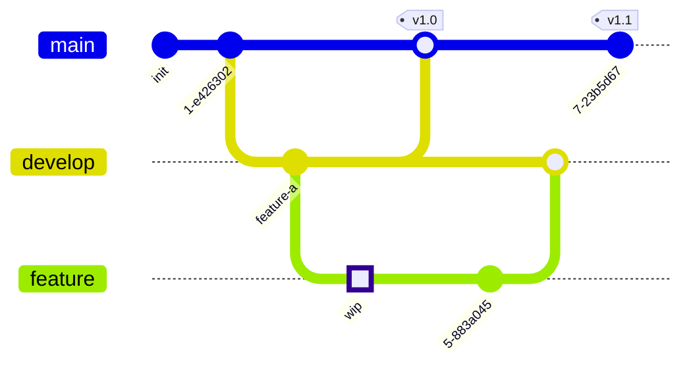

## Dark diagram


