# Diagram gallery

Every Mermaid diagram family md-doc draws, each with the syntax people use in practice. The
diagrams share one design system: structural diagrams take their colours from the theme, data
charts start from the brand colours then continue with an accessible palette, and everything renders at body-text size.

## Flowchart

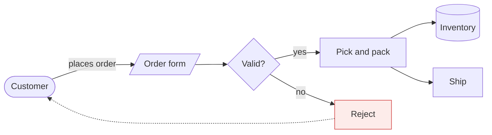

## Flowchart with groups


<!-- pagebreak -->

## Sequence

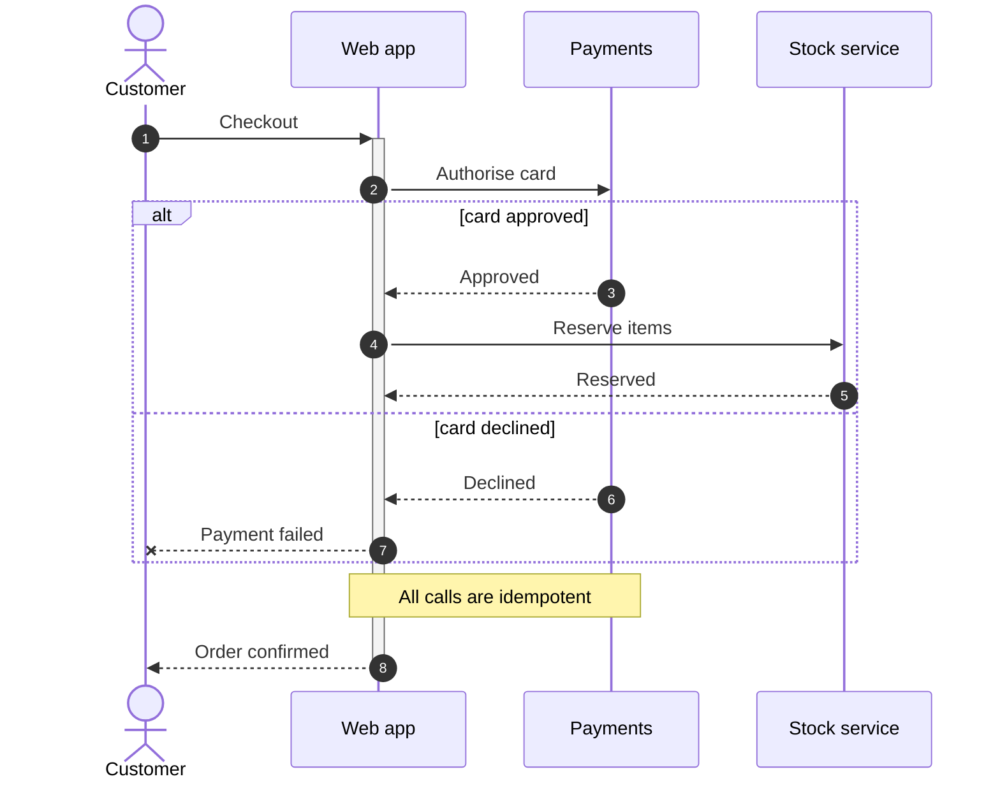

## State

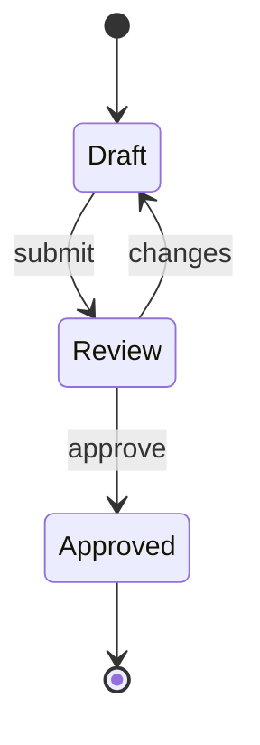

<!-- pagebreak -->

## Entity-relationship

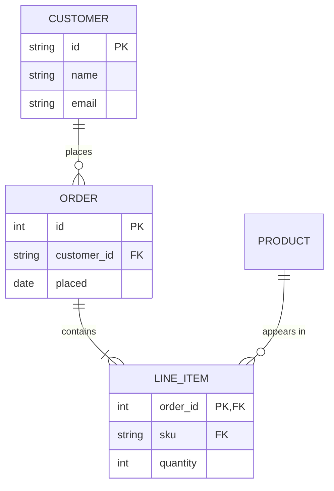

## Mind map

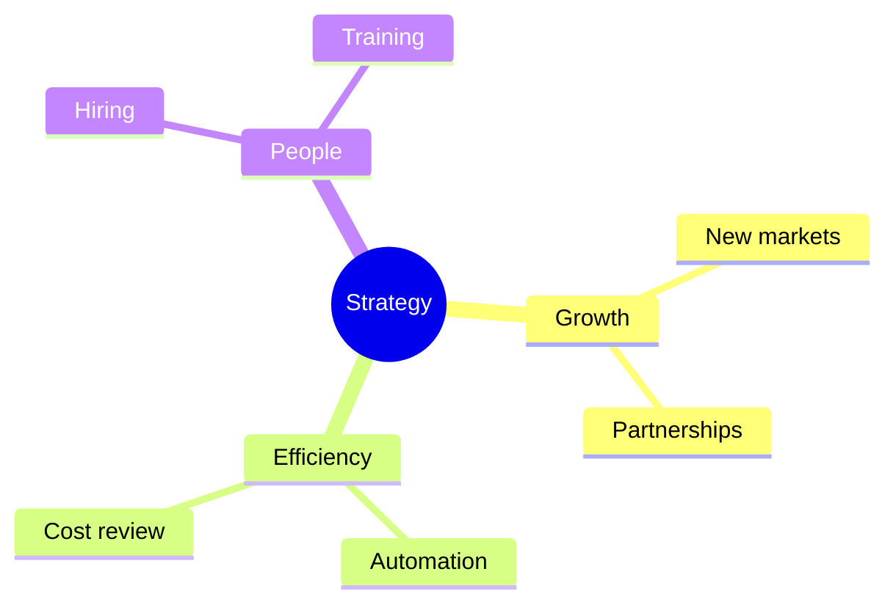

<!-- pagebreak -->

## Timeline

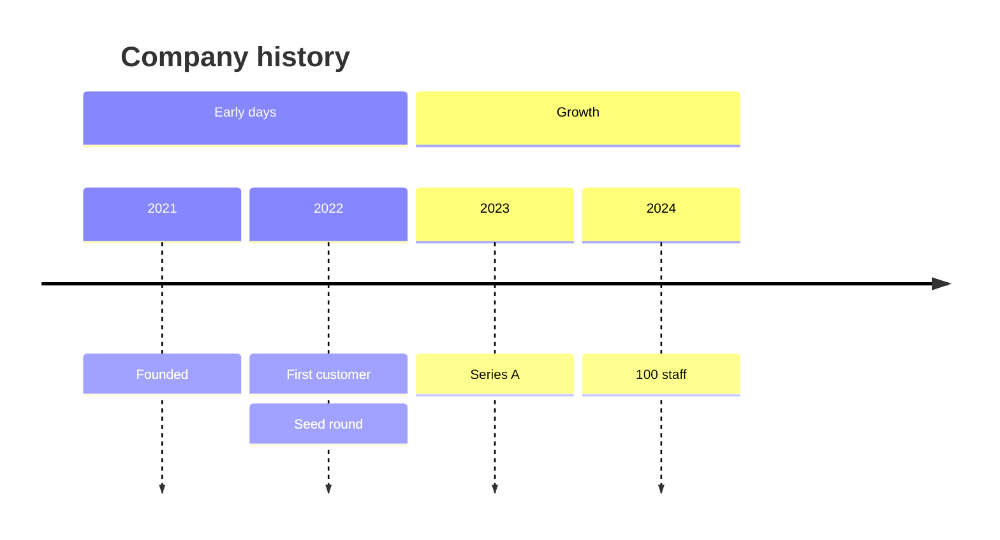

## Gantt

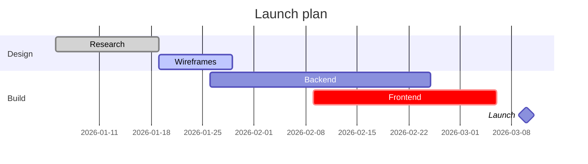

<!-- pagebreak -->

## Pie

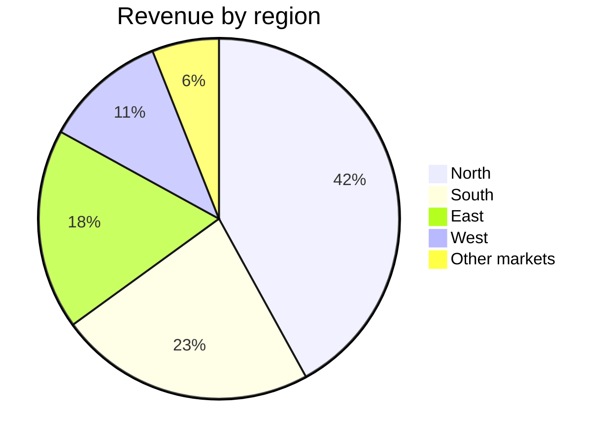

## Donut

```mermaid
donut showData
    "Done" : 64
    "In progress" : 24
    "Blocked" : 12
```

## Bar and line

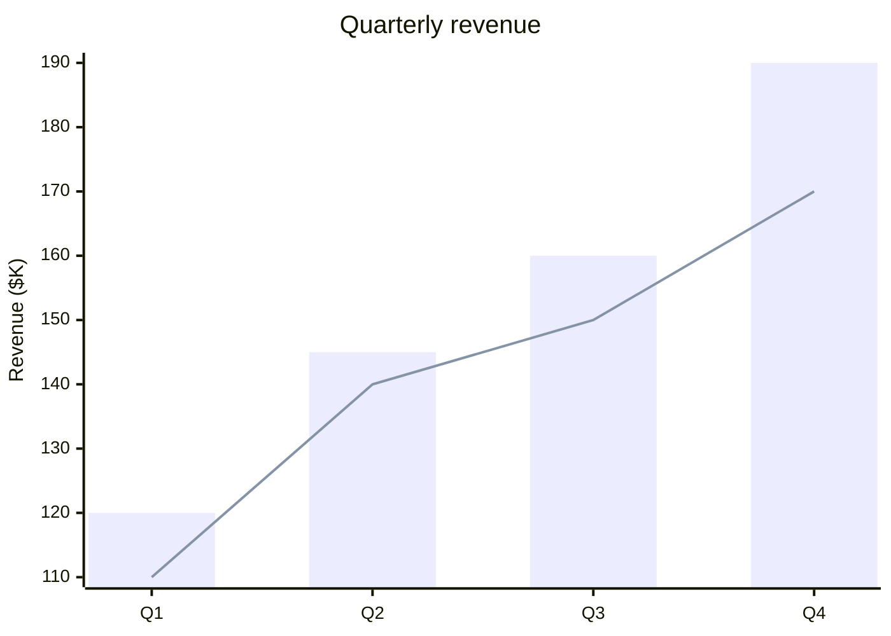

## Gauge

```mermaid
gauge
    title Customer satisfaction
    value: 72
    max: 100
```

<!-- pagebreak -->

## Class

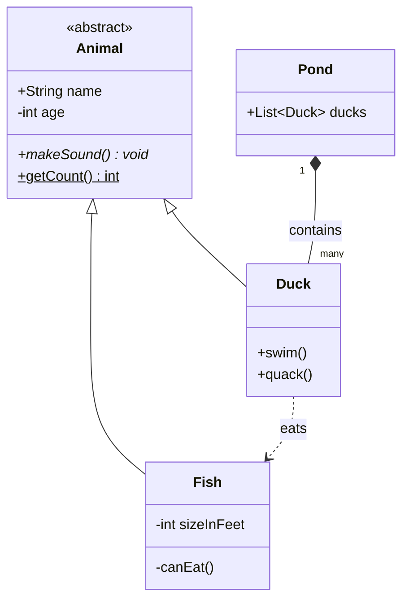

## User journey

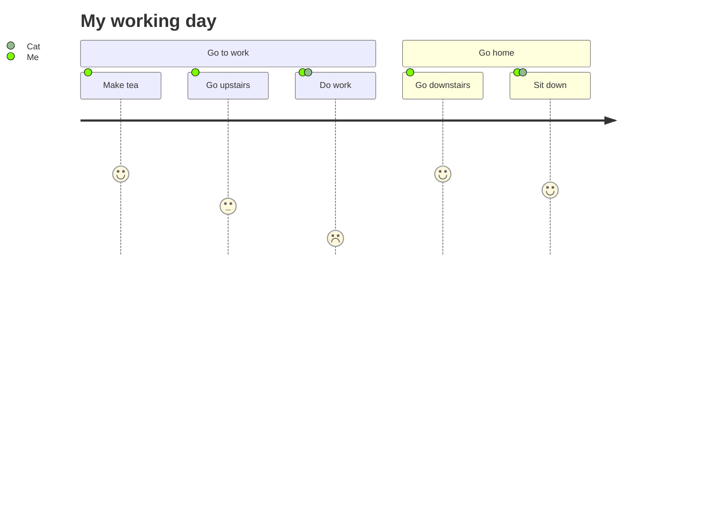

## Git graph


## Dark diagram

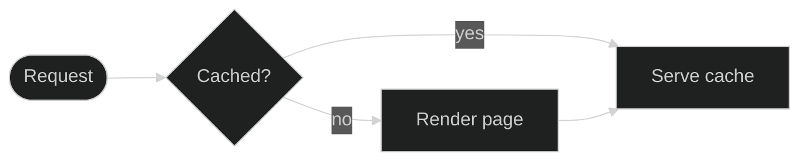

<!-- pagebreak -->

## Quadrant chart

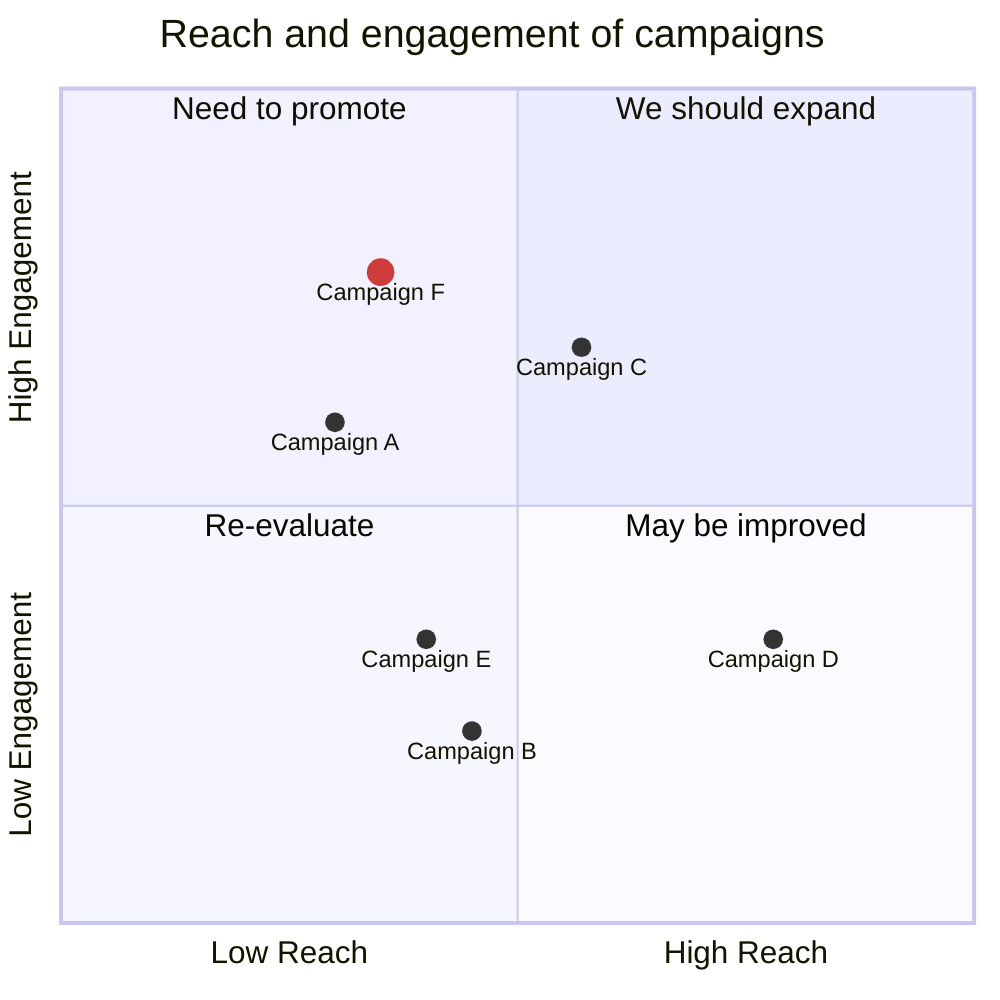

## Sankey

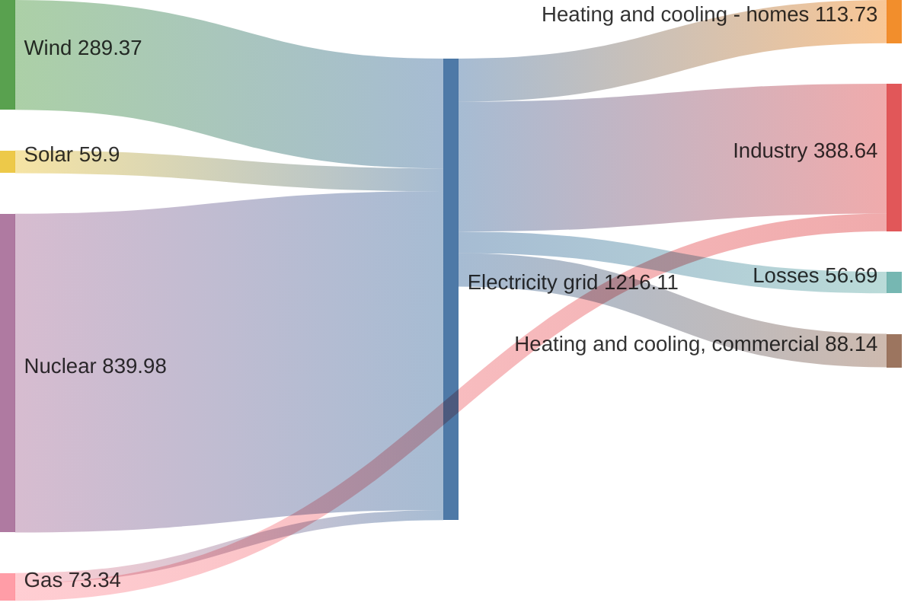

<!-- pagebreak -->

## Radar

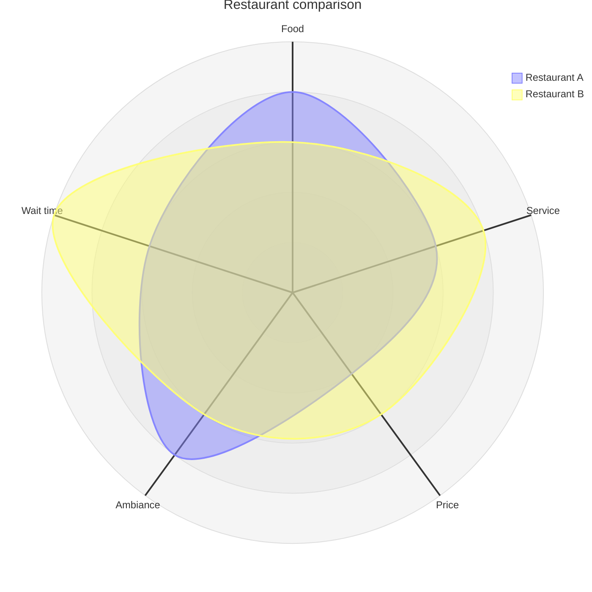

## Treemap

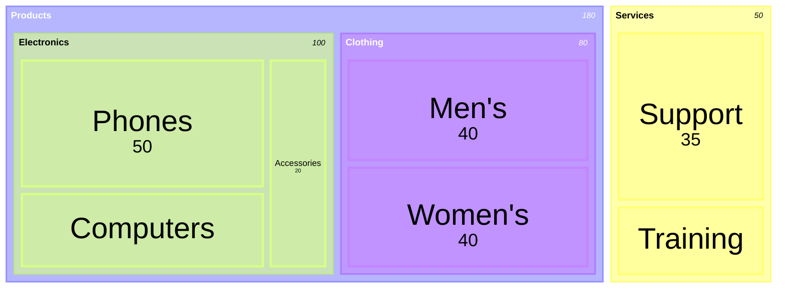

<!-- pagebreak -->

## Packet

```mermaid
---
title: "TCP Packet"
---
packet
0-15: "Source Port"
16-31: "Destination Port"
32-63: "Sequence Number"
64-95: "Acknowledgment Number"
96-99: "Data Offset"
100-105: "Reserved"
106: "URG"
107: "ACK"
108: "PSH"
109: "RST"
110: "SYN"
111: "FIN"
112-127: "Window"
128-143: "Checksum"
144-159: "Urgent Pointer"
160-191: "(Options and Padding)"
192-255: "Data (variable length)"
```

## Block

```mermaid
block
columns 1
  db(("DB"))
  blockArrowId6(down)
  block:ID
    A
    B["A wide one in the middle"]
    C
  end
  space
  D
  ID --> D
  C --> D
  style B fill:#e8eefc,stroke:#3c5aa8
```

<!-- pagebreak -->

## Kanban

```mermaid
kanban
  Todo
    [Create Documentation]
    docs[Create Blog about the new diagram]
  [In progress]
    id6[Create renderer so that it works in all cases]@{ priority: 'High' }
  id9[Ready for deploy]
    id8[Design grammar]@{ assigned: 'knsv' }
  id10[Ready for test]
    id4[Create parsing tests]@{ ticket: MC-2038, assigned: 'K.Sveidqvist', priority: 'High' }
    id66[last item]@{ priority: 'Very Low', assigned: 'knsv' }
  id11[Done]
    id5[define getData]
    id2[Title of diagram is more than 100 chars]@{ ticket: MC-2036, priority: 'Very High'}
```

## Architecture

```mermaid
architecture-beta
    group api(cloud)[API]
    service db(database)[Database] in api
    service disk1(disk)[Storage] in api
    service disk2(disk)[Storage] in api
    service server(server)[Server] in api
    service web(internet)[Internet]
    db:L -- R:server
    disk1:T -- B:server
    disk2:T -- B:db
    web:R --> L:server
```

<!-- pagebreak -->

## C4 container

```mermaid
C4Container
    title Container diagram for Internet Banking System
    System_Ext(email_system, "E-Mail System", "The internal Microsoft Exchange system")
    Person(customer, Customer, "A customer of the bank, with personal bank accounts")
    Container_Boundary(c1, "Internet Banking") {
        Container(spa, "Single-Page App", "JavaScript, Angular", "Provides all the Internet banking functionality to customers via their web browser")
        Container_Ext(mobile_app, "Mobile App", "C#, Xamarin", "Provides a limited subset of the Internet banking functionality")
        Container(web_app, "Web Application", "Java, Spring MVC", "Delivers the static content and the SPA")
        ContainerDb(database, "Database", "SQL Database", "Stores user registration information, hashed credentials, access logs")
        ContainerDb_Ext(backend_api, "API Application", "Java, Docker Container", "Provides Internet banking functionality via API")
    }
    System_Ext(banking_system, "Mainframe Banking System", "Stores all of the core banking information")
    Rel(customer, web_app, "Uses", "HTTPS")
    Rel(customer, spa, "Uses", "HTTPS")
    Rel(customer, mobile_app, "Uses")
    Rel_Back(database, backend_api, "Reads from and writes to", "sync, JDBC")
    Rel(email_system, customer, "Sends e-mails to")
    Rel(backend_api, email_system, "Sends e-mails using", "sync, SMTP")
    Rel(backend_api, banking_system, "Uses", "sync/async, XML/HTTPS")
    UpdateLayoutConfig($c4ShapeInRow="3", $c4BoundaryInRow="1")
```

## Requirement

```mermaid
requirementDiagram
  requirement checkout_req {
    id: 1
    text: Orders must be payable online.
    risk: high
    verifymethod: test
  }
  functionalRequirement payment_req {
    id: 1.1
    text: Card payments must be authorised.
    risk: high
    verifymethod: test
  }
  element checkout_service {
    type: service
    docref: docs/checkout.md
  }
  checkout_req - contains -> payment_req
  checkout_service - satisfies -> payment_req
```

<!-- pagebreak -->

## ZenUML

```mermaid
zenuml
    title Order service
    @Actor Client
    @Database DB
    Client->OrderService.create(order) {
      valid = Validator.check(order)
      if(valid) {
        DB.save(order)
        return id
      } else {
        @return
        OrderService->Client: rejected
      }
    }
    par {
      OrderService->Email: confirmation
      OrderService->Analytics: track
    }
```

<!-- pagebreak -->

## Use case

```mermaid
usecase-beta
direction LR
actor Customer
actor Support
systemBoundary Storefront
  Browse("Browse catalogue")
  Checkout("Checkout")
end
systemBoundary Fulfilment
  Track("Track delivery")
end
Customer --> Browse
Customer --> Checkout
Customer --> Track
Support --> Track
Checkout ..> : include Browse
```

## Swimlanes

```mermaid
swimlane-beta LR
  subgraph Customer
    request[Request service]
    receive[Receive update]
  end
  subgraph Support
    triage[Triage request]
    answer[Send answer]
  end
  subgraph Engineering
    investigate[Investigate issue]
    fix[Prepare fix]
  end
  request --> triage
  triage -->|Known issue| answer
  triage -->|Needs code| investigate
  investigate --> fix --> answer
  answer --> receive
```

<!-- pagebreak -->

## Agent flow

```mermaid
agentflow-beta TB
  brief@{ shape: input, label: "Release brief" }
  flow drafting["Drafting Agent"]
    draft@{ shape: task, label: "Draft the notes" }
    search@{ shape: tool, label: "changelog_search" }
    tone@{ shape: refdoc, label: "Tone of voice" }
    draft --> search
    draft -.-> tone
  end
  flow review["Review Agent"]
    check@{ shape: task, label: "Check the claims" }
    ok@{ shape: decision, label: "Accurate?" }
    check --> ok
  end
  publish@{ shape: action, label: "Publish" }
  brief --> draft
  tone --> check
  ok -->|yes| publish
  ok --x|no| draft
```

## Tree view

```mermaid
treeView-beta
src/
  App.tsx :::highlight ## main component
  index.ts ## entry point
  components/
    Button.tsx
    Card.tsx
.env ## environment variables
package.json
```

<!-- pagebreak -->

## Ishikawa

```mermaid
ishikawa-beta
Blurry photo
  Process
    Out of focus
    Shutter speed too slow
  Equipment
    Lens
      Dirty lens
    Sensor
  User
    Shaky hands
  Environment
    Too dark
    Subject moved
```

## Venn

```mermaid
venn-beta
  title What makes a good feature
  set Desirable
  set Feasible
  set Viable
  union Desirable,Feasible["Buildable"]
  union Feasible,Viable["Sustainable"]
  union Desirable,Viable["Marketable"]
  union Desirable,Feasible,Viable["Ship it"]
```

<!-- pagebreak -->

## Cynefin

```mermaid
cynefin-beta
  title Incident response
  complex
    "Investigate root cause"
    "Run chaos experiment"
  complicated
    "Analyse performance data"
  clear
    "Restart service"
    "Apply known fix"
  chaotic
    "Page on-call immediately"
  confusion
    "Unknown failure mode"
  chaotic --> complex : "Stabilised"
  complex --> complicated : "Pattern found"
```

<!-- pagebreak -->

## Wardley map

```mermaid
wardley-beta
title Tea shop value chain
anchor Business [0.95, 0.63]
component Cup of Tea [0.79, 0.61]
component Tea [0.63, 0.81]
component Hot Water [0.52, 0.80]
component Kettle [0.43, 0.35] (build)
component Power [0.10, 0.70] (outsource)
Business -> Cup of Tea
Cup of Tea -> Tea
Cup of Tea -> Hot Water
Hot Water -> Kettle
Kettle -> Power
evolve Kettle 0.62
note "Standard power lets kettles evolve" [0.28, 0.40]
```

## Railroad

```mermaid
railroad-ebnf-beta
title "Arithmetic expressions"
expression = term ( ( "+" | "-" ) term )* ;
term = factor ( ( "*" | "/" ) factor )* ;
factor = number | "(" expression ")" ;
number = digit+ ;
```

<!-- pagebreak -->

## Event modeling

```mermaid
eventmodeling
tf 01 ui CartUI
tf 02 cmd AddItem { description: string, price: number }
tf 03 evt ItemAdded
tf 04 rmo CartItems ->> 03
tf 05 ui CartUI
rf 06 evt External.InventoryChanged
tf 07 pcr InventoryProcessor
tf 08 cmd ChangeInventory
tf 09 evt Cart.InventoryChanged
```
