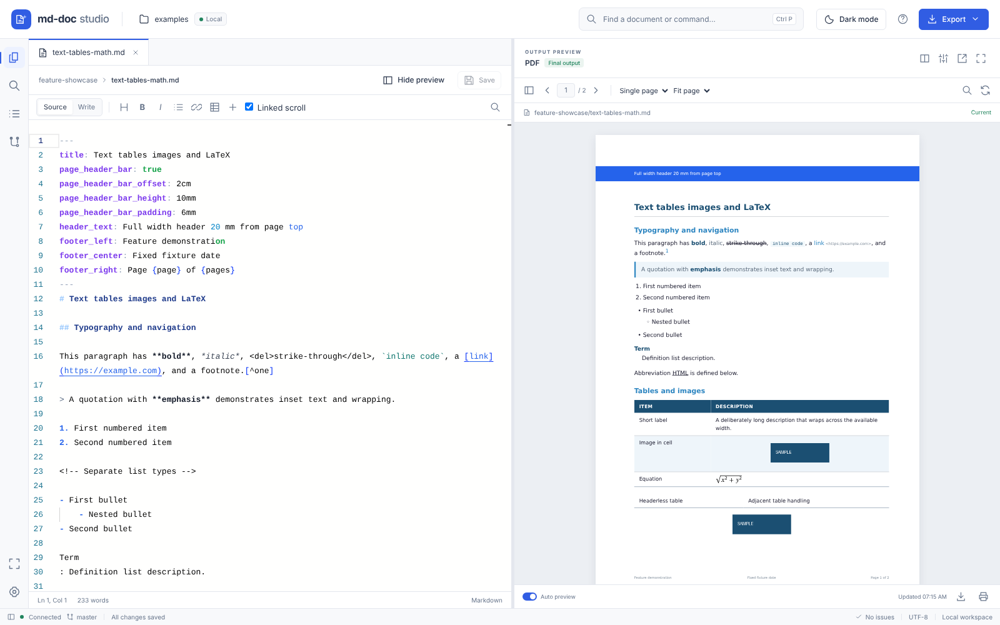


# md-doc Document Studio

A local browser workspace for the [md-doc pipeline](https://github.com/gregshallardau/md-doc-pipeline). Edit Markdown, inherited metadata and themes, review the actual generated PDF, and export PDF, DOCX, DOTX or PowerPoint. Monaco provides the source editor; PDF.js displays the pipeline's immutable output. All browser assets are bundled locally.



## Launch

From the repository root:

```bash
uv sync --group editor
uv run --offline --no-sync md-doc-edit
```

With no directory, the editor discovers local folders under `workspace/` and the remote shares in `workspace/remote-workspaces.yml`, falling back to examples on a fresh checkout. The workspace button switches between available workspaces; unmounted shares remain listed. Each workspace has its own editor session, buffers and output artifacts. New workspaces appear without restarting.

An available configured remote workspace is opened before local samples. Its configured `path` is used exactly; relative paths resolve from the project directory. The header identifies remote workspaces and the explorer displays the full directory path. **Choose document folder** lets you explicitly open a nested folder without changing the configuration or guessing where documents live.

The Files rail button toggles the sidebar. Click the workspace row to collapse its files, or use **Expand all / Collapse all** for folders. New sessions open the first two folder levels; folder badges count Markdown documents recursively. PDFs, Office outputs, images and authoring files appear alongside Markdown. PDF/image files open in a browser tab and Office files download. **Dark mode / Light mode** is available directly in the header.

In Source mode, click a `` line (or press **Alt+Enter**) to expand its source directly into the main editor. Multiple and nested templates share the document's font, background, cursor, selection and scrolling. Click an expanded include again to collapse it, or use **Collapse templates** to collapse them all. The source indicator identifies the file under the cursor; **Save source** saves that file, and the main **Save** button / **Ctrl+S** saves changed sources in the expanded document. Template drafts stay separate from the parent source and update the final document's PDF without writing to disk. Collapsing keeps drafts. Selections crossing file boundaries cannot be changed in one edit; collapse templates to change an include declaration.

Expanded template sections have a **TEMPLATE · filename** label, a subtle tint and a continuous edge marker. **END TEMPLATE** marks where each expanded section finishes, including its nested templates. The source indicator distinguishes document text from upstream template text; these indicators are editor decorations and do not appear in saved files or output.

The **Outline** shows the composed downstream document, using the pipeline's Jinja rendering and Markdown parser. It includes nested Markdown/HTML template headings, resolves variables, follows loops and excludes conditional sections that will not appear in the output. It updates from unsaved document, metadata and template drafts, including when automatic PDF preview is paused. Clicking a heading expands its source in the main document and navigates there. Template lookup uses the same directory cascade as the final build.

Automatic preview generation waits **1.5 seconds** after typing stops. Choose **3 seconds** or **5 seconds** in **Studio settings → Preview delay after typing**, or use manual refresh. While a render is running, automatic updates are combined into one follow-up using the latest drafts, so edits do not repeatedly cancel long document builds. Manual refresh can replace a running render immediately.

For inline Markdown edits, including unsaved included `.md` files, PDF preview retains the previous layout in an isolated worker. It maps composed content blocks to pages and resumes layout ten pages before the earliest changed block, moving farther back for enclosing paragraphs, tables, heading groups or an unsafe page boundary. Unchanged earlier body pages are reused; headers and footers are refreshed so final page totals remain correct. Markdown composition and CSS calculation still run for the complete document.

The page visible when rendering starts can update before the rest of the document finishes. It appears over the previous PDF with **Updating · visible page ready** status. This page is provisional: total-page counts and references may change, and text selection/forms on it wait for the completed PDF. The final PDF replaces the temporary page, restoring normal viewer features. Downloads, search and thumbnails continue to refer to the last completed PDF during rendering. Pop-out preview receives the same page updates.

Theme, metadata and asset changes invalidate the cache. Interactive forms, footnotes, cross-reference counters, multi-column/flex/grid layouts and general floating/absolutely positioned content use a full render. The pipeline's hidden running date and cover artwork are supported. The adapter is verified against **WeasyPrint 68.1**, pinned by the editor package; other installed versions fall back to the public full-render API. PDF exports always use the normal full renderer. This first implementation rebuilds the tail after an edit; it does not yet reuse an unchanged tail or provide exact Markdown-line-to-page navigation.

Use **Pop out preview** in the output preview header to open a resizable window, including on a second monitor. It follows the editor’s rendered updates, including unsaved changes, and has independent zoom, page navigation, search, thumbnails and PDF download. Clicking the button again focuses the existing window. Rendering and automatic/manual refresh remain controlled by the editor.

Linked folders whose targets remain inside the configured workspace are scanned and included in preview snapshots. Cycles, external links and unreadable directories appear as scan diagnostics instead of silently disappearing.

To reproduce remote discovery with sample documents, run from the checkout:

```bash
uv run --no-sync python tools/create_remote_editor_demo.py
```

The generator prints a separate demo project path. Change into that project and launch the checkout's installed `md-doc-edit` executable. It creates two remote fixtures with 15 folders and 50 Markdown files each, plus cascading metadata, imported PDF CSS and an HTML include. One fixture uses linked folders; its first folder is deliberately empty. It leaves existing directories untouched and does not change your real remote configuration.

To open all samples as one directory:

```bash
uv run --offline --no-sync md-doc-edit serve examples/
```

The browser opens at **http://127.0.0.1:8765/**. Choose **Open a sample** for a complete branded document. To work on live documents:

```bash
uv run --offline --no-sync md-doc-edit serve workspace/
uv run --offline --no-sync md-doc-edit serve workspace/acme/ --port 9000
```

Add `--no-browser` to start only the server. The editor and pipeline must be installed in the same Python environment. Include `--group editor` in subsequent `uv sync` commands to keep the editor installed. Installation needs internet access or a populated package cache; running the installed editor does not.

## Editing and preview

- **Source**: Monaco with Markdown, Jinja2, Word fields, PDF forms and YAML highlighting. Each tab retains its buffer, cursor, undo stack and scroll position.
- **Write**: visual editing for supported paragraphs and headings. Frontmatter, templates, forms, tables, HTML, images and other advanced syntax remain protected source blocks. Clicking a protected block opens it in Source. Untouched blocks retain their original source.
- **Output preview**: the actual PDF, including the complete theme, imported CSS, local fonts and images, cover, page breaks, diagrams, headers and footers. Automatic rendering starts after 1.5 seconds of idle time and combines edits made during a running render into one follow-up; pause it or refresh manually for large documents.
- **Unsaved edits**: previews include open unsaved document, YAML, CSS and template buffers. The renderer uses an isolated project snapshot. Preview and export never save these buffers or generate themes in your source project.
- **Pinned document**: opening its metadata, theme or included template keeps the document visible in the preview. Opening another document selects that document's output.
- **Current output**: a status label distinguishes current, updating, out-of-date and failed output. The last successful PDF remains visible during updates and errors. Errors and renderer logs are available from the status bar.

Drag either separator to resize navigation or source/preview. Focus a separator and use arrows (Shift for larger steps), Home/End, or double-click to reset. **Change layout** offers side-by-side, stacked, source-only and preview-only. Use **Hide preview** / **Show preview** beside Save in the editor toolbar to toggle the output pane; showing it restores the most recent side-by-side or stacked layout. Layouts and appearance persist per workspace. Narrow windows use a single main pane and navigation drawers; **Show preview** opens the preview pane there.

The PDF viewer supports page navigation, fit page/width, zoom, text selection, search, lazy thumbnails, bookmarks and maximised preview. Choose **Side by side** in the **Page view** selector to review pairs of pages (1–2, 3–4, and so on), or **Single page** for one page per row. **Fit width** fits the pair to the available width. **Fit width** and **Fit page** recalculate when the current page changes, including landscape sections within portrait documents; fixed zoom percentages stay unchanged. This also works in the pop-out preview. Form test mode is available in Settings; test values do not change source defaults or exported artifacts. Print opens the displayed PDF in a browser tab for the browser's print controls.

**Linked scroll** in the source toolbar is enabled by default and remembered for this workspace. Scrolling the source moves the PDF preview to the corresponding text, including in the pop-out window. It follows the active document when that document is also selected for preview, and works with expanded includes. Matching uses the last rendered PDF's text, with positions interpolated between matching source lines. Source-only syntax, images, and diagrams follow nearby text; large unrendered edits may need a preview refresh for accurate alignment. Turn Linked scroll off to browse the preview independently. Scrolling the preview does not move the source editor.

JavaScript modules and PDF.js workers are served with explicit browser-compatible content types, independent of system MIME settings. If a viewer module fails to load, Diagnostics reports the failing asset or response type and **Open generated PDF** remains available. Restart the editor and reload the page after updating; the browser can retain a failed module import until reload.

## Document tools

The inspector shows editable common properties, the configuration cascade and provenance, the resolved PDF theme, included templates, and documented merge fields. Simple property changes update individual frontmatter lines. Structured YAML is edited in Source to preserve its syntax. Inherited metadata, theme and template files can be opened without changing the selected document.

Use the insertion toolbar for formatting, tables, fields, PDF forms, page breaks, Mermaid, includes and slide directives. The **More insert options** button opens a compact submenu beside the toolbar. Use arrow keys to choose an item, Enter to insert, or Escape/click outside to dismiss. Insert images by searching existing workspace assets or uploading a new local image; existing filenames are never silently overwritten. New document scaffolds support reports, fillable PDF forms, decks and blank documents. File actions include folder creation, duplicate, rename in place, move to a chosen folder and recoverable trash. After moving a document, review relative asset/include references; the studio preserves them as written.

Use **Check workspace** in the diagnostics panel to run the pipeline linter against the current workspace snapshot, including unsaved text buffers. Results are grouped by file and open the relevant source; missing local Markdown image files are reported with their line number. Run the check again after editing to refresh its results.

Workspace search finds text in Markdown, YAML and CSS. The outline navigates source headings. The shared command bar opens with **Ctrl+P** for file search or **Ctrl+Shift+P** / **F1** for commands (**Ctrl+K** also opens commands). Type `>` to switch to commands, or delete it to search files in the same input. File names, paths and commands support fuzzy matching. Use ⌘ instead of Ctrl on macOS.

| Shortcut | Action |
| --- | --- |
| Ctrl/⌘ P | Quick open |
| Ctrl/⌘ K | Files and commands |
| Ctrl/⌘ S | Save active buffer |
| Ctrl/⌘ B / I | Bold / italic in Source |
| Escape | Close dialog or leave focus mode |
| Arrows on a separator | Resize panes |

## Saves and recovery

Save is an explicit action. Atomic, revision-checked writes detect external edits and offer a comparison before choosing the disk version or saving your draft. Opening another file replaces the previous tab if it has never been edited. Once edited, a tab stays open even after saving or undoing its changes; this is preserved across reloads. Switching tabs preserves unsaved changes. Closing an unsaved tab offers Save, Discard or Cancel.

Drafts and session preferences are stored in this browser's local storage, scoped to the workspace path. Reloading or reopening restores drafts without writing them to disk. If the disk revision changed, review the recovered draft before saving. Private browsing, storage limits and clearing browser data can remove these drafts; save important work to disk.

External file changes are checked every second while the tab is visible, and when you return to the editor. Saved files refresh automatically in source and visual mode, including expanded templates and the pinned preview. Unsaved edits are preserved without repeated warning pop-ups; if both versions changed, saving offers a comparison before overwriting the disk file. Dependency changes refresh the pinned preview.

## Source control

The Git panel shows the repository branch, workspace changes, staged changes, diffs and recent workspace history. Stage/unstage individual files, create a feature branch, commit staged workspace files, or explicitly pull with `--ff-only`. Git must be installed and the selected workspace must be inside a repository.

Commits use staged content and preserve unstaged edits and staged files outside the selected workspace. Commits, branch changes and pulls run only when selected in the interface. Git authentication and commit identity use the machine's existing configuration. Rename paths and deleted files are represented by Git's status. The editor has no push action.

## Export

Export uses the current editing snapshot, including unsaved dependency buffers. Downloading the displayed PDF reuses that exact immutable artifact. Save remains separate.

PDF has an authoritative visual preview. DOCX and DOTX use the Word theme and native pipeline builders; PPTX uses the slide builder. These formats are downloadable and do not claim exact browser/Word/PowerPoint layout equivalence. No Office conversion service is required.

## Local operation and limits

The editor defaults to loopback and is intended for use on your own machine. It is not an authenticated multi-user hosting service. Browser writes require the local session token and reject cross-origin requests. Document scripts and external links cannot execute in the PDF viewer. PDF assets are restricted to the project snapshot; remote resources are blocked.

Snapshots retain project-relative paths so the CLI's cascade, template resolution, CSS imports and assets continue to work when a subdirectory is selected. Hidden directories, symlinks, dependency packages and generated outputs are excluded. Preview can use inherited project metadata/themes/templates; there is no general filesystem browser.

Limits: 128 MiB / 10,000 snapshot inputs, 20 MiB text files, 100 unsaved buffers, 10 MiB uploaded raster images, two render workers, eight pending/running jobs, and 180 seconds per render. Up to two preview sessions retain a snapshot and layout cache; idle sessions expire after 30 minutes or are evicted for another client. Job snapshots are discarded after rendering. Artifact leases expire after 30 minutes and are refreshed by downloads. Refresh an expired preview to produce it again. Artifacts and workers are cleaned on expiry/shutdown.

## Service APIs

| Endpoint | Purpose |
| --- | --- |
| GET `/api/capabilities` | Workspace, project context, formats, limits and local session token |
| POST `/api/outline` | Composed document headings and source locations from an isolated snapshot of authoring buffers |
| GET `/api/tree` | Workspace authoring files |
| GET/PUT `/api/file` | Buffer contents and revision; conditional atomic save |
| POST `/api/preview/jobs` | Immutable buffer snapshot; format, revision, client and purpose |
| GET/DELETE `/api/jobs/{id}` | Poll render state, inspection, diagnostics and artifact; cancel |
| GET `/api/artifacts/{id}` | Display artifact; `?download=true` for attachment |
| GET `/api/changes` | Dependency change signature |
| GET `/api/search?q=…` | Workspace text matches |
| POST `/api/files/action` | Scaffold, duplicate, move, trash, restore |
| POST `/api/assets` | Validated base64 raster image upload |
| GET `/api/git/status`, `/api/git/diff` | Workspace source control inspection |
| POST `/api/git/action` | Explicit stage, unstage, commit, branch or pull |

Snapshot job responses include effective configuration, provenance, theme, fields and includes. Editable inherited resources use scoped `project:` handles. Legacy config/CSS/includes and saved-file `/api/build` endpoints remain available for existing integrations. Browser mutations send `X-Editor-Token` from capabilities; cross-origin requests are rejected.

PDF preview requests accept `visible_page` (1-based, default 1). While a job runs,
`preview_pages` can contain `{page, url, revision, provisional}` entries for early
page updates. `preview_reset` clears provisional output if a checkpoint fails.
Completed jobs include `render_stats` with the render mode, fallback reason,
reused/rebuilt page counts and composed block-to-page mapping. Page artifacts use
the existing artifact endpoint; the final `artifact` is the complete document.

## Verification

```bash
.venv/bin/pytest md-doc-web-editor/tests --no-cov
npm ci --prefix tests/browser
node tests/browser/studio.cjs
```

The browser suite uses a disposable Git project and blocks all nonlocal browser requests. It exercises real Monaco, PDF rendering, resizing, drafts, conflicts, visual editing, inspector dependencies, Git and responsive layouts. Set `MD_DOC_TEST_BROWSER` for a locally installed Chromium executable and `MD_DOC_TEST_PYTHON` for a packaged editor environment.

Build distributable assets and run the installed-package smoke check:

```bash
uv build md-doc-web-editor
python md-doc-web-editor/tests/smoke_installed.py
```

Run the smoke check with the installed environment's Python. The built wheel includes Monaco, marked, PDF.js, fonts, CMaps, WebAssembly decoders, icons, and vendor licenses; no frontend build or runtime Node installation is needed.


### Save recovery and concurrent editors

See the [saving and recovery review](SAVE_SAFETY_REVIEW.md) for findings, fixes
and remaining limitations.

Existing files require the revision returned by `GET /api/file` on every
`PUT /api/file`. A missing, null or stale revision returns **409** and leaves the
file unchanged. New files can be created with a null revision only while the
path is absent. File API responses bypass browser caches. Save completion marks
only the submitted text as saved; text typed during a save stays unsaved, and
Save & close keeps that tab open. External-file responses that began before a
save completed are ignored and retried. Review dialogs refuse to replace a draft
that changed after the comparison opened.

Before each accepted save, the editor preserves both the current disk content
and the submitted content under `.editor-history/<filename>/<sha256>.txt` in the
source file's parent directory (including inherited template/theme directories).
These are exact UTF-8 recovery copies, including original line endings, and
survive server restarts and preview cleanup. If a recovery copy cannot be
written, the source is not replaced. To recover, copy the chosen `.txt` content
to a **new file**, compare it with the current document, then restore deliberately.
History is hidden from the file tree, preview snapshots and editor Git status.
External Git tools can still add it: add `**/.editor-history/` to your project's
Git ignore rules. Copies are deduplicated by content and are not automatically
pruned; their disk usage grows with saved versions. They are created by this
version onward and cannot recover earlier losses. They only capture external
edits present at an editor save, not every VS Code keystroke.

The browser also keeps an independent last-draft recovery journal for each page
session, in addition to automatic draft restoration. Saving, discarding,
choosing the disk version, or another tab updating automatic drafts does not
clear that journal. In browser developer tools, open **Application → Local
Storage** (Firefox: **Storage → Local Storage**) for the editor's address and
look for `md-doc-studio:<workspace-path>:recovery:<session-id>`. Each file entry
contains `content`, its saved baseline, revision and update timestamp. Copy the
value to a separate recovery file. These journals are for manual recovery and
are not automatically replayed as drafts. Storage remains specific to browser
profile and origin (including port); private browsing, clearing data and quota
limits can remove or prevent recovery. Journals retain the latest unsaved text
per file per page session, not a history of every keystroke. They are not
pruned automatically; back them up before deleting old recovery entries.

Concurrent VS Code writes cannot participate in the editor's server lock. A
revision check detects changes already on disk, but a write made by another
program during the small check-and-replace interval can still race. Recovery
copies reduce the consequences; they do not provide a cross-application lock.
Preview/export snapshots are temporary rendering inputs, not backups: jobs,
expiry and shutdown can delete them. A displayed or downloaded output can still
help reconstruct content when no source copy remains.
